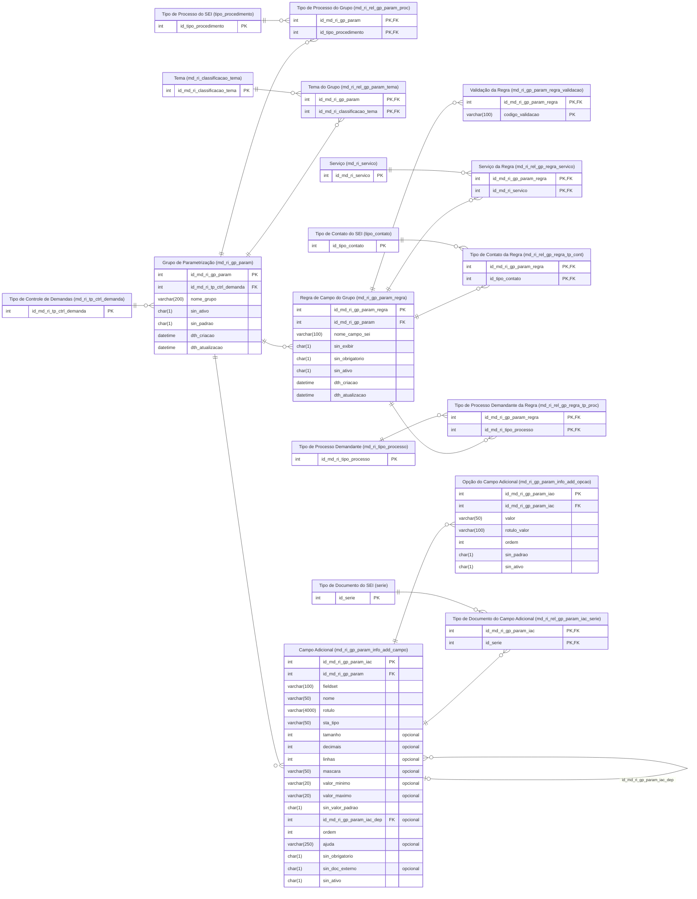
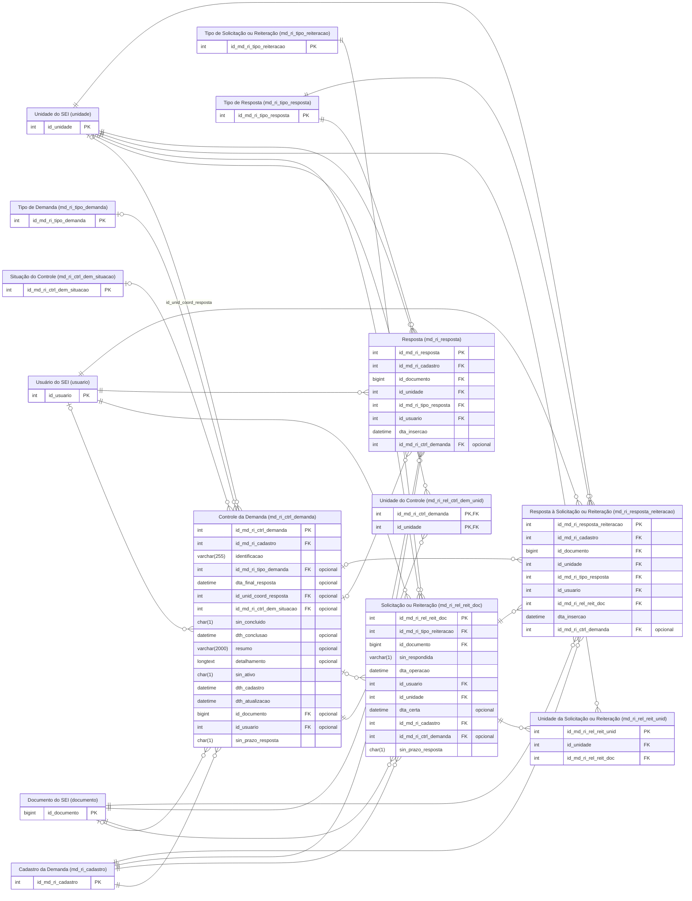

# Modelo de Dados do Controle de Demandas

Este documento mostra como o módulo Controle de Demandas do SEI guarda as informações no banco de dados: quais tabelas existem, quais dados cada uma guarda e como elas se ligam. O retrato é da versão 3.0.0 do módulo, em 4 de novembro de 2026.

O módulo tem 45 tabelas próprias e usa 10 tabelas do SEI, como processo, documento, unidade e usuário. Ficam fora deste documento 8 tabelas legadas que ainda existem no banco e serão removidas na versão 3.1.0, conforme a seção seguinte.

## Tabelas legadas pendentes de sanitização

Este modelo não mostra as tabelas abaixo. Elas ainda existem no banco, mas pertencem ao modelo anterior à versão 3.0.0: nenhuma tela do módulo grava nelas, e a migração para a versão 3.0.0 transfere o conteúdo delas para o Tipo de Controle de Demandas e para a localização da demanda. A remoção está prevista para a versão 3.1.0.

- `md_ri_crit_cad`
- `md_ri_rel_cad_cidade`
- `md_ri_rel_cad_localidade`
- `md_ri_rel_cad_uf`
- `md_ri_rel_crit_cad_cont`
- `md_ri_rel_crit_cad_proc`
- `md_ri_rel_crit_cad_serie`
- `md_ri_rel_crit_cad_unid`

### Pendências na camada de dados do módulo

Os DTOs abaixo ainda mapeiam as tabelas legadas e continuam no módulo, cada um com as classes de regra de negócio (RN) e de acesso ao banco (BD) correspondentes. Eles precisam sair junto com as tabelas:

- `MdRiCriterioCadastroDTO`: `md_ri_crit_cad`
- `MdRiRelCadastroCidadeDTO`: `md_ri_rel_cad_cidade`
- `MdRiRelCadastroLocalidadeDTO`: `md_ri_rel_cad_localidade`
- `MdRiRelCadastroUfDTO`: `md_ri_rel_cad_uf`
- `MdRiRelCriterioCadastroTipoContatoDTO`: `md_ri_rel_crit_cad_cont`
- `MdRiRelCriterioCadastroTipoProcessoDTO`: `md_ri_rel_crit_cad_proc`
- `MdRiRelCriterioCadastroSerieDTO`: `md_ri_rel_crit_cad_serie`
- `MdRiRelCriterioCadastroUnidadeDTO`: `md_ri_rel_crit_cad_unid`

Até a remoção, o módulo ainda lê parte dessas tabelas. A sanitização precisa retirar essas leituras junto com as tabelas e os DTOs:

- `md_ri_rel_crit_cad_cont` ainda é lida na seleção de contatos sem Grupo de Parametrização e na montagem da lista de tipos de contato.
- `md_ri_rel_crit_cad_unid` ainda é lida na seleção e no autocompletar de unidades e impede desativar ou excluir uma unidade vinculada a critério.
- `md_ri_crit_cad`, `md_ri_rel_crit_cad_proc` e `md_ri_rel_crit_cad_serie` só aparecem na gravação de critérios, que nenhuma tela aciona desde a versão 3.0.0.
- `md_ri_rel_cad_uf`, `md_ri_rel_cad_cidade` e `md_ri_rel_cad_localidade` só são lidas para apagar os vínculos antigos quando uma demanda é excluída.

Há ainda o DTO `MdRiRelTipoControleDemandaGrupoParamRegraDTO`, que aponta para a tabela `md_ri_rel_tp_ctrl_dmd_gp_param_regra`. Nenhum script de instalação cria essa tabela, e nenhuma classe usa esse DTO. Ele não corresponde a uma tabela do banco e também deve ser removido na versão 3.1.0.

## As quatro áreas do modelo

| Área | O que guarda | Tabela principal |
|---|---|---|
| Configuração | Tipo de Controle de Demandas e os cadastros de apoio: tipos de demanda, de resposta, de solicitação e de referência, temas, subtemas, serviços e situações. | Tipo de Controle de Demandas |
| Parametrização | Grupos que definem, para cada Tipo de Controle de Demandas, quais campos aparecem no cadastro, quais são obrigatórios e quais campos adicionais o formulário tem. | Grupo de Parametrização |
| Cadastro | A demanda registrada no processo e o que se informa nela: documentos, unidades responsáveis, contatos, temas, serviços, localidades, referências e informações adicionais. | Cadastro da Demanda |
| Acompanhamento | Controles sobre a demanda, respostas, solicitações ou reiterações e respostas a essas solicitações. | Controle da Demanda |

## Como ler os diagramas

Cada caixa é uma tabela. O título da caixa traz o nome da tabela e, entre parênteses, o nome dela no banco. Cada linha da caixa é uma coluna, com o tipo do dado, o nome da coluna e as marcações abaixo.

| Marcação | Significado |
|---|---|
| PK | Chave primária: identifica cada registro da tabela. |
| FK | Chave estrangeira: aponta para um registro de outra tabela. |
| UK | Chave única: a combinação não pode se repetir. |
| opcional | A coluna pode ficar sem valor. |
| aponta para | Indica a tabela do SEI para a qual a coluna aponta. Aparece só no diagrama completo. |

| Tipo do dado | Significado |
|---|---|
| int, bigint | Número inteiro. Nas colunas iniciadas por `id_`, é o código de um registro. |
| varchar(n) | Texto de até n caracteres. |
| longtext | Texto longo. |
| char(1), varchar(1) | Indicador de uma letra, em geral S (sim) ou N (não). |
| datetime | Data e hora. |

As linhas entre as caixas mostram os vínculos. O símbolo em cada ponta indica quantos registros participam do vínculo.

| Símbolo na ponta da linha | Significado |
|---|---|
| Duas barras | Exatamente um. |
| Círculo e barra | Zero ou um: o vínculo é opcional. |
| Círculo e pé de galinha | Zero ou vários. |

Exemplo: entre Cadastro da Demanda e Controle da Demanda, a ponta do cadastro tem duas barras e a ponta do controle tem círculo e pé de galinha. Isso quer dizer que um cadastro tem zero ou vários controles, e cada controle pertence a exatamente um cadastro.

A linha tracejada indica um vínculo que o sistema garante, mas o banco não trava. Ela aparece só em Classificação da Demanda. O texto sobre uma linha indica a coluna do vínculo quando o nome dela não deixa isso claro, como `id_unid_coord_resposta`, que liga o controle à unidade que coordena a resposta. Nos diagramas por área, as caixas "do SEI" são tabelas do próprio SEI e aparecem só com a chave. No diagrama completo, essas caixas não aparecem: a coluna que aponta para uma tabela do SEI traz a observação "aponta para", como "aponta para Unidade do SEI".

## Diagrama completo

Todas as 45 tabelas do módulo, com todas as colunas e todos os vínculos. Para ler os detalhes, use o zoom. Os diagramas por área, nas seções seguintes, mostram as mesmas informações em partes menores.

```mermaid
erDiagram
  direction LR
  md_ri_tp_ctrl_demanda["Tipo de Controle de Demandas (md_ri_tp_ctrl_demanda)"] {
    int id_md_ri_tp_ctrl_demanda PK
    varchar(100) nome
    varchar(1000) descricao
    datetime dth_corte "opcional"
    char(1) sin_ativo
    datetime dth_criacao
    datetime dth_atualizacao
    char(1) sin_exibir_pendencia
  }
  md_ri_rel_tp_ctrl_dmd_gestor["Gestor do Tipo de Controle (md_ri_rel_tp_ctrl_dmd_gestor)"] {
    int id_md_ri_tp_ctrl_demanda PK, FK
    int id_usuario PK, FK "aponta para Usuário do SEI"
  }
  md_ri_rel_tp_ctrl_dmd_unid["Unidade do Tipo de Controle (md_ri_rel_tp_ctrl_dmd_unid)"] {
    int id_md_ri_tp_ctrl_demanda PK, FK
    int id_unidade PK, FK "aponta para Unidade do SEI"
  }
  md_ri_rel_tp_ctrl_dmd_proc["Tipo de Processo do Tipo de Controle (md_ri_rel_tp_ctrl_dmd_proc)"] {
    int id_md_ri_tp_ctrl_demanda PK, FK
    int id_tipo_procedimento PK, FK "aponta para Tipo de Processo do SEI"
  }
  md_ri_rel_tp_ctrl_dmd_serie["Tipo de Documento do Tipo de Controle (md_ri_rel_tp_ctrl_dmd_serie)"] {
    int id_md_ri_tp_ctrl_demanda PK, FK
    int id_serie PK, FK "aponta para Tipo de Documento do SEI"
  }
  md_ri_rel_tp_ctrl_dmd_cont["Tipo de Contato do Tipo de Controle (md_ri_rel_tp_ctrl_dmd_cont)"] {
    int id_md_ri_tp_ctrl_demanda PK, FK
    int id_tipo_contato PK, FK "aponta para Tipo de Contato do SEI"
  }
  md_ri_ctrl_dem_situacao["Situação do Controle (md_ri_ctrl_dem_situacao)"] {
    int id_md_ri_ctrl_dem_situacao PK
    int id_md_ri_tp_ctrl_demanda FK
    varchar(200) nome
    varchar(2000) descricao "opcional"
    int ordem
    char(1) sin_conclui_fluxo
    char(1) sin_ativo
  }
  md_ri_tipo_demanda["Tipo de Demanda (md_ri_tipo_demanda)"] {
    int id_md_ri_tipo_demanda PK
    int id_md_ri_tp_ctrl_demanda FK
    varchar(255) tipo_demanda
    char(1) sin_ativo
  }
  md_ri_tipo_controle["Tipo de Referência (md_ri_tipo_controle)"] {
    int id_md_ri_tipo_controle PK
    varchar(255) tipo_controle
    char(1) sin_ativo
    int id_md_ri_tp_ctrl_demanda FK "opcional"
  }
  md_ri_tipo_resposta["Tipo de Resposta (md_ri_tipo_resposta)"] {
    int id_md_ri_tipo_resposta PK
    varchar(255) tipo_resposta
    char(1) sin_ativo
    char(1) sin_merito
    int id_md_ri_tp_ctrl_demanda FK "opcional"
  }
  md_ri_tipo_reiteracao["Tipo de Solicitação ou Reiteração (md_ri_tipo_reiteracao)"] {
    int id_md_ri_tipo_reiteracao PK
    varchar(255) tipo_reiteracao
    char(1) sin_ativo
    int id_md_ri_tp_ctrl_demanda FK "opcional"
  }
  md_ri_classificacao_tema["Tema (md_ri_classificacao_tema)"] {
    int id_md_ri_classificacao_tema PK
    varchar(255) classificacao_tema
    int id_md_ri_tp_ctrl_demanda FK "opcional"
  }
  md_ri_subtema["Subtema (md_ri_subtema)"] {
    int id_md_ri_subtema PK
    varchar(255) nome
    char(1) sin_ativo
    int id_md_ri_tp_ctrl_demanda FK "opcional"
  }
  md_ri_rel_class_tema_subtema["Subtema do Tema (md_ri_rel_class_tema_subtema)"] {
    int id_md_ri_classificacao_tema PK, FK
    int id_md_ri_subtema PK, FK
    char(1) sin_ativo
  }
  md_ri_tipo_processo["Tipo de Processo Demandante (md_ri_tipo_processo)"] {
    int id_md_ri_tipo_processo PK
    varchar(255) tipo_processo
    char(1) sin_ativo
  }
  md_ri_servico["Serviço (md_ri_servico)"] {
    int id_md_ri_servico PK
    varchar(255) nome
    char(1) sin_ativo
  }
  md_ri_gp_param["Grupo de Parametrização (md_ri_gp_param)"] {
    int id_md_ri_gp_param PK
    int id_md_ri_tp_ctrl_demanda FK
    varchar(200) nome_grupo
    char(1) sin_ativo
    char(1) sin_padrao
    datetime dth_criacao
    datetime dth_atualizacao
  }
  md_ri_rel_gp_param_proc["Tipo de Processo do Grupo (md_ri_rel_gp_param_proc)"] {
    int id_md_ri_gp_param PK, FK
    int id_tipo_procedimento PK, FK "aponta para Tipo de Processo do SEI"
  }
  md_ri_rel_gp_param_tema["Tema do Grupo (md_ri_rel_gp_param_tema)"] {
    int id_md_ri_gp_param PK, FK
    int id_md_ri_classificacao_tema PK, FK
  }
  md_ri_gp_param_regra["Regra de Campo do Grupo (md_ri_gp_param_regra)"] {
    int id_md_ri_gp_param_regra PK
    int id_md_ri_gp_param FK
    varchar(100) nome_campo_sei
    char(1) sin_exibir
    char(1) sin_obrigatorio
    char(1) sin_ativo
    datetime dth_criacao
    datetime dth_atualizacao
  }
  md_ri_gp_param_regra_validacao["Validação da Regra (md_ri_gp_param_regra_validacao)"] {
    int id_md_ri_gp_param_regra PK, FK
    varchar(100) codigo_validacao PK
  }
  md_ri_rel_gp_regra_servico["Serviço da Regra (md_ri_rel_gp_regra_servico)"] {
    int id_md_ri_gp_param_regra PK, FK
    int id_md_ri_servico PK, FK
  }
  md_ri_rel_gp_regra_tp_cont["Tipo de Contato da Regra (md_ri_rel_gp_regra_tp_cont)"] {
    int id_md_ri_gp_param_regra PK, FK
    int id_tipo_contato PK, FK "aponta para Tipo de Contato do SEI"
  }
  md_ri_rel_gp_regra_tp_proc["Tipo de Processo Demandante da Regra (md_ri_rel_gp_regra_tp_proc)"] {
    int id_md_ri_gp_param_regra PK, FK
    int id_md_ri_tipo_processo PK, FK
  }
  md_ri_gp_param_info_add_campo["Campo Adicional (md_ri_gp_param_info_add_campo)"] {
    int id_md_ri_gp_param_iac PK
    int id_md_ri_gp_param FK
    varchar(100) fieldset
    varchar(50) nome
    varchar(4000) rotulo
    varchar(50) sta_tipo
    int tamanho "opcional"
    int decimais "opcional"
    int linhas "opcional"
    varchar(50) mascara "opcional"
    varchar(20) valor_minimo "opcional"
    varchar(20) valor_maximo "opcional"
    char(1) sin_valor_padrao
    int id_md_ri_gp_param_iac_dep FK "opcional"
    int ordem
    varchar(250) ajuda "opcional"
    char(1) sin_obrigatorio
    char(1) sin_doc_externo "opcional"
    char(1) sin_ativo
  }
  md_ri_gp_param_info_add_opcao["Opção do Campo Adicional (md_ri_gp_param_info_add_opcao)"] {
    int id_md_ri_gp_param_iao PK
    int id_md_ri_gp_param_iac FK
    varchar(50) valor
    varchar(100) rotulo_valor
    int ordem
    char(1) sin_padrao
    char(1) sin_ativo
  }
  md_ri_rel_gp_param_iac_serie["Tipo de Documento do Campo Adicional (md_ri_rel_gp_param_iac_serie)"] {
    int id_md_ri_gp_param_iac PK, FK
    int id_serie PK, FK "aponta para Tipo de Documento do SEI"
  }
  md_ri_cadastro["Cadastro da Demanda (md_ri_cadastro)"] {
    int id_md_ri_cadastro PK
    bigint id_documento FK "aponta para Documento do SEI"
    bigint id_procedimento FK "aponta para Processo do SEI"
    int id_usuario FK "aponta para Usuário do SEI"
    int id_unidade FK "aponta para Unidade do SEI"
    datetime dta_prazo "opcional"
    datetime dta_criacao
    varchar(1000) informacoes_complementares "opcional"
    int id_md_ri_tp_ctrl_demanda FK "opcional"
    int id_md_ri_gp_param FK "opcional"
  }
  md_ri_rel_cad_doc["Documento da Demanda (md_ri_rel_cad_doc)"] {
    int id_md_ri_cadastro PK, FK
    bigint id_documento PK, FK "aponta para Documento do SEI"
  }
  md_ri_rel_cad_unidade["Unidade Responsável pela Demanda (md_ri_rel_cad_unidade)"] {
    int id_md_ri_cadastro PK, FK
    int id_unidade PK, FK "aponta para Unidade do SEI"
  }
  md_ri_rel_cad_contato["Contato da Demanda (md_ri_rel_cad_contato)"] {
    int id_md_ri_cadastro PK, FK
    int id_contato PK, FK "aponta para Contato do SEI"
  }
  md_ri_rel_cad_classif["Classificação da Demanda (md_ri_rel_cad_classif)"] {
    int id_md_ri_cadastro FK, UK
    int id_md_ri_classificacao_tema FK, UK
    int id_md_ri_subtema FK, UK "opcional"
  }
  md_ri_rel_cad_servico["Serviço da Demanda (md_ri_rel_cad_servico)"] {
    int id_md_ri_cadastro PK, FK
    int id_md_ri_servico PK, FK
  }
  md_ri_rel_cad_local["Localidade da Demanda (md_ri_rel_cad_local)"] {
    int id_md_ri_rel_cad_local PK
    int id_md_ri_cadastro FK
    int id_uf FK "aponta para UF do SEI"
    int id_cidade FK "opcional; aponta para Cidade do SEI"
    varchar(500) local "opcional"
  }
  md_ri_rel_cad_tipo_prc["Processo Demandante da Demanda (md_ri_rel_cad_tipo_prc)"] {
    int id_md_ri_cadastro PK, FK
    varchar(50) numero PK
    int id_md_ri_tipo_processo PK, FK
  }
  md_ri_rel_cad_tp_ctrl["Referência da Demanda (md_ri_rel_cad_tp_ctrl)"] {
    int id_md_ri_cadastro PK, FK
    varchar(50) numero PK
    int id_md_ri_tipo_controle PK, FK
  }
  md_ri_cad_info_add_reg["Registro de Informações Adicionais (md_ri_cad_info_add_reg)"] {
    int id_md_ri_cad_info_add_reg PK
    int id_md_ri_cadastro FK, UK
    int id_md_ri_gp_param FK, UK
    varchar(100) fieldset UK
    varchar(255) chave_registro UK "opcional"
    int id_contato FK "opcional; aponta para Contato do SEI"
    datetime dta_operacao
    int id_usuario FK "aponta para Usuário do SEI"
  }
  md_ri_cad_info_add_val["Valor da Informação Adicional (md_ri_cad_info_add_val)"] {
    int id_md_ri_cad_info_add_val PK
    int id_md_ri_cad_info_add_reg FK, UK
    int id_md_ri_gp_param_iac FK, UK
    longtext valor_texto "opcional"
    int id_md_ri_gp_param_iao FK "opcional"
    datetime dta_operacao
    int id_usuario FK "aponta para Usuário do SEI"
  }
  md_ri_cad_info_add_val_opc["Opção Escolhida na Informação Adicional (md_ri_cad_info_add_val_opc)"] {
    int id_md_ri_cad_info_add_reg PK, FK
    int id_md_ri_gp_param_iac PK, FK
    int id_md_ri_gp_param_iao PK, FK
    datetime dta_operacao
    int id_usuario FK "aponta para Usuário do SEI"
  }
  md_ri_ctrl_demanda["Controle da Demanda (md_ri_ctrl_demanda)"] {
    int id_md_ri_ctrl_demanda PK
    int id_md_ri_cadastro FK
    varchar(255) identificacao
    int id_md_ri_tipo_demanda FK "opcional"
    datetime dta_final_resposta "opcional"
    int id_unid_coord_resposta FK "opcional; aponta para Unidade do SEI"
    int id_md_ri_ctrl_dem_situacao FK "opcional"
    char(1) sin_concluido
    datetime dth_conclusao "opcional"
    varchar(2000) resumo "opcional"
    longtext detalhamento "opcional"
    char(1) sin_ativo
    datetime dth_cadastro
    datetime dth_atualizacao
    bigint id_documento FK "opcional; aponta para Documento do SEI"
    int id_usuario FK "opcional; aponta para Usuário do SEI"
    char(1) sin_prazo_resposta
  }
  md_ri_rel_ctrl_dem_unid["Unidade do Controle (md_ri_rel_ctrl_dem_unid)"] {
    int id_md_ri_ctrl_demanda PK, FK
    int id_unidade PK, FK "aponta para Unidade do SEI"
  }
  md_ri_resposta["Resposta (md_ri_resposta)"] {
    int id_md_ri_resposta PK
    int id_md_ri_cadastro FK
    bigint id_documento FK "aponta para Documento do SEI"
    int id_unidade FK "aponta para Unidade do SEI"
    int id_md_ri_tipo_resposta FK
    int id_usuario FK "aponta para Usuário do SEI"
    datetime dta_insercao
    int id_md_ri_ctrl_demanda FK "opcional"
  }
  md_ri_rel_reit_doc["Solicitação ou Reiteração (md_ri_rel_reit_doc)"] {
    int id_md_ri_rel_reit_doc PK
    int id_md_ri_tipo_reiteracao FK
    bigint id_documento FK "aponta para Documento do SEI"
    varchar(1) sin_respondida
    datetime dta_operacao
    int id_usuario FK "aponta para Usuário do SEI"
    int id_unidade FK "aponta para Unidade do SEI"
    datetime dta_certa "opcional"
    int id_md_ri_cadastro FK
    int id_md_ri_ctrl_demanda FK "opcional"
    char(1) sin_prazo_resposta
  }
  md_ri_rel_reit_unid["Unidade da Solicitação ou Reiteração (md_ri_rel_reit_unid)"] {
    int id_md_ri_rel_reit_unid PK
    int id_unidade FK "aponta para Unidade do SEI"
    int id_md_ri_rel_reit_doc FK
  }
  md_ri_resposta_reiteracao["Resposta à Solicitação ou Reiteração (md_ri_resposta_reiteracao)"] {
    int id_md_ri_resposta_reiteracao PK
    int id_md_ri_cadastro FK
    bigint id_documento FK "aponta para Documento do SEI"
    int id_unidade FK "aponta para Unidade do SEI"
    int id_md_ri_tipo_resposta FK
    int id_usuario FK "aponta para Usuário do SEI"
    int id_md_ri_rel_reit_doc FK
    datetime dta_insercao
    int id_md_ri_ctrl_demanda FK "opcional"
  }
  md_ri_cadastro ||--o{ md_ri_cad_info_add_reg : ""
  md_ri_gp_param ||--o{ md_ri_cad_info_add_reg : ""
  md_ri_gp_param_info_add_campo ||--o{ md_ri_cad_info_add_val : ""
  md_ri_gp_param_info_add_opcao o|--o{ md_ri_cad_info_add_val : ""
  md_ri_cad_info_add_reg ||--o{ md_ri_cad_info_add_val : ""
  md_ri_gp_param_info_add_campo ||--o{ md_ri_cad_info_add_val_opc : ""
  md_ri_gp_param_info_add_opcao ||--o{ md_ri_cad_info_add_val_opc : ""
  md_ri_cad_info_add_reg ||--o{ md_ri_cad_info_add_val_opc : ""
  md_ri_tp_ctrl_demanda o|--o{ md_ri_cadastro : ""
  md_ri_gp_param o|--o{ md_ri_cadastro : ""
  md_ri_tp_ctrl_demanda o|--o{ md_ri_classificacao_tema : ""
  md_ri_tp_ctrl_demanda ||--o{ md_ri_ctrl_dem_situacao : ""
  md_ri_cadastro ||--o{ md_ri_ctrl_demanda : ""
  md_ri_ctrl_dem_situacao o|--o{ md_ri_ctrl_demanda : ""
  md_ri_tipo_demanda o|--o{ md_ri_ctrl_demanda : ""
  md_ri_tp_ctrl_demanda ||--o{ md_ri_gp_param : ""
  md_ri_gp_param_info_add_campo o|--o{ md_ri_gp_param_info_add_campo : "id_md_ri_gp_param_iac_dep"
  md_ri_gp_param ||--o{ md_ri_gp_param_info_add_campo : ""
  md_ri_gp_param_info_add_campo ||--o{ md_ri_gp_param_info_add_opcao : ""
  md_ri_gp_param ||--o{ md_ri_gp_param_regra : ""
  md_ri_gp_param_regra ||--o{ md_ri_gp_param_regra_validacao : ""
  md_ri_cadastro ||--o{ md_ri_rel_cad_classif : ""
  md_ri_cadastro ||--o{ md_ri_rel_cad_contato : ""
  md_ri_cadastro ||--o{ md_ri_rel_cad_doc : ""
  md_ri_cadastro ||--o{ md_ri_rel_cad_local : ""
  md_ri_cadastro ||--o{ md_ri_rel_cad_servico : ""
  md_ri_servico ||--o{ md_ri_rel_cad_servico : ""
  md_ri_cadastro ||--o{ md_ri_rel_cad_tipo_prc : ""
  md_ri_tipo_processo ||--o{ md_ri_rel_cad_tipo_prc : ""
  md_ri_cadastro ||--o{ md_ri_rel_cad_tp_ctrl : ""
  md_ri_tipo_controle ||--o{ md_ri_rel_cad_tp_ctrl : ""
  md_ri_cadastro ||--o{ md_ri_rel_cad_unidade : ""
  md_ri_classificacao_tema ||--o{ md_ri_rel_class_tema_subtema : ""
  md_ri_subtema ||--o{ md_ri_rel_class_tema_subtema : ""
  md_ri_ctrl_demanda ||--o{ md_ri_rel_ctrl_dem_unid : ""
  md_ri_gp_param_info_add_campo ||--o{ md_ri_rel_gp_param_iac_serie : ""
  md_ri_gp_param ||--o{ md_ri_rel_gp_param_proc : ""
  md_ri_gp_param ||--o{ md_ri_rel_gp_param_tema : ""
  md_ri_classificacao_tema ||--o{ md_ri_rel_gp_param_tema : ""
  md_ri_gp_param_regra ||--o{ md_ri_rel_gp_regra_servico : ""
  md_ri_servico ||--o{ md_ri_rel_gp_regra_servico : ""
  md_ri_gp_param_regra ||--o{ md_ri_rel_gp_regra_tp_cont : ""
  md_ri_gp_param_regra ||--o{ md_ri_rel_gp_regra_tp_proc : ""
  md_ri_tipo_processo ||--o{ md_ri_rel_gp_regra_tp_proc : ""
  md_ri_cadastro ||--o{ md_ri_rel_reit_doc : ""
  md_ri_tipo_reiteracao ||--o{ md_ri_rel_reit_doc : ""
  md_ri_ctrl_demanda o|--o{ md_ri_rel_reit_doc : ""
  md_ri_rel_reit_doc ||--o{ md_ri_rel_reit_unid : ""
  md_ri_tp_ctrl_demanda ||--o{ md_ri_rel_tp_ctrl_dmd_cont : ""
  md_ri_tp_ctrl_demanda ||--o{ md_ri_rel_tp_ctrl_dmd_gestor : ""
  md_ri_tp_ctrl_demanda ||--o{ md_ri_rel_tp_ctrl_dmd_proc : ""
  md_ri_tp_ctrl_demanda ||--o{ md_ri_rel_tp_ctrl_dmd_serie : ""
  md_ri_tp_ctrl_demanda ||--o{ md_ri_rel_tp_ctrl_dmd_unid : ""
  md_ri_cadastro ||--o{ md_ri_resposta : ""
  md_ri_tipo_resposta ||--o{ md_ri_resposta : ""
  md_ri_ctrl_demanda o|--o{ md_ri_resposta : ""
  md_ri_ctrl_demanda o|--o{ md_ri_resposta_reiteracao : ""
  md_ri_cadastro ||--o{ md_ri_resposta_reiteracao : ""
  md_ri_tipo_resposta ||--o{ md_ri_resposta_reiteracao : ""
  md_ri_rel_reit_doc ||--o{ md_ri_resposta_reiteracao : ""
  md_ri_tp_ctrl_demanda o|--o{ md_ri_subtema : ""
  md_ri_tp_ctrl_demanda o|--o{ md_ri_tipo_controle : ""
  md_ri_tp_ctrl_demanda ||--o{ md_ri_tipo_demanda : ""
  md_ri_tp_ctrl_demanda o|--o{ md_ri_tipo_reiteracao : ""
  md_ri_tp_ctrl_demanda o|--o{ md_ri_tipo_resposta : ""
  md_ri_classificacao_tema ||..o{ md_ri_rel_cad_classif : ""
  md_ri_subtema o|..o{ md_ri_rel_cad_classif : ""
```

## Diagrama da área Configuração

O Tipo de Controle de Demandas é o ponto de partida. Ele define as unidades, os gestores, os tipos de processo, os tipos de documento e os tipos de contato aos quais se aplica, e reúne os próprios tipos de demanda, de resposta, de solicitação e de referência, os temas, os subtemas e as situações do controle. Tipo de Processo Demandante e Serviço são listas comuns a todos os Tipos de Controle de Demandas.

```mermaid
erDiagram
  direction LR
  md_ri_tp_ctrl_demanda["Tipo de Controle de Demandas (md_ri_tp_ctrl_demanda)"] {
    int id_md_ri_tp_ctrl_demanda PK
    varchar(100) nome
    varchar(1000) descricao
    datetime dth_corte "opcional"
    char(1) sin_ativo
    datetime dth_criacao
    datetime dth_atualizacao
    char(1) sin_exibir_pendencia
  }
  md_ri_rel_tp_ctrl_dmd_gestor["Gestor do Tipo de Controle (md_ri_rel_tp_ctrl_dmd_gestor)"] {
    int id_md_ri_tp_ctrl_demanda PK, FK
    int id_usuario PK, FK
  }
  md_ri_rel_tp_ctrl_dmd_unid["Unidade do Tipo de Controle (md_ri_rel_tp_ctrl_dmd_unid)"] {
    int id_md_ri_tp_ctrl_demanda PK, FK
    int id_unidade PK, FK
  }
  md_ri_rel_tp_ctrl_dmd_proc["Tipo de Processo do Tipo de Controle (md_ri_rel_tp_ctrl_dmd_proc)"] {
    int id_md_ri_tp_ctrl_demanda PK, FK
    int id_tipo_procedimento PK, FK
  }
  md_ri_rel_tp_ctrl_dmd_serie["Tipo de Documento do Tipo de Controle (md_ri_rel_tp_ctrl_dmd_serie)"] {
    int id_md_ri_tp_ctrl_demanda PK, FK
    int id_serie PK, FK
  }
  md_ri_rel_tp_ctrl_dmd_cont["Tipo de Contato do Tipo de Controle (md_ri_rel_tp_ctrl_dmd_cont)"] {
    int id_md_ri_tp_ctrl_demanda PK, FK
    int id_tipo_contato PK, FK
  }
  md_ri_ctrl_dem_situacao["Situação do Controle (md_ri_ctrl_dem_situacao)"] {
    int id_md_ri_ctrl_dem_situacao PK
    int id_md_ri_tp_ctrl_demanda FK
    varchar(200) nome
    varchar(2000) descricao "opcional"
    int ordem
    char(1) sin_conclui_fluxo
    char(1) sin_ativo
  }
  md_ri_tipo_demanda["Tipo de Demanda (md_ri_tipo_demanda)"] {
    int id_md_ri_tipo_demanda PK
    int id_md_ri_tp_ctrl_demanda FK
    varchar(255) tipo_demanda
    char(1) sin_ativo
  }
  md_ri_tipo_controle["Tipo de Referência (md_ri_tipo_controle)"] {
    int id_md_ri_tipo_controle PK
    varchar(255) tipo_controle
    char(1) sin_ativo
    int id_md_ri_tp_ctrl_demanda FK "opcional"
  }
  md_ri_tipo_resposta["Tipo de Resposta (md_ri_tipo_resposta)"] {
    int id_md_ri_tipo_resposta PK
    varchar(255) tipo_resposta
    char(1) sin_ativo
    char(1) sin_merito
    int id_md_ri_tp_ctrl_demanda FK "opcional"
  }
  md_ri_tipo_reiteracao["Tipo de Solicitação ou Reiteração (md_ri_tipo_reiteracao)"] {
    int id_md_ri_tipo_reiteracao PK
    varchar(255) tipo_reiteracao
    char(1) sin_ativo
    int id_md_ri_tp_ctrl_demanda FK "opcional"
  }
  md_ri_classificacao_tema["Tema (md_ri_classificacao_tema)"] {
    int id_md_ri_classificacao_tema PK
    varchar(255) classificacao_tema
    int id_md_ri_tp_ctrl_demanda FK "opcional"
  }
  md_ri_subtema["Subtema (md_ri_subtema)"] {
    int id_md_ri_subtema PK
    varchar(255) nome
    char(1) sin_ativo
    int id_md_ri_tp_ctrl_demanda FK "opcional"
  }
  md_ri_rel_class_tema_subtema["Subtema do Tema (md_ri_rel_class_tema_subtema)"] {
    int id_md_ri_classificacao_tema PK, FK
    int id_md_ri_subtema PK, FK
    char(1) sin_ativo
  }
  md_ri_tipo_processo["Tipo de Processo Demandante (md_ri_tipo_processo)"] {
    int id_md_ri_tipo_processo PK
    varchar(255) tipo_processo
    char(1) sin_ativo
  }
  md_ri_servico["Serviço (md_ri_servico)"] {
    int id_md_ri_servico PK
    varchar(255) nome
    char(1) sin_ativo
  }
  serie["Tipo de Documento do SEI (serie)"] {
    int id_serie PK
  }
  tipo_contato["Tipo de Contato do SEI (tipo_contato)"] {
    int id_tipo_contato PK
  }
  tipo_procedimento["Tipo de Processo do SEI (tipo_procedimento)"] {
    int id_tipo_procedimento PK
  }
  unidade["Unidade do SEI (unidade)"] {
    int id_unidade PK
  }
  usuario["Usuário do SEI (usuario)"] {
    int id_usuario PK
  }
  md_ri_tp_ctrl_demanda o|--o{ md_ri_classificacao_tema : ""
  md_ri_tp_ctrl_demanda ||--o{ md_ri_ctrl_dem_situacao : ""
  md_ri_classificacao_tema ||--o{ md_ri_rel_class_tema_subtema : ""
  md_ri_subtema ||--o{ md_ri_rel_class_tema_subtema : ""
  md_ri_tp_ctrl_demanda ||--o{ md_ri_rel_tp_ctrl_dmd_cont : ""
  tipo_contato ||--o{ md_ri_rel_tp_ctrl_dmd_cont : ""
  md_ri_tp_ctrl_demanda ||--o{ md_ri_rel_tp_ctrl_dmd_gestor : ""
  usuario ||--o{ md_ri_rel_tp_ctrl_dmd_gestor : ""
  md_ri_tp_ctrl_demanda ||--o{ md_ri_rel_tp_ctrl_dmd_proc : ""
  tipo_procedimento ||--o{ md_ri_rel_tp_ctrl_dmd_proc : ""
  serie ||--o{ md_ri_rel_tp_ctrl_dmd_serie : ""
  md_ri_tp_ctrl_demanda ||--o{ md_ri_rel_tp_ctrl_dmd_serie : ""
  md_ri_tp_ctrl_demanda ||--o{ md_ri_rel_tp_ctrl_dmd_unid : ""
  unidade ||--o{ md_ri_rel_tp_ctrl_dmd_unid : ""
  md_ri_tp_ctrl_demanda o|--o{ md_ri_subtema : ""
  md_ri_tp_ctrl_demanda o|--o{ md_ri_tipo_controle : ""
  md_ri_tp_ctrl_demanda ||--o{ md_ri_tipo_demanda : ""
  md_ri_tp_ctrl_demanda o|--o{ md_ri_tipo_reiteracao : ""
  md_ri_tp_ctrl_demanda o|--o{ md_ri_tipo_resposta : ""
```

## Diagrama da área Parametrização

Cada Tipo de Controle de Demandas tem um ou mais Grupos de Parametrização. O grupo vale para os tipos de processo e temas associados a ele e define as regras de exibição, de obrigatoriedade e de validação dos campos do cadastro, além dos campos adicionais e das opções de cada campo.

## Diagrama da área Cadastro

O Cadastro da Demanda fica ligado a um processo do SEI e a um Tipo de Controle de Demandas. A partir dele se registram os documentos, as unidades responsáveis, os contatos, a classificação por tema e subtema, os serviços, as localidades, os processos demandantes, as referências e os valores das informações adicionais.

```mermaid
erDiagram
  direction LR
  md_ri_cadastro["Cadastro da Demanda (md_ri_cadastro)"] {
    int id_md_ri_cadastro PK
    bigint id_documento FK
    bigint id_procedimento FK
    int id_usuario FK
    int id_unidade FK
    datetime dta_prazo "opcional"
    datetime dta_criacao
    varchar(1000) informacoes_complementares "opcional"
    int id_md_ri_tp_ctrl_demanda FK "opcional"
    int id_md_ri_gp_param FK "opcional"
  }
  md_ri_rel_cad_doc["Documento da Demanda (md_ri_rel_cad_doc)"] {
    int id_md_ri_cadastro PK, FK
    bigint id_documento PK, FK
  }
  md_ri_rel_cad_unidade["Unidade Responsável pela Demanda (md_ri_rel_cad_unidade)"] {
    int id_md_ri_cadastro PK, FK
    int id_unidade PK, FK
  }
  md_ri_rel_cad_contato["Contato da Demanda (md_ri_rel_cad_contato)"] {
    int id_md_ri_cadastro PK, FK
    int id_contato PK, FK
  }
  md_ri_rel_cad_classif["Classificação da Demanda (md_ri_rel_cad_classif)"] {
    int id_md_ri_cadastro FK, UK
    int id_md_ri_classificacao_tema FK, UK
    int id_md_ri_subtema FK, UK "opcional"
  }
  md_ri_rel_cad_servico["Serviço da Demanda (md_ri_rel_cad_servico)"] {
    int id_md_ri_cadastro PK, FK
    int id_md_ri_servico PK, FK
  }
  md_ri_rel_cad_local["Localidade da Demanda (md_ri_rel_cad_local)"] {
    int id_md_ri_rel_cad_local PK
    int id_md_ri_cadastro FK
    int id_uf FK
    int id_cidade FK "opcional"
    varchar(500) local "opcional"
  }
  md_ri_rel_cad_tipo_prc["Processo Demandante da Demanda (md_ri_rel_cad_tipo_prc)"] {
    int id_md_ri_cadastro PK, FK
    varchar(50) numero PK
    int id_md_ri_tipo_processo PK, FK
  }
  md_ri_rel_cad_tp_ctrl["Referência da Demanda (md_ri_rel_cad_tp_ctrl)"] {
    int id_md_ri_cadastro PK, FK
    varchar(50) numero PK
    int id_md_ri_tipo_controle PK, FK
  }
  md_ri_cad_info_add_reg["Registro de Informações Adicionais (md_ri_cad_info_add_reg)"] {
    int id_md_ri_cad_info_add_reg PK
    int id_md_ri_cadastro FK, UK
    int id_md_ri_gp_param FK, UK
    varchar(100) fieldset UK
    varchar(255) chave_registro UK "opcional"
    int id_contato FK "opcional"
    datetime dta_operacao
    int id_usuario FK
  }
  md_ri_cad_info_add_val["Valor da Informação Adicional (md_ri_cad_info_add_val)"] {
    int id_md_ri_cad_info_add_val PK
    int id_md_ri_cad_info_add_reg FK, UK
    int id_md_ri_gp_param_iac FK, UK
    longtext valor_texto "opcional"
    int id_md_ri_gp_param_iao FK "opcional"
    datetime dta_operacao
    int id_usuario FK
  }
  md_ri_cad_info_add_val_opc["Opção Escolhida na Informação Adicional (md_ri_cad_info_add_val_opc)"] {
    int id_md_ri_cad_info_add_reg PK, FK
    int id_md_ri_gp_param_iac PK, FK
    int id_md_ri_gp_param_iao PK, FK
    datetime dta_operacao
    int id_usuario FK
  }
  cidade["Cidade do SEI (cidade)"] {
    int id_cidade PK
  }
  contato["Contato do SEI (contato)"] {
    int id_contato PK
  }
  documento["Documento do SEI (documento)"] {
    bigint id_documento PK
  }
  md_ri_classificacao_tema["Tema (md_ri_classificacao_tema)"] {
    int id_md_ri_classificacao_tema PK
  }
  md_ri_gp_param["Grupo de Parametrização (md_ri_gp_param)"] {
    int id_md_ri_gp_param PK
  }
  md_ri_gp_param_info_add_campo["Campo Adicional (md_ri_gp_param_info_add_campo)"] {
    int id_md_ri_gp_param_iac PK
  }
  md_ri_gp_param_info_add_opcao["Opção do Campo Adicional (md_ri_gp_param_info_add_opcao)"] {
    int id_md_ri_gp_param_iao PK
  }
  md_ri_servico["Serviço (md_ri_servico)"] {
    int id_md_ri_servico PK
  }
  md_ri_subtema["Subtema (md_ri_subtema)"] {
    int id_md_ri_subtema PK
  }
  md_ri_tipo_controle["Tipo de Referência (md_ri_tipo_controle)"] {
    int id_md_ri_tipo_controle PK
  }
  md_ri_tipo_processo["Tipo de Processo Demandante (md_ri_tipo_processo)"] {
    int id_md_ri_tipo_processo PK
  }
  md_ri_tp_ctrl_demanda["Tipo de Controle de Demandas (md_ri_tp_ctrl_demanda)"] {
    int id_md_ri_tp_ctrl_demanda PK
  }
  procedimento["Processo do SEI (procedimento)"] {
    bigint id_procedimento PK
  }
  uf["UF do SEI (uf)"] {
    int id_uf PK
  }
  unidade["Unidade do SEI (unidade)"] {
    int id_unidade PK
  }
  usuario["Usuário do SEI (usuario)"] {
    int id_usuario PK
  }
  md_ri_cadastro ||--o{ md_ri_cad_info_add_reg : ""
  contato o|--o{ md_ri_cad_info_add_reg : ""
  md_ri_gp_param ||--o{ md_ri_cad_info_add_reg : ""
  usuario ||--o{ md_ri_cad_info_add_reg : ""
  md_ri_gp_param_info_add_campo ||--o{ md_ri_cad_info_add_val : ""
  md_ri_gp_param_info_add_opcao o|--o{ md_ri_cad_info_add_val : ""
  md_ri_cad_info_add_reg ||--o{ md_ri_cad_info_add_val : ""
  usuario ||--o{ md_ri_cad_info_add_val : ""
  md_ri_gp_param_info_add_campo ||--o{ md_ri_cad_info_add_val_opc : ""
  md_ri_gp_param_info_add_opcao ||--o{ md_ri_cad_info_add_val_opc : ""
  md_ri_cad_info_add_reg ||--o{ md_ri_cad_info_add_val_opc : ""
  usuario ||--o{ md_ri_cad_info_add_val_opc : ""
  documento ||--o{ md_ri_cadastro : ""
  procedimento ||--o{ md_ri_cadastro : ""
  unidade ||--o{ md_ri_cadastro : ""
  usuario ||--o{ md_ri_cadastro : ""
  md_ri_tp_ctrl_demanda o|--o{ md_ri_cadastro : ""
  md_ri_gp_param o|--o{ md_ri_cadastro : ""
  md_ri_cadastro ||--o{ md_ri_rel_cad_classif : ""
  md_ri_cadastro ||--o{ md_ri_rel_cad_contato : ""
  contato ||--o{ md_ri_rel_cad_contato : ""
  md_ri_cadastro ||--o{ md_ri_rel_cad_doc : ""
  documento ||--o{ md_ri_rel_cad_doc : ""
  md_ri_cadastro ||--o{ md_ri_rel_cad_local : ""
  uf ||--o{ md_ri_rel_cad_local : ""
  cidade o|--o{ md_ri_rel_cad_local : ""
  md_ri_cadastro ||--o{ md_ri_rel_cad_servico : ""
  md_ri_servico ||--o{ md_ri_rel_cad_servico : ""
  md_ri_cadastro ||--o{ md_ri_rel_cad_tipo_prc : ""
  md_ri_tipo_processo ||--o{ md_ri_rel_cad_tipo_prc : ""
  md_ri_cadastro ||--o{ md_ri_rel_cad_tp_ctrl : ""
  md_ri_tipo_controle ||--o{ md_ri_rel_cad_tp_ctrl : ""
  md_ri_cadastro ||--o{ md_ri_rel_cad_unidade : ""
  unidade ||--o{ md_ri_rel_cad_unidade : ""
  md_ri_classificacao_tema ||..o{ md_ri_rel_cad_classif : ""
  md_ri_subtema o|..o{ md_ri_rel_cad_classif : ""
```

## Diagrama da área Acompanhamento

Cada Cadastro da Demanda pode ter vários Controles da Demanda, cada um com prazo, situação e unidade coordenadora da resposta. Respostas e solicitações ficam sempre ligadas ao Cadastro da Demanda e, quando se referem a um controle específico, também ao Controle da Demanda.

## Glossário das tabelas

A descrição de cada tabela vem do dicionário de dados do módulo.

| Nome | Área | Tabela no banco | Para que serve |
|---|---|---|---|
| Tipo de Controle de Demandas | Configuração | `md_ri_tp_ctrl_demanda` | Representa Tipo de Controle de Demandas, com uma linha para cada configuração independente de controle institucional. |
| Gestor do Tipo de Controle | Configuração | `md_ri_rel_tp_ctrl_dmd_gestor` | Associa Tipo de Controle de Demandas a usuário gestor, com uma linha para cada usuário gestor designado. |
| Unidade do Tipo de Controle | Configuração | `md_ri_rel_tp_ctrl_dmd_unid` | Associa Tipo de Controle de Demandas a unidade, com uma linha para cada unidade abrangida pelo tipo de controle. |
| Tipo de Processo do Tipo de Controle | Configuração | `md_ri_rel_tp_ctrl_dmd_proc` | Associa Tipo de Controle de Demandas a tipo de processo do SEI, com uma linha para cada tipo de processo aderente. |
| Tipo de Documento do Tipo de Controle | Configuração | `md_ri_rel_tp_ctrl_dmd_serie` | Associa Tipo de Controle de Demandas a tipo de documento do SEI, com uma linha para cada tipo de documento aderente. |
| Tipo de Contato do Tipo de Controle | Configuração | `md_ri_rel_tp_ctrl_dmd_cont` | Associa Tipo de Controle de Demandas a tipo de contato, com uma linha para cada tipo de contato permitido ou abrangido. |
| Situação do Controle | Configuração | `md_ri_ctrl_dem_situacao` | Representa situação configurável de um controle sobre a demanda, com uma linha para cada situação pertencente a um Tipo de Controle de Demandas. |
| Tipo de Demanda | Configuração | `md_ri_tipo_demanda` | Representa tipo de demanda disponível para controles, com uma linha para cada classificação de demanda pertencente a um Tipo de Controle de Demandas. |
| Tipo de Referência | Configuração | `md_ri_tipo_controle` | Representa tipo de referência disponível para demandas, com uma linha para cada tipo de referência cadastrado no contexto de um Tipo de Controle de Demandas. |
| Tipo de Resposta | Configuração | `md_ri_tipo_resposta` | Representa tipo de resposta disponível para demandas e solicitações, com uma linha para cada classificação de resposta cadastrada no contexto de um Tipo de Controle de Demandas. |
| Tipo de Solicitação ou Reiteração | Configuração | `md_ri_tipo_reiteracao` | Representa tipo de solicitação ou reiteração disponível para demandas, com uma linha para cada tipo cadastrado no contexto de um Tipo de Controle de Demandas. |
| Tema | Configuração | `md_ri_classificacao_tema` | Representa classificação temática disponível para demandas, com uma linha para cada tema cadastrado. |
| Subtema | Configuração | `md_ri_subtema` | Representa subtema disponível no catálogo de classificações, com uma linha para cada subtema cadastrado. |
| Subtema do Tema | Configuração | `md_ri_rel_class_tema_subtema` | Associa classificação temática a subtema, com uma linha para cada combinação de tema e subtema disponibilizada no catálogo. |
| Tipo de Processo Demandante | Configuração | `md_ri_tipo_processo` | Representa tipo de processo demandante disponível para referências e parametrizações, com uma linha para cada tipo cadastrado. |
| Serviço | Configuração | `md_ri_servico` | Representa serviço disponível para associação a demandas e regras de parametrização, com uma linha para cada serviço cadastrado. |
| Grupo de Parametrização | Parametrização | `md_ri_gp_param` | Representa grupo de parametrização de campos de um Tipo de Controle de Demandas, com uma linha para cada grupo configurado. |
| Tipo de Processo do Grupo | Parametrização | `md_ri_rel_gp_param_proc` | Associa grupo de parametrização a tipo de processo, com uma linha para cada combinação configurada. |
| Tema do Grupo | Parametrização | `md_ri_rel_gp_param_tema` | Associa grupo de parametrização a classificação temática, com uma linha para cada tema disponibilizado ao grupo. |
| Regra de Campo do Grupo | Parametrização | `md_ri_gp_param_regra` | Representa regra de exibição e preenchimento de um campo do grupo de parametrização, com uma linha para cada campo controlado em um grupo. |
| Validação da Regra | Parametrização | `md_ri_gp_param_regra_validacao` | Associa regra de grupo de parametrização a código de validação, com uma linha para cada código configurado para uma regra. |
| Serviço da Regra | Parametrização | `md_ri_rel_gp_regra_servico` | Associa regra de grupo a serviço, com uma linha para cada serviço considerado pela regra. |
| Tipo de Contato da Regra | Parametrização | `md_ri_rel_gp_regra_tp_cont` | Associa regra de grupo a tipo de contato, com uma linha para cada tipo de contato abrangido pela regra. |
| Tipo de Processo Demandante da Regra | Parametrização | `md_ri_rel_gp_regra_tp_proc` | Associa regra de grupo a tipo de processo demandante, com uma linha para cada tipo de processo abrangido pela regra. |
| Campo Adicional | Parametrização | `md_ri_gp_param_info_add_campo` | Representa definição de campo adicional de um grupo de parametrização, com uma linha para cada campo configurado em uma seção. |
| Opção do Campo Adicional | Parametrização | `md_ri_gp_param_info_add_opcao` | Representa opção configurada para um campo adicional, com uma linha para cada alternativa de seleção de um campo. |
| Tipo de Documento do Campo Adicional | Parametrização | `md_ri_rel_gp_param_iac_serie` | Associa campo adicional a tipo de documento aplicável, com uma linha para cada combinação configurada. |
| Cadastro da Demanda | Cadastro | `md_ri_cadastro` | Representa cadastro de demanda associado a um processo, com uma linha para cada demanda registrada no processo. |
| Documento da Demanda | Cadastro | `md_ri_rel_cad_doc` | Associa cadastro de demanda a documento do processo, com uma linha para cada combinação de cadastro e documento associado. |
| Unidade Responsável pela Demanda | Cadastro | `md_ri_rel_cad_unidade` | Associa cadastro de demanda a unidade responsável, com uma linha para cada combinação de cadastro e unidade. |
| Contato da Demanda | Cadastro | `md_ri_rel_cad_contato` | Associa cadastro de demanda a contato, com uma linha para cada combinação de cadastro e contato. |
| Classificação da Demanda | Cadastro | `md_ri_rel_cad_classif` | Associa cadastro de demanda a classificação temática, com uma linha para cada combinação de cadastro, tema e, quando houver, subtema. |
| Serviço da Demanda | Cadastro | `md_ri_rel_cad_servico` | Associa cadastro de demanda a serviço, com uma linha para cada combinação de cadastro e serviço selecionado. |
| Localidade da Demanda | Cadastro | `md_ri_rel_cad_local` | Representa localidade vinculada a uma demanda, com uma linha para cada combinação de cadastro, unidade federativa, cidade opcional e localidade textual. |
| Processo Demandante da Demanda | Cadastro | `md_ri_rel_cad_tipo_prc` | Associa cadastro de demanda a tipo de processo demandante, com uma linha para cada combinação de cadastro, tipo de processo e número informado. |
| Referência da Demanda | Cadastro | `md_ri_rel_cad_tp_ctrl` | Associa cadastro de demanda a tipo de referência, com uma linha para cada combinação de cadastro, tipo de referência e número informado. |
| Registro de Informações Adicionais | Cadastro | `md_ri_cad_info_add_reg` | Representa registro de informações adicionais de uma demanda, com uma linha para cada ocorrência identificada por seção e chave dentro de um grupo de parametrização. |
| Valor da Informação Adicional | Cadastro | `md_ri_cad_info_add_val` | Representa valor de campo de informação adicional de uma demanda, com uma linha para cada campo preenchido em um registro de seção. |
| Opção Escolhida na Informação Adicional | Cadastro | `md_ri_cad_info_add_val_opc` | Associa registro de informações adicionais a opção de seleção de um campo, com uma linha para cada opção escolhida para um campo dentro de um registro de seção. |
| Controle da Demanda | Acompanhamento | `md_ri_ctrl_demanda` | Representa controle individual sobre uma demanda cadastrada, com uma linha para cada controle associado a um cadastro de demanda. |
| Unidade do Controle | Acompanhamento | `md_ri_rel_ctrl_dem_unid` | Associa controle sobre a demanda a unidade responsável, com uma linha para cada combinação de controle e unidade. |
| Resposta | Acompanhamento | `md_ri_resposta` | Representa resposta a uma demanda, com uma linha para cada documento de resposta registrado. |
| Solicitação ou Reiteração | Acompanhamento | `md_ri_rel_reit_doc` | Representa solicitação ou reiteração vinculada a uma demanda, com uma linha para cada documento de solicitação registrado. |
| Unidade da Solicitação ou Reiteração | Acompanhamento | `md_ri_rel_reit_unid` | Associa solicitação ou reiteração a unidade destinatária, com uma linha para cada combinação de solicitação e unidade. |
| Resposta à Solicitação ou Reiteração | Acompanhamento | `md_ri_resposta_reiteracao` | Representa resposta a uma solicitação ou reiteração, com uma linha para cada documento de resposta registrado para uma solicitação. |
