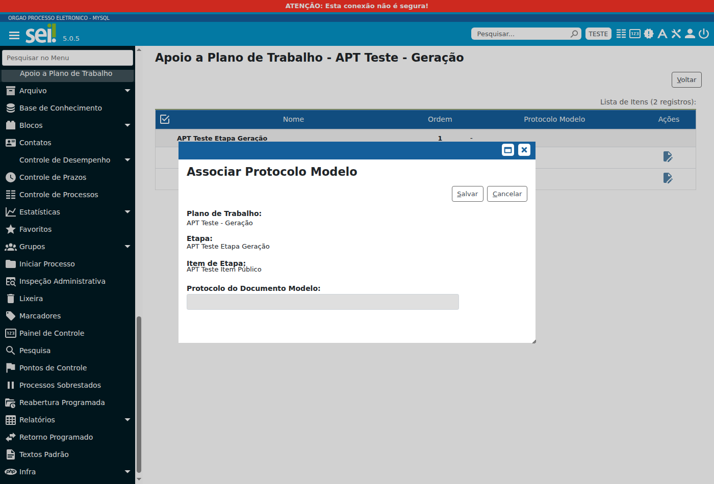

# Manual do módulo Apoio a Plano de Trabalho

Público: administradores do SEI que associam documentos modelo a itens de etapa de plano de trabalho e usuários do SEI que geram documentos a partir desses itens.

Versão: módulo Apoio a Plano de Trabalho (APT) 1.0.0, com interface em português brasileiro. Conteúdo conferido no código do módulo em 8 de outubro de 2026.

## Sumário

- [Para que serve o módulo](#para-que-serve-o-módulo)
    - [Termos usados neste manual](#termos-usados-neste-manual)
- [Antes de começar](#antes-de-começar)
    - [Quem pode realizar cada tarefa](#quem-pode-realizar-cada-tarefa)
    - [Como escolher o documento modelo](#como-escolher-o-documento-modelo)
- [Como abrir a tela Apoio a Plano de Trabalho](#como-abrir-a-tela-apoio-a-plano-de-trabalho)
- [Como consultar as etapas e os itens de um plano](#como-consultar-as-etapas-e-os-itens-de-um-plano)
- [Como associar um documento modelo a um item de etapa](#como-associar-um-documento-modelo-a-um-item-de-etapa)
    - [Campos da janela de associação](#campos-da-janela-de-associação)
- [Como trocar o documento modelo de um item](#como-trocar-o-documento-modelo-de-um-item)
- [Como excluir a associação de um item](#como-excluir-a-associação-de-um-item)
- [Como gerar um documento com o conteúdo do modelo](#como-gerar-um-documento-com-o-conteúdo-do-modelo)
    - [O que o módulo copia para o documento gerado](#o-que-o-módulo-copia-para-o-documento-gerado)
    - [Quando o documento fica sem o conteúdo do modelo](#quando-o-documento-fica-sem-o-conteúdo-do-modelo)
- [Mensagens e como resolver](#mensagens-e-como-resolver)
    - [Mensagens ao salvar a associação](#mensagens-ao-salvar-a-associação)
    - [Mensagens de acesso negado](#mensagens-de-acesso-negado)

## Para que serve o módulo

O módulo Apoio a Plano de Trabalho (APT) permite escolher um documento modelo para cada item de etapa de um plano de trabalho. Depois disso, quando alguém gera pelo item um documento do editor do SEI, o corpo do texto do novo documento já vem com o texto do documento modelo.

O uso tem duas partes. O administrador associa o documento modelo ao item. O usuário gera o documento a partir do item, sem nenhum passo a mais.

### Termos usados neste manual

| Termo | Significado |
|---|---|
| Plano de trabalho | Estrutura do SEI que organiza o trabalho de um processo em etapas e itens. |
| Etapa | Parte de um plano de trabalho. Cada etapa reúne itens. |
| Item de etapa | Parte de uma etapa. O plano pode prever, para cada item, os tipos de documento que o usuário inclui no processo a partir dele. |
| Documento de editor interno | Documento escrito no editor do SEI. Documento externo não é de editor interno. |
| Documento modelo | Documento de editor interno já existente no SEI cujo texto é copiado para os documentos gerados a partir do item. |
| Associação | Ligação entre um item de etapa e um documento modelo. Cada item tem no máximo uma associação. |
| Protocolo | Número que identifica o documento no SEI. |

## Antes de começar

### Quem pode realizar cada tarefa

As permissões do SEI valem por unidade. Você só vê os menus e os ícones de uma tarefa quando está em uma unidade em que seu perfil tem as permissões dela. Os nomes da coluna de permissões são os nomes que o gestor de perfis vê no SIP.

| Tarefa | Quem realiza | Permissões no SEI |
|---|---|---|
| Abrir a tela e consultar as associações | Administrador | `md_apt_etapa_pl_doc_modelo_listar`, `plano_trabalho_listar`, `plano_trabalho_consultar`, `etapa_trabalho_listar` e `item_etapa_listar` |
| Associar documento modelo a um item | Administrador | `md_apt_etapa_pl_doc_modelo_cadastrar`, `md_apt_etapa_pl_doc_modelo_listar`, `plano_trabalho_listar`, `plano_trabalho_consultar`, `etapa_trabalho_listar`, `item_etapa_listar`, `item_etapa_consultar`, `documento_consultar` e `protocolo_listar` |
| Trocar o documento modelo de um item | Administrador | `md_apt_etapa_pl_doc_modelo_alterar`, `md_apt_etapa_pl_doc_modelo_listar`, `plano_trabalho_listar`, `plano_trabalho_consultar`, `etapa_trabalho_listar`, `item_etapa_listar`, `item_etapa_consultar`, `documento_consultar` e `protocolo_listar` |
| Excluir a associação de um item | Administrador | `md_apt_etapa_pl_doc_modelo_excluir`, `md_apt_etapa_pl_doc_modelo_listar`, `plano_trabalho_listar`, `plano_trabalho_consultar`, `etapa_trabalho_listar` e `item_etapa_listar` |
| Gerar documento a partir do item | Usuário do SEI | `plano_trabalho_detalhar`, `item_etapa_incluir_documento`, `documento_gerar` e `documento_consultar`. Não precisa das permissões do módulo |

A instalação do módulo dá ao perfil **Administrador** as quatro permissões que começam com `md_apt_` e o item de menu do módulo. A instalação não concede as permissões do SEI sobre planos de trabalho, etapas, itens e documentos. Se faltar alguma, peça ao gestor de perfis do SIP.

### Como escolher o documento modelo

No momento em que você associa o documento, o SEI só aceita documento que cumpre todas estas condições:

- é de editor interno;
- não está cancelado;
- não é sigiloso;
- pode ser consultado pela unidade em que você está.

O SEI confere essas condições de novo cada vez que alguém gera um documento pelo item, na unidade em que essa pessoa está. Se o documento modelo deixar de cumprir alguma delas para essa unidade, o documento é gerado sem o texto do modelo. Por isso, escolha um documento modelo que todas as unidades que geram documentos pelo item possam consultar.

O módulo copia somente o corpo do texto do documento modelo. Cabeçalho, rodapé e as demais partes do documento gerado continuam as do tipo de documento que o usuário escolher.

O texto copiado é sempre o texto atual do documento modelo no momento da geração. Se você alterar o texto do modelo, os próximos documentos gerados recebem o texto novo. Os documentos já gerados não mudam.

Atenção: a conferência do documento modelo, ao salvar a associação e a cada geração, conta como consulta da unidade em que a pessoa está. Se essa unidade não é a que gerou o documento modelo e o documento modelo já está assinado, o SEI pode bloquear o documento modelo. Com o bloqueio, a unidade que o gerou deixa de poder alterar o conteúdo, excluir o documento ou cancelar a assinatura. Considere esse efeito antes de usar como modelo um documento já assinado.

## Como abrir a tela Apoio a Plano de Trabalho

Use esta tela para ver os planos de trabalho ativos e escolher o plano cujos itens você vai configurar. É preciso ter as permissões da tarefa "Abrir a tela e consultar as associações" em [Quem pode realizar cada tarefa](#quem-pode-realizar-cada-tarefa).

1. No menu do SEI, acesse **Administração > Apoio a Plano de Trabalho**.

> **[NECESSÁRIO INSERIR IMAGEM DE PRINT DA TELA DESTA FUNCIONALIDADE]** - **caminho no sistema**: Administração > Apoio a Plano de Trabalho - **contexto da captura**: perfil Administrador; tela Apoio a Plano de Trabalho com a tabela Lista de Planos de Trabalho, pelo menos dois planos ativos com nomes de homologação e o ícone Detalhar Plano visível na coluna Ações

2. Localize o plano na tabela **Lista de Planos de Trabalho**. A tabela mostra somente planos de trabalho ativos, em ordem alfabética, e a quantidade de registros no título.
3. Selecione o nome do plano ou o ícone **Detalhar Plano**, na coluna **Ações**.

O SEI abre as etapas e os itens do plano, como explica [Como consultar as etapas e os itens de um plano](#como-consultar-as-etapas-e-os-itens-de-um-plano).

Se nenhum plano de trabalho estiver ativo, a tela não mostra a tabela. Se o item **Apoio a Plano de Trabalho** não aparecer no menu **Administração**, seu perfil na unidade atual não tem a permissão `md_apt_etapa_pl_doc_modelo_listar`.

## Como consultar as etapas e os itens de um plano

Depois que você escolhe o plano, o título da tela passa a ser **Apoio a Plano de Trabalho**, seguido de um hífen e do nome do plano. A tabela **Lista de Itens** mostra as etapas ativas do plano e, abaixo de cada etapa, os itens ativos dela, na ordem definida no plano. A quantidade de registros no título da tabela conta somente os itens.

> **[NECESSÁRIO INSERIR IMAGEM DE PRINT DA TELA DESTA FUNCIONALIDADE]** - **caminho no sistema**: Administração > Apoio a Plano de Trabalho > Detalhar Plano - **contexto da captura**: perfil Administrador com as permissões de associar, alterar e excluir; plano de homologação com uma etapa que tenha um item com documento modelo associado e um item sem associação; visíveis a tabela Lista de Itens, as colunas Nome, Ordem, Protocolo Modelo e Ações, os ícones Associar Protocolo Modelo, Alterar Associação e Excluir Associação e o botão Voltar

| Coluna | O que mostra |
|---|---|
| Nome | Nome da etapa, em negrito, ou nome do item, logo abaixo da etapa a que pertence. |
| Ordem | Posição da etapa no plano ou posição do item na etapa. |
| Protocolo Modelo | Protocolo do documento modelo associado ao item. Um traço indica item sem associação. Nas linhas de etapa, a coluna sempre mostra um traço. |
| Ações | Ícones das ações que você pode realizar no item. As linhas de etapa não têm ações. |

| Situação do item | Ícone exibido | Permissão necessária |
|---|---|---|
| Item sem documento modelo | **Associar Protocolo Modelo** | `md_apt_etapa_pl_doc_modelo_cadastrar` |
| Item com documento modelo | **Alterar Associação** | `md_apt_etapa_pl_doc_modelo_alterar` |
| Item com documento modelo | **Excluir Associação** | `md_apt_etapa_pl_doc_modelo_excluir` |

Os ícones **Associar Protocolo Modelo** e **Alterar Associação** têm o mesmo desenho. Para saber qual é qual, observe a coluna **Protocolo Modelo** ou pare o ponteiro do mouse sobre o ícone para ver o nome dele.

Quem tem a permissão de excluir vê também uma coluna de seleção, com caixa de marcação nos itens associados. Nesta versão, a tela não tem comando que use essa seleção. Para excluir, use o ícone de cada item.

Para voltar à lista de planos, selecione **Voltar**.

## Como associar um documento modelo a um item de etapa

Use esta tarefa para definir o documento modelo de um item que ainda não tem associação. É preciso ter as permissões da tarefa "Associar documento modelo a um item" em [Quem pode realizar cada tarefa](#quem-pode-realizar-cada-tarefa) e conhecer o protocolo de um documento que cumpra as condições de [Como escolher o documento modelo](#como-escolher-o-documento-modelo).

1. Abra o plano, como explica [Como consultar as etapas e os itens de um plano](#como-consultar-as-etapas-e-os-itens-de-um-plano).
2. Na linha do item, selecione o ícone **Associar Protocolo Modelo**. O SEI abre a janela **Associar Protocolo Modelo** sobre a lista.

*Janela Associar Protocolo Modelo em ambiente de teste, com plano, etapa e item fictícios.*

3. Confira o plano, a etapa e o item mostrados no alto da janela.
4. Em **Protocolo do Documento Modelo**, digite o protocolo do documento modelo.
5. Selecione **Salvar**.

A janela fecha, a tela é recarregada e a coluna **Protocolo Modelo** do item passa a mostrar o protocolo do documento.

Se o SEI recusar o protocolo, ele mostra um alerta com o motivo e mantém a janela aberta. Corrija o protocolo ou selecione **Cancelar**, que fecha a janela sem gravar. Os motivos estão em [Mensagens ao salvar a associação](#mensagens-ao-salvar-a-associação).

Se outra pessoa associar um modelo ao mesmo item depois que você abriu a lista, o SEI abre a janela de alteração com o modelo que ela associou, em vez da janela de associação.

### Campos da janela de associação

O print de [Como associar um documento modelo a um item de etapa](#como-associar-um-documento-modelo-a-um-item-de-etapa) mostra estes campos.

| Campo | Como preencher | Regra |
|---|---|---|
| Plano de Trabalho | Não é editável. Mostra o plano a que o item pertence. | Preenchido pelo SEI. |
| Etapa | Não é editável. Mostra a etapa a que o item pertence. | Preenchido pelo SEI. |
| Item de Etapa | Não é editável. Mostra o item que vai receber o documento modelo. | Preenchido pelo SEI. |
| Protocolo do Documento Modelo | Digite o protocolo do documento modelo. | Obrigatório. Aceita até 50 caracteres. Se ficar vazio, o SEI mostra `Informe o protocolo do documento modelo.` |

## Como trocar o documento modelo de um item

Use esta tarefa para substituir o documento modelo de um item que já tem associação. É preciso ter as permissões da tarefa "Trocar o documento modelo de um item" em [Quem pode realizar cada tarefa](#quem-pode-realizar-cada-tarefa).

1. Abra o plano, como explica [Como consultar as etapas e os itens de um plano](#como-consultar-as-etapas-e-os-itens-de-um-plano).
2. Na linha do item, selecione o ícone **Alterar Associação**. O SEI abre a janela **Alterar Associação de Protocolo Modelo**, com o protocolo atual no campo **Protocolo do Documento Modelo**.
3. Substitua o protocolo pelo do novo documento modelo.
4. Selecione **Salvar**.

A janela fecha, a tela é recarregada e a coluna **Protocolo Modelo** do item passa a mostrar o novo protocolo. O item continua o mesmo.

A janela de alteração tem os mesmos campos e regras descritos em [Campos da janela de associação](#campos-da-janela-de-associação). Se o SEI recusar o novo protocolo, a janela continua aberta e o item continua com o documento modelo anterior. Para desistir, selecione **Cancelar**.

## Como excluir a associação de um item

Use esta tarefa para que o item deixe de ter documento modelo. É preciso ter as permissões da tarefa "Excluir a associação de um item" em [Quem pode realizar cada tarefa](#quem-pode-realizar-cada-tarefa).

1. Abra o plano, como explica [Como consultar as etapas e os itens de um plano](#como-consultar-as-etapas-e-os-itens-de-um-plano).
2. Na linha do item, selecione o ícone **Excluir Associação**.
3. O SEI pergunta `Confirma exclusão da associação do item`, seguido do nome do item entre aspas. Confirme para excluir. Se você não confirmar, nada muda.

O SEI mostra a mensagem `Operação realizada com sucesso.` e a coluna **Protocolo Modelo** do item passa a mostrar um traço.

A exclusão remove somente a associação. O documento modelo continua no processo dele, e os documentos já gerados não mudam. Os próximos documentos gerados a partir do item vêm com o conteúdo inicial do SEI.

## Como gerar um documento com o conteúdo do modelo

Use esta tarefa para criar, a partir de um item de etapa, um documento que já começa com o texto do documento modelo. É preciso ter as permissões da tarefa "Gerar documento a partir do item" em [Quem pode realizar cada tarefa](#quem-pode-realizar-cada-tarefa).

Antes de começar, confira se:

- o processo tem plano de trabalho associado;
- o processo está aberto na sua unidade;
- o item prevê pelo menos um tipo de documento e sua unidade tem acesso ao item;
- o administrador associou um documento modelo ao item.

1. Abra o processo e, na barra de ações do processo, selecione o ícone **Plano de Trabalho**. Em processo sem plano de trabalho associado, o ícone não aparece, exceto para quem pode associar planos a processos; nesse caso, ele abre a associação de plano, e não a tela **Plano de Trabalho**.
2. Na tela **Plano de Trabalho**, localize a etapa e o item. Se os itens da etapa estiverem ocultos, selecione o ícone **Exibir Itens da Etapa**.

> **[NECESSÁRIO INSERIR IMAGEM DE PRINT DA TELA DESTA FUNCIONALIDADE]** - **caminho no sistema**: Plano de Trabalho (ícone da barra de ações do processo) - **contexto da captura**: usuário com permissão de incluir documento no item, em unidade onde o processo está aberto; tela Plano de Trabalho com a etapa expandida e o ícone Incluir Documento visível na linha de um item que tem documento modelo associado; mascarar número do processo, nomes e siglas reais

3. Na coluna **Ações** do item, selecione o ícone **Incluir Documento**.

> **[NECESSÁRIO INSERIR IMAGEM DE PRINT DA TELA DESTA FUNCIONALIDADE]** - **caminho no sistema**: Plano de Trabalho > Incluir Documento - **contexto da captura**: item que prevê mais de um tipo de documento; tela Gerar Documento do Plano de Trabalho com o campo Tipo do Documento preenchido, a opção Externo desmarcada quando aparecer e os botões Continuar e Cancelar

4. Na tela **Gerar Documento do Plano de Trabalho**, selecione o **Tipo do Documento**. Se a opção **Externo** aparecer, deixe-a desmarcada. Depois, selecione **Continuar**. Se você selecionar **Continuar** sem escolher o tipo, o SEI mostra `Selecione um Tipo de Documento.`
5. Na tela **Gerar Documento**, o tipo de documento já vem definido e a área **Texto Inicial** não aparece. Preencha os demais campos como em qualquer documento do SEI e selecione **Salvar**.

Quando o item prevê um único tipo de documento e esse tipo só admite uma forma, interna ou externa, o SEI pula a tela do passo 4 e abre direto o formulário de inclusão.

O SEI inclui o documento na árvore do processo e abre o editor. O corpo do texto do documento traz o texto do documento modelo associado ao item.

> **[NECESSÁRIO INSERIR IMAGEM DE PRINT DA TELA DESTA FUNCIONALIDADE]** - **caminho no sistema**: Plano de Trabalho > Incluir Documento > Continuar > Salvar - **contexto da captura**: editor do SEI aberto logo depois de salvar, com o corpo do texto igual ao do documento modelo associado ao item e o cabeçalho do tipo de documento; documento modelo com texto fictício de homologação

Se você tentar incluir, pelo caminho comum de inclusão de documento no processo, um tipo de documento previsto em item do plano, o SEI abre a tela **Plano de Trabalho** para que a inclusão seja feita pelo item.

### O que o módulo copia para o documento gerado

- O texto atual do corpo do documento modelo, no momento da geração.
- Nada além do corpo do texto. Cabeçalho, rodapé e as demais partes do documento continuam como o SEI as criou para o tipo de documento.

A cópia fica registrada como nova versão do documento. O documento gerado fica com duas versões: a primeira, criada pelo SEI, e a segunda, com o texto do modelo. A segunda versão fica em nome do usuário e da unidade que geraram o documento.

Depois de gerado, o documento é independente do modelo. Alterações posteriores no documento modelo não mudam documentos já gerados.

### Quando o documento fica sem o conteúdo do modelo

Nos casos abaixo, o documento fica com o conteúdo inicial do SEI, sem aviso na tela:

- o item não tem documento modelo associado;
- o documento não é de editor interno, por exemplo quando você marca **Externo**;
- o documento é incluído no processo sem passar pelo ícone **Incluir Documento** do item;
- o documento modelo deixou de cumprir as condições de [Como escolher o documento modelo](#como-escolher-o-documento-modelo) para a unidade em que você está, por exemplo porque foi cancelado, ficou sigiloso ou sua unidade não pode consultá-lo. Nesse caso, o motivo fica registrado no log do SEI;
- ocorre erro na cópia do texto do modelo. Nesse caso, o erro fica registrado no log do SEI, e a equipe de suporte pode consultá-lo.

## Mensagens e como resolver

### Mensagens ao salvar a associação

Estas mensagens aparecem em alerta na janela de associação ou de alteração. A janela continua aberta e nada é gravado. Nas mensagens, PROTOCOLO representa o número que você digitou e SIGLA representa a sigla da sua unidade atual.

| Mensagem | Quando aparece | Como resolver |
|---|---|---|
| `Informe o protocolo do documento modelo.` | O campo Protocolo do Documento Modelo está vazio. | Digite o protocolo do documento modelo. |
| `Documento PROTOCOLO não encontrado.` | O número não é de documento, é de processo ou é de documento sigiloso. | Confira o número digitado. Documento sigiloso não pode ser documento modelo. |
| `Documento PROTOCOLO foi cancelado.` | O documento foi cancelado. | Escolha outro documento. |
| `Unidade [SIGLA] não possui acesso ao documento [PROTOCOLO].` | Sua unidade atual não pode consultar o documento. | Escolha um documento que sua unidade possa consultar. |
| `O protocolo "PROTOCOLO" não pode ser usado como modelo (somente documentos do editor interno são aceitos).` | O documento não é de editor interno, por exemplo documento externo. | Escolha um documento de editor interno. |
| `Já existe uma associação de protocolo modelo para este item de etapa.` | Outra pessoa associou um documento modelo ao item depois que você abriu a janela. | Selecione Cancelar, atualize a tela do plano e use Alterar Associação se quiser trocar o modelo. |
| `Erro ao cadastrar associação de protocolo modelo.` | Falha inesperada ao gravar uma nova associação. | Tente de novo. Se a mensagem se repetir, informe a equipe de suporte do SEI. |
| `Erro ao alterar associação de protocolo modelo.` | Falha inesperada ao gravar a troca do documento modelo. | Tente de novo. Se a mensagem se repetir, informe a equipe de suporte do SEI. |

### Mensagens de acesso negado

| Mensagem | Quando aparece | Como resolver |
|---|---|---|
| `Acesso negado a este recurso nesta unidade (RECURSO / SIGLA).` | Seu perfil na unidade atual não tem a permissão RECURSO, exigida pela tela ou pela ação. | Peça ao gestor de perfis do SIP a permissão indicada ou acesse o SEI em uma unidade em que seu perfil já a tenha. |
| `O tipo de documento "TIPO" somente pode ser incluído no processo por meio do Plano de Trabalho.` | Você tentou incluir pelo caminho comum um tipo de documento previsto no plano, sem a permissão `plano_trabalho_detalhar`. | Peça ao gestor de perfis do SIP a permissão `plano_trabalho_detalhar` e inclua o documento pelo item do plano. |
