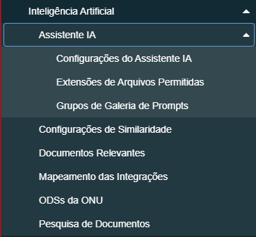

		

# Manual de Administração do módulo SEI IA

Este manual abrange os submenus de **Administração > Inteligência Artificial**, seus formulários, consultas e janelas de seleção. As instruções consideram as opções da versão de referência; os valores apresentados na instalação dependem das configurações existentes.

O manual também orienta a administração na preparação da disponibilização, na definição de acesso e uso responsável e no acompanhamento da equipe que opera o Servidor de Soluções de IA. Os guias oficiais do módulo e do servidor detalham a instalação e a atualização técnica; este documento não substitui esses procedimentos.

## Sumário

- [Antes de começar](#antes-de-começar)
- [Planejar a disponibilização do SEI IA](#planejar-a-disponibilização-do-sei-ia)
    - [Compreender os componentes e as responsabilidades](#compreender-os-componentes-e-as-responsabilidades)
    - [Conferir a preparação do ambiente](#conferir-a-preparação-do-ambiente)
    - [Definir os perfis de acesso](#definir-os-perfis-de-acesso)
- [Localizar a administração do SEI IA](#localizar-a-administração-do-sei-ia)
- [Configurar o Assistente IA](#configurar-o-assistente-ia)
    - [Definir a exibição e as orientações do Assistente](#definir-a-exibição-e-as-orientações-do-assistente)
    - [Definir os limites diários por usuário](#definir-os-limites-diários-por-usuário)
- [Administrar extensões de arquivos permitidas](#administrar-extensões-de-arquivos-permitidas)
    - [Consultar o tratamento de uma extensão](#consultar-o-tratamento-de-uma-extensão)
    - [Alterar o limite para arquivos avulsos](#alterar-o-limite-para-arquivos-avulsos)
    - [Desativar ou reativar extensões](#desativar-ou-reativar-extensões)
- [Administrar grupos da galeria de prompts](#administrar-grupos-da-galeria-de-prompts)
    - [Criar ou alterar um grupo](#criar-ou-alterar-um-grupo)
    - [Excluir ou imprimir grupos](#excluir-ou-imprimir-grupos)
- [Configurar a similaridade entre processos](#configurar-a-similaridade-entre-processos)
    - [Definir a apresentação dos processos similares](#definir-a-apresentação-dos-processos-similares)
    - [Distribuir a relevância do conteúdo e dos metadados](#distribuir-a-relevância-do-conteúdo-e-dos-metadados)
- [Administrar documentos relevantes](#administrar-documentos-relevantes)
    - [Pesquisar e consultar documentos relevantes](#pesquisar-e-consultar-documentos-relevantes)
    - [Cadastrar a abrangência de um documento relevante](#cadastrar-a-abrangência-de-um-documento-relevante)
    - [Selecionar tipos de processo para documentos relevantes](#selecionar-tipos-de-processo-para-documentos-relevantes)
    - [Definir segmentos e percentuais de relevância](#definir-segmentos-e-percentuais-de-relevância)
    - [Alterar registros e tratar sobreposições](#alterar-registros-e-tratar-sobreposições)
    - [Desativar, reativar ou excluir documentos relevantes](#desativar-reativar-ou-excluir-documentos-relevantes)
- [Mapear as integrações](#mapear-as-integrações)
    - [Consultar e alterar uma integração](#consultar-e-alterar-uma-integração)
    - [Cadastrar uma funcionalidade ainda não mapeada](#cadastrar-uma-funcionalidade-ainda-não-mapeada)
- [Configurar os ODSs da ONU](#configurar-os-odss-da-onu)
    - [Definir a exibição e a avaliação dos ODS](#definir-a-exibição-e-a-avaliação-dos-ods)
    - [Selecionar as unidades de alerta](#selecionar-as-unidades-de-alerta)
    - [Configurar metas e tipos de processo por objetivo](#configurar-metas-e-tipos-de-processo-por-objetivo)
    - [Entender o efeito da classificação automática](#entender-o-efeito-da-classificação-automática)
- [Configurar a pesquisa de documentos](#configurar-a-pesquisa-de-documentos)
    - [Definir a seção e os resultados da pesquisa](#definir-a-seção-e-os-resultados-da-pesquisa)
    - [Incluir, desativar e reativar tipos de documento alvo](#incluir-desativar-e-reativar-tipos-de-documento-alvo)
- [Orientar o uso institucional](#orientar-o-uso-institucional)
    - [Definir orientações de uso responsável](#definir-orientações-de-uso-responsável)
    - [Planejar a capacitação e a galeria de prompts](#planejar-a-capacitação-e-a-galeria-de-prompts)
    - [Acompanhar custos e limites de uso](#acompanhar-custos-e-limites-de-uso)
- [Acompanhar a operação e as atualizações](#acompanhar-a-operação-e-as-atualizações)
    - [Conferir a saúde e o processamento dos serviços](#conferir-a-saúde-e-o-processamento-dos-serviços)
    - [Preparar uma atualização de versão](#preparar-uma-atualização-de-versão)
- [Resolver dificuldades de configuração](#resolver-dificuldades-de-configuração)
- [Consultar os materiais de referência](#consultar-os-materiais-de-referência)

## Antes de começar

O administrador define quais funcionalidades o módulo oferece, orienta seu uso e configura os critérios de similaridade, pesquisa, classificação pelos Objetivos de Desenvolvimento Sustentável (ODS) da Organização das Nações Unidas (ONU) e interação com o Assistente IA. Tenha acesso ao perfil **Administrador** e às permissões das ações que pretende executar. O sistema pode ocultar botões conforme as permissões da sessão.

Para habilitar funcionalidades que consultam serviços de inteligência artificial (IA), obtenha com a equipe responsável os endereços corretos do Servidor de Soluções de IA e confirme sua disponibilidade. A habilitação de uma seção não substitui a integração, os documentos elegíveis nem o processamento necessário para produzir resultados.

Use os tipos de documento, tipos de processo, usuários e unidades já cadastrados no SEI. As janelas de seleção permitem vinculá-los à configuração do módulo. Quando faltar um cadastro geral, providencie-o pela administração do SEI antes de concluir o vínculo.

As opções **Exibir** e **Não Exibir** controlam a oferta da funcionalidade ao usuário. As opções **Ativar** e **Desativar** controlam o recurso indicado pelo campo. Para listas de registros, **Desativar** conserva o registro e permite sua reativação; **Excluir** remove o registro selecionado, quando a tela oferece essa ação.

Nas telas de configuração, conclua com **Salvar**. Adicionar, remover ou editar itens de uma tabela ou lista de seleção normalmente prepara a alteração no formulário. A janela de metas dos ODS tem seu próprio **Salvar**, que grava as regras daquela janela.

As orientações para coleta de prints indicam os estados que devem ilustrar cada procedimento. Colete os PNG com perfil **Administrador**, na versão correspondente, usando dados fictícios ou mascarados. Preserve os rótulos e controles necessários ao entendimento e registre navegador, resolução e zoom. A imagem disponível abaixo mostra o menu; as capturas dos formulários ainda precisam de coleta manual.

## Planejar a disponibilização do SEI IA

### Compreender os componentes e as responsabilidades

O SEI IA depende de dois componentes: o módulo PHP instalado no SEI e o Servidor de Soluções de IA. O servidor reúne serviços de recomendação de processos e documentos similares e do Assistente de IA Generativa. Habilitar uma funcionalidade no menu administrativo não instala nem configura esses serviços.

| Componente ou atividade | O que a administração precisa conhecer | Articulação com a equipe técnica |
|---|---|---|
| Módulo SEI IA no SEI e recursos no SIP | Oferece menus, configurações e funcionalidades aos usuários. O Sistema de Permissões (SIP) mantém os recursos e sua associação a perfis. | Conferir instalação, versão, recursos e menus antes de disponibilizar o uso. |
| Servidor de Soluções de IA | Executa os serviços da solução em contêineres Docker em um servidor Linux exclusivo. | Definir responsáveis por disponibilidade, rede, armazenamento, atualização e cópias de segurança. |
| Serviços de modelos de IA | Fornecem modelos de linguagem e embeddings, representações do conteúdo usadas na recuperação de contexto. A configuração do servidor determina os modelos disponíveis. | Conferir contratação, credenciais, modelos implantados, capacidade e condições de tratamento dos dados. |
| Indexação e processamento | O Solr mantém índices para recomendações; o Airflow coordena tarefas de processamento. Há também rotinas agendadas no SEI, como a classificação de ODS por tipo de processo. | Distinguir o processamento do servidor dos agendamentos do SEI e acompanhar o resultado de cada rotina pertinente. |

O [README do servidor](https://github.com/anatelgovbr/sei-ia/blob/main/README.md) indica Linux, 16 núcleos de 2,10 GHz, 128 GB de memória RAM, Docker Engine 27.1.1 ou posterior e Docker Compose 2.29 ou posterior. Esses requisitos pertencem ao Servidor de Soluções de IA, não à infraestrutura do SEI. Não compartilhe esse servidor com outras soluções. A documentação não recomenda Windows com Subsistema do Windows para Linux (WSL) em produção.

Dimensione o armazenamento com a equipe técnica conforme o volume de processos e documentos e seu crescimento. Os números de consumo da Anatel no [guia de instalação do servidor](https://github.com/anatelgovbr/sei-ia/blob/main/docs/INSTALL.md) são referências de um ambiente e de uma data, não uma previsão de consumo para qualquer órgão.

### Conferir a preparação do ambiente

Realize esta conferência com as equipes responsáveis pelo SEI, pelo SIP e pelo Servidor de Soluções de IA antes de divulgar o uso institucional.

1. Confirme a versão do SEI. O requisito mínimo informado pelos projetos é 4.1.5; versões anteriores não têm compatibilidade e versões mais recentes exigem conferência prévia.
2. Solicite a confirmação da instalação e configuração do módulo no SEI e dos recursos no SIP. O módulo deve estar instalado e configurado no ambiente correspondente antes da instalação do servidor de IA.
3. Confira o reconhecimento do módulo em **Infra > Módulos** no SEI e o parâmetro **VERSAO_MODULO_IA** em **Infra > Parâmetros** do SEI e do SIP. Confronte os valores com a versão que a equipe informa para o código instalado.
4. Faça novo login após a instalação e confira os submenus de **Administração > Inteligência Artificial**. Prepare as orientações, os limites, os documentos relevantes e os tipos alvo conforme as tarefas deste manual.
5. Solicite à equipe técnica a confirmação do funcionamento do servidor e da comunicação nos dois sentidos: do SEI para os serviços de IA e do servidor de IA para os serviços do módulo no SEI.
6. Valide os dois registros de **Mapeamento das Integrações**, confira a conexão na configuração do Assistente e conclua as configurações das funcionalidades que o órgão pretende oferecer.
7. Combine a conferência de uso com usuários autorizados e documentos de teste adequados. Diferencie uma configuração salva, um serviço disponível e um resultado funcional antes de anunciar a disponibilização.

O [README do módulo PHP](https://github.com/anatelgovbr/mod-sei-ia/blob/master/README.md) e os guias do servidor orientam os trabalhos técnicos. Solicite a leitura integral do README do servidor e do seu guia de instalação antes da implantação. A equipe deve conferir também as configurações de PHP do ambiente web e da linha de comando. Não execute scripts de instalação ou atualização como tentativa de corrigir uma configuração da interface.

A preparação inicial e a conferência após instalar o servidor são momentos distintos: primeiro configure o módulo no SEI; depois, com os serviços disponíveis, valide a comunicação e a operação conjunta.

### Definir os perfis de acesso

Os scripts do SIP criam recursos e menus do módulo e os associam aos perfis **Básico** e **Administrador**. Perfis próprios do órgão precisam manter os recursos correspondentes às tarefas que seus usuários realizarão.

1. Identifique as pessoas que administrarão o módulo e as que utilizarão suas funcionalidades.
2. Solicite à administração de acesso a conferência dos recursos do módulo, que usam o prefixo `md_ia_`, nos perfis correspondentes.
3. Para ampliar ou restringir a visibilidade do Assistente, confira o recurso `md_ia_adm_config_assist_ia_consultar` nos perfis pertinentes.
4. Confira o acesso com a configuração **Exibir Funcionalidade** e nas telas que admitem o Assistente. Ter o recurso não substitui a habilitação da funcionalidade.
5. Após atualizar o módulo, revise os perfis próprios e a política de acesso. O README informa que os scripts de versões futuras continuam a associar recursos aos perfis **Básico** e **Administrador**.

A retirada de um recurso do perfil **Básico** pode afetar todos os usuários que dependem desse perfil. Avalie o alcance com a administração de acesso antes de alterar a associação. A permissão de visualizar o Assistente não equivale à permissão de alterar suas configurações administrativas.

## Localizar a administração do SEI IA

1. Acesse **Administração** no menu do SEI.
2. Expanda **Inteligência Artificial**.
3. Expanda **Assistente IA** para acessar suas três opções ou selecione um dos demais submenus.

A imagem fornecida mostra a organização dos submenus. Ela não inclui o menu pai **Administração**.

| Submenu | O que administrar |
|---|---|
| Assistente IA > Configurações do Assistente IA | Exibição, orientações, recursos opcionais e limites diários de interação. |
| Assistente IA > Extensões de Arquivos Permitidas | Características das extensões, limite para arquivos avulsos e situação ativa. |
| Assistente IA > Grupos de Galeria de Prompts | Nomes dos grupos que organizam a galeria de prompts. |
| Configurações de Similaridade | Exibição de processos similares, quantidade de resultados e distribuição de relevância. |
| Documentos Relevantes | Tipos de documento, abrangência por tipo de processo e relevância de segmentos. |
| Mapeamento das Integrações | Endereços e parâmetros das integrações com os serviços de IA. |
| ODSs da ONU | Exibição, orientações, unidades de alerta e configuração das metas por objetivo. |
| Pesquisa de Documentos | Nome da seção, quantidade de resultados e tipos de documento alvo. |

## Configurar o Assistente IA

Acesse **Administração > Inteligência Artificial > Assistente IA > Configurações do Assistente IA**. Essa tela reúne a configuração geral do Assistente e a lista de usuários com limite diário diferenciado.

Para a captura, abra o formulário com os indicadores de conexão, as opções de exibição e recursos, as orientações e as ações visíveis. Se a altura exigir dois recortes, conserve a identificação da tela em ambos. A captura deste formulário também deve ilustrar os campos da tabela seguinte.

> **[NECESSÁRIO INSERIR IMAGEM DE PRINT DA TELA DESTA FUNCIONALIDADE]** - **caminho no sistema**: Administração > Inteligência Artificial > Assistente IA > Configurações do Assistente IA

### Definir a exibição e as orientações do Assistente

1. Confira o resultado da verificação de conexão que a tela apresenta.
2. Selecione **Exibir** ou **Não Exibir** em **Exibir Funcionalidade**.
3. Selecione as opções de **Refletir** e **Buscar na Web**, considerando as condições abaixo.
4. Preencha **Orientações Gerais** com as instruções que os usuários devem consultar ao usar o Assistente.
5. Ajuste os limites e a lista de usuários conforme o próximo tópico.
6. Acione **Salvar**.

O sistema grava a configuração e apresenta uma mensagem de sucesso. Ao abrir a tela novamente, confira as opções e a lista de usuários que permaneceram gravadas.

| Campo | Como utilizar |
|---|---|
| Exibir Funcionalidade | **Exibir** habilita a oferta do Assistente nas telas admitidas pelo módulo, para usuários com a permissão necessária. **Não Exibir** desabilita essa oferta. |
| Refletir | **Ativar** ou **Desativar** a configuração de reflexão. A ajuda informa que o serviço precisa oferecer um modelo de linguagem com esse recurso. Confirme com a equipe do serviço o suporte e o efeito na versão instalada antes de orientar os usuários sobre seu uso. |
| Buscar na Web | **Ativar** ou **Desativar** a configuração de busca na web. O recurso depende de uma interface de programação de aplicações (API) de busca configurada no Servidor de Soluções de IA. A ajuda da tela registra indisponibilidade na versão 1.1 desse servidor; confirme a versão e a capacidade atuais com a equipe responsável. |
| Orientações Gerais | Campo obrigatório, com editor de texto. O Assistente apresenta essas orientações para consulta do usuário. |
| Prompt System para o LLM | Texto de instruções do sistema para o modelo de linguagem de grande porte, identificado pela sigla LLM. A tela apresenta esse conteúdo somente para leitura e informa que não deve ser alterado. |

Os guias atuais do servidor descrevem **WebSearch**, busca externa com Bing Grounding, como recurso opcional, inclusive na atualização de 1.1.x para 1.2.x. Sua configuração exige serviços e credenciais no Azure e um modelo compatível. Essa orientação não comprova que a instalação do órgão oferece o recurso nem elimina o aviso histórico da ajuda local. Antes de ativar **Buscar na Web**, confirme com a equipe técnica a versão instalada, a configuração e o funcionamento da busca. Quando o órgão não usar esse serviço, mantenha a opção **Desativar**; o guia informa que o Assistente pode funcionar sem consultas externas.

Confirme também os modelos que o servidor realmente executa. Os guias do servidor descrevem a centralização das conexões no LiteLLM Proxy; os nomes apresentados em materiais de usuário ou na interface, por si só, não comprovam o modelo implantado nem o suporte à reflexão.

Ao confirmar a conexão, a tela pode apresentar **Conectado a API do SEI IA com sucesso.** Quando a conexão falha, apresenta **Não foi possível conectar a API do SEI IA. Verifique os dados da integração no Mapeamento de Integrações.** e seleciona **Não Exibir**. Confira a integração, retorne ao formulário e confirme a conexão antes de habilitar o Assistente.

Para a captura do estado de falha, registre a mensagem de conexão e a seleção **Não Exibir**, caso esse estado ocorra no ambiente de conferência. A equipe responsável deve autorizar qualquer preparação que altere o serviço para produzir esse estado.

> **[NECESSÁRIO INSERIR IMAGEM DE PRINT DA TELA DESTA FUNCIONALIDADE]** - **caminho no sistema**: Administração > Inteligência Artificial > Assistente IA > Configurações do Assistente IA

### Definir os limites diários por usuário

Token é uma unidade de processamento de texto do modelo. Os campos desta tela usam **milhões de tokens**, por usuário e por dia. Por exemplo, informar `3` representa 3 milhões de tokens. O módulo compara o consumo diário registrado para a pessoa com o limite que lhe corresponde e identifica quando esse consumo alcança ou ultrapassa o limite.

| Campo | Preenchimento e efeito |
|---|---|
| Limite Geral de Tokens por Usuário/Dia (milhões de tokens) | Informe um valor de 1 a 15 milhões de tokens. O limite geral atende os usuários que não constam da lista de limite maior. A ajuda indica 3 milhões como padrão de instalação, que pode diferir do valor atual. |
| Limite maior para Usuários específicos | Informe um valor de 1 a 15 milhões de tokens. Esse valor substitui o limite geral para os usuários da lista. A ajuda indica 6 milhões como padrão de instalação. Para conceder um limite maior, escolha um valor superior ao geral. |
| Usuários que terão limite maior | Inclua somente as pessoas que devem receber o limite diferenciado. Remover uma pessoa da lista faz com que ela passe a usar o limite geral após salvar. |

1. Informe os dois limites.
2. Digite pelo menos três caracteres no campo de usuário e selecione uma sugestão para incluí-la na lista.
3. Para usar a janela de seleção, acione o ícone **Selecionar Usuário**.
4. Na janela, localize os usuários com os filtros **Órgão**, **Sigla**, **Nome** e **Nome Social**.
5. Marque os usuários desejados e acione **Transportar** para devolvê-los ao formulário.
6. Para retirar alguém da lista, selecione a pessoa e acione **Remover Usuário**.
7. Acione **Salvar** no formulário de configuração.

**Fechar** encerra a janela de seleção. A inclusão na lista do formulário ainda exige **Salvar** para persistir.

Para a captura, abra **Selecionar Usuário** com filtros, linhas de exemplo e **Transportar** visíveis. Use nomes fictícios ou mascare os dados pessoais. O formulário principal deve ter uma segunda captura da área de limites e da lista resultante, caso essa área não caiba no print anterior.

> **[NECESSÁRIO INSERIR IMAGEM DE PRINT DA TELA DESTA FUNCIONALIDADE]** - **caminho no sistema**: Administração > Inteligência Artificial > Assistente IA > Configurações do Assistente IA > Selecionar Usuário

## Administrar extensões de arquivos permitidas

Acesse **Administração > Inteligência Artificial > Assistente IA > Extensões de Arquivos Permitidas**. A lista permite examinar o tratamento dos arquivos em citações de protocolos de documentos e em anexos avulsos do Assistente.

Um **protocolo de documento** identifica um documento que já pertence ao SEI. Um **arquivo avulso** é um arquivo anexado à interação com o Assistente. A permissão de uso pode diferir entre essas duas formas de fornecer contexto.

Para a captura, apresente a lista com registros ativos e inativos, as colunas de permissão e tamanho, as ações por linha e os comandos coletivos. Use registros reais da instalação sem dados pessoais.

> **[NECESSÁRIO INSERIR IMAGEM DE PRINT DA TELA DESTA FUNCIONALIDADE]** - **caminho no sistema**: Administração > Inteligência Artificial > Assistente IA > Extensões de Arquivos Permitidas

### Consultar o tratamento de uma extensão

1. Localize a extensão na lista.
2. Examine a forma de entrega, a permissão de interação por protocolo, a permissão de arquivos avulsos e seu tamanho máximo.
3. Acione **Consultar Extensão de Arquivo Permitida** na linha correspondente.
4. Leia as características e as descrições de tratamento.
5. Acione **Fechar** para retornar à lista.

| Informação | Significado |
|---|---|
| Extensão | Identifica o formato do arquivo. A tela conserva o valor cadastrado. |
| Conteúdo Vetorizável | Indica a característica cadastrada para transformação do conteúdo em uma representação que permite busca por similaridade. |
| Forma de Entrega do Arquivo na citação de Protocolo de Documentos | Pode indicar **Feed do Solr**, **Download do Arquivo**, **Feed do Solr e Download do Arquivo** ou **Não é permitida a citação como Protocolo de Documento**. Solr é o serviço de indexação e pesquisa; seu feed fornece o conteúdo disponível nesse índice. A opção de download entrega o arquivo para tratamento pelo serviço de IA. |
| Aceita em Protocolo de Documentos | Indica se a extensão admite essa forma de interação. Leia também **Descrição do Tratamento (Protocolo)**. |
| Aceita em Arquivos Avulsos | Indica se a extensão admite anexo avulso. Leia também **Descrição do Tratamento (Avulso)**. A lista informa que os arquivos avulsos seguem por download. |
| Tamanho Máximo para Arquivos Avulsos(Mb) | Limite por arquivo avulso, em megabytes. A consulta apresenta o valor cadastrado. |

O formulário de consulta e o de alteração compartilham as informações da extensão. Colete a consulta com as descrições de tratamento e **Fechar** visíveis; a captura de alteração do próximo tópico deve mostrar a edição do limite.

> **[NECESSÁRIO INSERIR IMAGEM DE PRINT DA TELA DESTA FUNCIONALIDADE]** - **caminho no sistema**: Administração > Inteligência Artificial > Assistente IA > Extensões de Arquivos Permitidas > Consultar Extensão de Arquivo Permitida

### Alterar o limite para arquivos avulsos

1. Acione **Alterar Extensão de Arquivo Permitida** na linha desejada.
2. Confira **Aceita em Arquivos Avulsos**.
3. Quando a extensão aceita arquivos avulsos, informe **Tamanho Máximo para Arquivos Avulsos(Mb)**.
4. Consulte a ajuda ao lado do campo para conhecer o máximo admitido para aquela extensão na instalação.
5. Acione **Salvar**.

O tamanho deve ser numérico, no mínimo 1 e no máximo o limite calculado que a ajuda apresenta. Esse máximo considera o limite geral de documentos externos do SEI e os limites de tratamento aplicáveis ao arquivo. A edição fica indisponível quando a extensão não aceita arquivos avulsos. A gravação altera o tamanho; as características de extensão, vetorização, entrega e aceitação continuam com os valores cadastrados.

Se a ajuda indicar um parâmetro geral inválido, solicite à administração responsável a regularização de **SEI_TAM_MB_DOC_EXTERNO** antes de definir o limite. Ao salvar com sucesso, o sistema retorna à lista. **Cancelar** encerra a alteração sem gravar o novo tamanho.

Se o usuário não conseguir anexar um arquivo dentro do limite da extensão, solicite à equipe técnica a conferência de **SEI_TAM_MB_DOC_EXTERNO**, `upload_max_filesize` e `post_max_size`. O README local do módulo orienta manter o limite total da requisição acima do limite de um arquivo. Os valores de exemplo não definem o limite do órgão. Para PDFs digitalizados, confirme também a dependência Python/PyMuPDF que o módulo usa na detecção da necessidade de reconhecimento óptico de caracteres (OCR).

Para a captura, escolha uma extensão que aceite arquivos avulsos e apresente o campo editável, a ajuda com o máximo calculado e **Salvar**. A tela pode mostrar o título **Alterar Extensão Permitidas**.

> **[NECESSÁRIO INSERIR IMAGEM DE PRINT DA TELA DESTA FUNCIONALIDADE]** - **caminho no sistema**: Administração > Inteligência Artificial > Assistente IA > Extensões de Arquivos Permitidas > Alterar Extensão de Arquivo Permitida

### Desativar ou reativar extensões

1. Marque uma ou mais linhas na lista de extensões.
2. Acione **Desativar** para retirar as extensões do conjunto ativo ou **Reativar** para devolvê-las a esse conjunto.
3. Confira a confirmação que identifica os registros selecionados.
4. Confirme a operação para aplicar a mudança ou cancele para conservar a situação anterior.

As ações por linha também permitem desativar um registro ativo e reativar um inativo. Nessa versão, a descrição dos ícones pode aparecer como **Desativar Documento Relevante** ou **Reativar Documento Relevante**, embora a linha pertença a uma extensão. Os comandos coletivos **Desativar** e **Reativar** ajudam a identificar a operação correta.

A desativação conserva a extensão na lista, mas retira sua disponibilidade nas seleções que exigem extensões ativas. A lista administrativa usa destaque vermelho para registros inativos. Se nenhuma linha estiver marcada ao usar um comando coletivo, marque os registros antes de repetir a ação.

Para a captura, apresente uma confirmação de desativação com uma extensão de exemplo e os controles de confirmar e cancelar. A lista anterior, com registros ativos e inativos, também ilustra o resultado dessa operação.

> **[NECESSÁRIO INSERIR IMAGEM DE PRINT DA TELA DESTA FUNCIONALIDADE]** - **caminho no sistema**: Administração > Inteligência Artificial > Assistente IA > Extensões de Arquivos Permitidas > Desativar

## Administrar grupos da galeria de prompts

Acesse **Administração > Inteligência Artificial > Assistente IA > Grupos de Galeria de Prompts**. Um prompt é uma instrução enviada ao Assistente. Os grupos ajudam a organizar os prompts da galeria; esta tela administra os nomes dos grupos.

Criar um grupo não cadastra o texto de um prompt. Planeje também o conteúdo da galeria e a capacitação conforme [Planejar a capacitação e a galeria de prompts](#planejar-a-capacitação-e-a-galeria-de-prompts).

Para a captura, apresente a lista com **Nome**, ações por linha e comandos **Novo**, **Excluir**, **Imprimir** e **Fechar**, conforme as permissões da sessão. Uma lista preenchida ilustra localização e seleção; uma lista vazia utiliza o mesmo acesso para **Novo**.

> **[NECESSÁRIO INSERIR IMAGEM DE PRINT DA TELA DESTA FUNCIONALIDADE]** - **caminho no sistema**: Administração > Inteligência Artificial > Assistente IA > Grupos de Galeria de Prompts

### Criar ou alterar um grupo

1. Acione **Novo** para criar um grupo ou **Alterar Grupo de Galeria de Prompts** na linha de um grupo existente.
2. Preencha **Nome** com até 100 caracteres. O nome é obrigatório e deve distinguir o grupo dos demais já cadastrados.
3. Acione **Salvar**.
4. Confira a mensagem apresentada e o registro na lista.

**Cancelar** encerra o formulário sem salvar. Para alterar um grupo, conserve ou substitua seu nome e confira o resultado após a gravação. Quando há nome repetido, a validação informa **Existe outro Grupo de Galeria de Prompts com mesmo nome nesta unidade.** Escolha outro nome e salve novamente.

Para a captura, apresente o formulário aberto por **Novo**, com **Nome**, **Salvar** e **Cancelar**. O formulário de alteração usa o mesmo campo; uma captura adicional só é necessária se o estado observado apresentar diferença relevante. Confira a gravação no ambiente antes de considerar esse procedimento validado na interface.

> **[NECESSÁRIO INSERIR IMAGEM DE PRINT DA TELA DESTA FUNCIONALIDADE]** - **caminho no sistema**: Administração > Inteligência Artificial > Assistente IA > Grupos de Galeria de Prompts > Novo

### Excluir ou imprimir grupos

1. Para excluir um grupo, acione **Excluir Grupo de Galeria de Prompts** na linha ou marque os grupos e acione **Excluir**.
2. Confira os nomes apresentados na confirmação.
3. Confirme para excluir ou cancele para conservar os registros.
4. Confira a lista após a operação.

Se a seleção estiver vazia, marque ao menos um grupo antes de usar **Excluir**. A exclusão remove o grupo; ela não equivale à desativação. Se o sistema apresentar uma crítica, confira seu conteúdo e a situação dos vínculos antes de repetir a operação.

Para imprimir a relação, acione **Imprimir** e conclua a impressão na janela do navegador. **Fechar** encerra a listagem. O print da lista já ilustra esses comandos; a configuração de impressora depende do navegador.

Para a captura da exclusão, selecione um grupo de exemplo e apresente a confirmação com o nome e as opções de confirmar e cancelar.

> **[NECESSÁRIO INSERIR IMAGEM DE PRINT DA TELA DESTA FUNCIONALIDADE]** - **caminho no sistema**: Administração > Inteligência Artificial > Assistente IA > Grupos de Galeria de Prompts > Excluir

## Configurar a similaridade entre processos

Acesse **Administração > Inteligência Artificial > Configurações de Similaridade**. A configuração define a apresentação de processos similares e a proporção de relevância atribuída ao conteúdo dos documentos e aos metadados, que são informações descritivas do processo.

Para a captura, apresente o formulário com exibição, quantidade, orientações, percentuais de conteúdo e metadados e data da última alteração. Um segundo recorte deve mostrar a tabela de metadados e sua edição quando a altura impedir uma captura legível única.

> **[NECESSÁRIO INSERIR IMAGEM DE PRINT DA TELA DESTA FUNCIONALIDADE]** - **caminho no sistema**: Administração > Inteligência Artificial > Configurações de Similaridade

### Definir a apresentação dos processos similares

1. Selecione **Exibir** ou **Não Exibir** em **Exibir Funcionalidade**.
2. Informe **Resultados a serem listados**, de 1 a 15.
3. Preencha **Orientações Gerais**, campo obrigatório que apresenta as instruções de uso da seção de processos similares.
4. Ajuste a distribuição de relevância conforme o próximo tópico.
5. Acione **Salvar**.

O sistema grava a configuração, apresenta uma mensagem de sucesso e mantém os valores para as próximas consultas. A ajuda indica 5 resultados como padrão de instalação, sem determinar o valor atual. A apresentação de resultados depende também dos documentos relevantes, da indexação e da integração disponíveis.

### Distribuir a relevância do conteúdo e dos metadados

Há duas distribuições relacionadas: a divisão entre conteúdo e metadados e a divisão interna entre os metadados cadastrados. A soma dos pesos internos deve totalizar 100% da parcela atribuída aos metadados.

| Campo ou informação | Regra |
|---|---|
| Percentual de Relevância do Conteúdo dos Documentos | Informe um percentual maior que zero e até 100%, conforme a ajuda. A tela usa esse valor para calcular a parcela restante dos metadados. |
| Percentual de Relevância dos Metadados | Campo calculado: 100 menos o percentual do conteúdo. A tela permite somente leitura. A ajuda indica 70% para conteúdo e 30% para metadados como padrões de instalação. |
| Metadado | Nome do item selecionado na tabela. A tela permite alterar os pesos dos metadados cadastrados, sem cadastrar um novo tipo nessa configuração. |
| Percentual de Relevância | Peso do metadado selecionado. Informe um valor maior que zero e até 100%, conservando a soma da tabela em 100%. |
| Data/Hora da Última Alteração | Informação de consulta sobre a alteração da configuração. A tabela também apresenta a data e hora dos pesos. |

1. Preencha **Percentual de Relevância do Conteúdo dos Documentos**.
2. Confira o **Percentual de Relevância dos Metadados** que a tela calculou.
3. Na tabela, acione **Alterar Percentual de Relevância do Metadado** na linha desejada.
4. Confira o nome preenchido em **Metadado**.
5. Informe o novo **Percentual de Relevância**.
6. Acione **Alterar** para atualizar a linha no formulário.
7. Ajuste as demais linhas necessárias até a soma alcançar 100%.
8. Acione **Salvar** para gravar a configuração e os pesos.

**Alterar** atualiza a tabela do formulário; **Salvar** conclui a gravação. Se a tela apresentar **A soma dos percentuais dos metadados deve ser igual a 100.**, revise os pesos de todas as linhas. Para campos obrigatórios vazios, informe o valor ou as orientações solicitadas e repita a gravação.

Para a captura, selecione um metadado existente para edição e apresente seu nome, o percentual, **Alterar** e a tabela de pesos. Essa captura também ilustra a distinção entre editar uma linha e salvar a configuração.

> **[NECESSÁRIO INSERIR IMAGEM DE PRINT DA TELA DESTA FUNCIONALIDADE]** - **caminho no sistema**: Administração > Inteligência Artificial > Configurações de Similaridade > Alterar Percentual de Relevância do Metadado

## Administrar documentos relevantes

Acesse **Administração > Inteligência Artificial > Documentos Relevantes**. Cada registro associa um tipo de documento e sua aplicabilidade a todos os tipos de processo ou a tipos específicos. Para documentos internos, a configuração também pode atribuir relevância a segmentos do documento.

### Pesquisar e consultar documentos relevantes

1. Preencha os filtros desejados: **Aplicabilidade**, **Tipo de Documento**, **Tipo de Processo**, **Segmento do Documento** e **Ativo**.
2. Acione **Pesquisar**.
3. Examine a aplicabilidade, o tipo de documento, a abrangência por tipo de processo, os segmentos e a data da última alteração.
4. Acione **Consultar Documento Relevante** na linha desejada para consultar o registro.
5. Acione **Fechar** na consulta para retornar à lista.

**Ativo** permite pesquisar todos os registros, somente os ativos ou somente os inativos. A lista destaca registros inativos em vermelho. Quando o vínculo não limita o tipo de processo, a coluna apresenta **Todos os Tipos de Processos**. Uma pesquisa sem resultados exige rever os filtros ou usar **Novo**, se a intenção for cadastrar uma regra ainda inexistente.

Para a captura, apresente a listagem com filtros, registros de abrangência geral e específica, um registro inativo e as ações por linha. A consulta compartilha os campos do cadastro em modo de leitura; colete também esse estado se o bloqueio dos campos não ficar claro nos prints do formulário.

> **[NECESSÁRIO INSERIR IMAGEM DE PRINT DA TELA DESTA FUNCIONALIDADE]** - **caminho no sistema**: Administração > Inteligência Artificial > Documentos Relevantes

Para a captura da consulta, apresente um documento interno com segmentos, a abrangência e **Fechar**. Essa imagem ilustra os campos sem os comandos de gravação.

> **[NECESSÁRIO INSERIR IMAGEM DE PRINT DA TELA DESTA FUNCIONALIDADE]** - **caminho no sistema**: Administração > Inteligência Artificial > Documentos Relevantes > Consultar Documento Relevante

### Cadastrar a abrangência de um documento relevante

1. Acione **Novo**.
2. Selecione **Aplicabilidade**: **Interno** para os tipos de documento produzidos no SEI ou **Externo** para os tipos recebidos como arquivo externo.
3. Selecione **Tipo de Documento** entre as opções que a aplicabilidade oferece.
4. Para documento interno, configure os segmentos, se necessários, conforme o tópico seguinte.
5. Selecione **Relevante para todos Tipos de Processos** ou **Relevante apenas para Tipos de Processos Específicos**.
6. Quando escolher tipos específicos, inclua pelo menos um **Tipo de Processo Específico**.
7. Acione **Salvar**.

Os campos de aplicabilidade, tipo de documento e abrangência são necessários ao cadastro. A opção geral cria um vínculo para todos os tipos de processo. A seleção específica cria os vínculos para os tipos que constam da lista. O sistema grava novos registros como ativos e apresenta uma mensagem de sucesso. **Cancelar** abandona o cadastro.

Para a captura, apresente **Novo** com aplicabilidade **Interno**, tipo de documento escolhido, área de segmentos e a opção de tipos específicos.

> **[NECESSÁRIO INSERIR IMAGEM DE PRINT DA TELA DESTA FUNCIONALIDADE]** - **caminho no sistema**: Administração > Inteligência Artificial > Documentos Relevantes > Novo

Colete também o formulário com aplicabilidade **Externo**, que não apresenta a edição de segmentos, para mostrar essa diferença de preenchimento. Inclua tipo de documento, abrangência e **Salvar** no recorte.

> **[NECESSÁRIO INSERIR IMAGEM DE PRINT DA TELA DESTA FUNCIONALIDADE]** - **caminho no sistema**: Administração > Inteligência Artificial > Documentos Relevantes > Novo

### Selecionar tipos de processo para documentos relevantes

1. Digite o nome do tipo em **Tipo de Processo Específico** e escolha uma sugestão ou acione **Selecionar Tipo Processo**.
2. Na janela de seleção, use os filtros **Nome**, **Assunto**, **Sinalização** e **Nível de Acesso** para localizar os tipos.
3. Acione **Pesquisar** para aplicar os filtros preenchidos.
4. Marque os tipos desejados e acione **Transportar**.
5. No formulário, confira a lista resultante.
6. Para retirar um tipo, selecione-o e acione **Remover Tipo Processo Selecionado**.
7. Acione **Salvar** no cadastro do documento relevante.

O formulário recusa a repetição de um tipo que já consta da lista. **Fechar** encerra a janela de seleção. O botão **Novo** pode aparecer nessa janela conforme a permissão de cadastro geral de tipos de processo; providencie esse cadastro pela administração geral do SEI quando necessário.

Para a captura, abra a seleção com filtros, tipos de exemplo e **Transportar** visíveis. A imagem deve identificar a janela como seleção de tipos de processo, evitando confundi-la com o cadastro do documento relevante.

> **[NECESSÁRIO INSERIR IMAGEM DE PRINT DA TELA DESTA FUNCIONALIDADE]** - **caminho no sistema**: Administração > Inteligência Artificial > Documentos Relevantes > Novo > Selecionar Tipo Processo

### Definir segmentos e percentuais de relevância

Os segmentos permitem indicar partes identificáveis de um documento interno, como seções com conteúdo relevante para a similaridade. A ajuda orienta o uso dessa divisão quando ela acrescenta um critério útil de análise. Quando o conteúdo não contém o segmento indicado, o tratamento ignora esse segmento.

1. Informe **Segmento do Documento**, com até 100 caracteres.
2. Informe seu **Percentual de Relevância**, maior que zero.
3. Acione **Adicionar** para incluir a linha na tabela do formulário.
4. Repita para os demais segmentos, mantendo a soma em até 100%.
5. Para revisar uma linha, acione **Alterar Percentual de Relevância do Segmento**, ajuste o valor e acione **Adicionar** para atualizar a linha.
6. Para retirar uma linha, acione **Excluir Percentual de Relevância do Segmento**. Em uma linha recém-adicionada, a descrição do ícone aparece como **Excluir Percentual de Relevância do Segmento do Documento**.
7. Acione **Salvar** no formulário para gravar a configuração completa.

A soma dos segmentos não pode superar 100%. Quando fica abaixo de 100%, a parcela restante corresponde ao restante do documento. Um nome de segmento já incluído não pode aparecer novamente na tabela. A ajuda admite `|` como alternativa lógica entre identificações de segmento, por exemplo `conselheiro|relatorio`; use esse recurso conforme a estrutura efetiva dos documentos.

Para a captura, apresente um documento interno com dois segmentos de exemplo, seus percentuais e as ações de edição e exclusão. O recorte deve incluir **Segmento do Documento**, **Percentual de Relevância** e **Adicionar**.

> **[NECESSÁRIO INSERIR IMAGEM DE PRINT DA TELA DESTA FUNCIONALIDADE]** - **caminho no sistema**: Administração > Inteligência Artificial > Documentos Relevantes > Novo

### Alterar registros e tratar sobreposições

1. Na lista, acione **Alterar Documento Relevante**.
2. Confira a aplicabilidade, o tipo de documento e a abrangência que identificam o registro.
3. Ajuste os segmentos de documento interno, quando o registro oferecer essa área.
4. Acione **Salvar**.

A alteração conserva a identificação e a abrangência do registro; esses campos aparecem bloqueados. Para mudar a abrangência, administre os registros existentes e cadastre a configuração pretendida, respeitando as críticas de sobreposição.

O cadastro verifica combinações já existentes de aplicabilidade, tipo de documento e tipo de processo. Um vínculo ativo para todos os tipos de processo entra em conflito com um vínculo específico da mesma aplicabilidade e documento. A configuração geral também entra em conflito com vínculos específicos ativos. Quando a combinação já existe como inativa, localize esse registro para avaliar sua reativação em vez de duplicá-lo. Examine a mensagem apresentada, pesquise a configuração existente e ajuste a abrangência antes de repetir o cadastro.

Para a captura, apresente **Alterar Documento Relevante** com os campos de identificação bloqueados e a edição de segmentos disponível. Esse estado difere do cadastro, que permite escolher a abrangência.

> **[NECESSÁRIO INSERIR IMAGEM DE PRINT DA TELA DESTA FUNCIONALIDADE]** - **caminho no sistema**: Administração > Inteligência Artificial > Documentos Relevantes > Alterar Documento Relevante

### Desativar, reativar ou excluir documentos relevantes

1. Localize os registros com os filtros da lista.
2. Use a ação por linha **Desativar Documento Relevante**, **Reativar Documento Relevante** ou **Excluir Documento Relevante**, conforme o estado e a finalidade.
3. Para agir sobre várias linhas, marque os registros e use **Desativar**, **Reativar** ou **Excluir**.
4. Confira a seleção na confirmação.
5. Confirme a operação ou cancele para conservar os registros.
6. Confira a situação na lista atualizada.

Desativar conserva os vínculos para eventual reativação. Reativar exige ausência de configuração ativa incompatível, inclusive a sobreposição entre abrangência geral e específica. Se a reativação apresentar essa crítica, pesquise e revise os registros conflitantes antes de tentar novamente. Excluir remove o documento relevante e seus segmentos associados. Para um comando coletivo sem seleção, marque ao menos uma linha.

Para a captura, apresente a confirmação de reativação com registros inativos de exemplo e os controles de confirmar e cancelar.

> **[NECESSÁRIO INSERIR IMAGEM DE PRINT DA TELA DESTA FUNCIONALIDADE]** - **caminho no sistema**: Administração > Inteligência Artificial > Documentos Relevantes > Reativar

Colete também a crítica de reativação por sobreposição, caso esse cenário faça parte dos dados autorizados para conferência. Conserve no recorte a mensagem que identifica a abrangência conflitante.

> **[NECESSÁRIO INSERIR IMAGEM DE PRINT DA TELA DESTA FUNCIONALIDADE]** - **caminho no sistema**: Administração > Inteligência Artificial > Documentos Relevantes > Reativar

## Mapear as integrações

Acesse **Administração > Inteligência Artificial > Mapeamento das Integrações**. A tela de destino tem o título **Mapeamento de Integrações**. Cada registro associa uma funcionalidade aos parâmetros de comunicação com o serviço correspondente.

As funcionalidades cadastradas na instalação de referência incluem **Autenticação junto à Solução de Inteligência Artificial do SEI** e **API Interna de interface entre SEI IA e LLM de IA Generativa**. Confira os registros existentes na instalação antes de alterar seus endereços.

O guia de instalação do servidor orienta validar os dois registros com o host do Servidor de Soluções de IA do ambiente correspondente. Após instalar ou atualizar o servidor, confira ambos, não apenas o registro relacionado ao Assistente.

Para a captura, apresente a lista com **Nome**, **Funcionalidade**, **Novo** e as ações de consulta e alteração. Mascare endereços sensíveis nos formulários seguintes sem modificar seus rótulos.

> **[NECESSÁRIO INSERIR IMAGEM DE PRINT DA TELA DESTA FUNCIONALIDADE]** - **caminho no sistema**: Administração > Inteligência Artificial > Mapeamento das Integrações

### Consultar e alterar uma integração

1. Acione **Consultar Integração** para examinar um registro e use **Fechar** para retornar à lista.
2. Para alterar o endereço, acione **Alterar Integração** na linha correspondente.
3. Informe **URL do Endpoint de Autenticação** com o endereço base fornecido pela equipe responsável pelo serviço. URL identifica um endereço; endpoint identifica um ponto de acesso ao serviço.
4. Acione **Validar**.
5. Confira o retorno da conexão e os dados da integração.
6. Acione **Salvar** para gravar o endereço.

A ajuda orienta um endereço HTTPS com o nome do servidor, sem porta explícita e sem barra ao final. Use o endereço base conforme a ajuda, sem acrescentar o caminho de uma operação específica. O campo da tela aceita até 100 caracteres. Se a validação indicar falha, confira o endereço e a disponibilidade do serviço com sua equipe responsável antes de repetir **Validar**.

As portas e os endereços internos descritos no guia do servidor servem à configuração e aos testes de infraestrutura; não os copie para esse campo no lugar do endereço base. A equipe técnica deve verificar a rede, a publicação dos serviços e os certificados conforme o ambiente.

Nos mapeamentos das duas funcionalidades de IA, a tela fixa funcionalidade e nome e mantém os parâmetros de comunicação previstos para elas. **Cancelar** encerra a alteração sem salvar. A consulta apresenta o formulário para leitura, sem validação ou gravação.

| Campo ou área | Orientação |
|---|---|
| Funcionalidade | Identifica a capacidade vinculada à integração. Na criação, a lista oferece somente as funcionalidades ainda não mapeadas. |
| Nome | Identifica o mapeamento, com até 100 caracteres. As integrações de IA já cadastradas conservam seus nomes na alteração. |
| Tipo de Integração | A tela apresenta **Sem Integração**, **SOAP** e **REST**. SOAP é um protocolo de integração; REST é uma forma de comunicação entre aplicações. Para as funcionalidades de IA, a configuração usa REST. A interface informa que SOAP ainda não está disponível nessa versão. |
| Versão SOAP | Opções **1.2** e **1.1** relacionadas a SOAP. A indisponibilidade de SOAP impede tratar essas opções como um procedimento suportado. |
| Método da Requisição | Para as funcionalidades de IA, mantenha **POST**. A interface recusa **GET** como método configurável nessa versão e volta para POST. |
| Método de Autenticação | A tela apresenta **Sem Autenticação**, **Header Authentication by Token** e **Body Authentication by Token**. As funcionalidades de IA usam **Sem Autenticação** nesse mapeamento. As opções por token identificam envio de chave no cabeçalho ou no corpo da requisição; não altere o padrão dessas integrações. |
| Formato do Retorno da Operação | Mantenha **JSON**, formato de intercâmbio de dados. A interface recusa **XML** nessa versão e volta para JSON. |
| URL do Endpoint de Autenticação | Endereço base da integração. Preencha antes de usar **Validar** e mantenha o formato que a ajuda descreve. |
| Cadastro de URL's | Relação de endereços das operações da integração. A tela alerta que a alteração desses valores pode comprometer o módulo e que sua manutenção cabe aos scripts. Conserve os valores apresentados; para uma divergência, encaminhe a análise à equipe de manutenção. |

**Sem Autenticação** é o valor desse campo de mapeamento, não uma orientação para dispensar os controles das demais integrações. O servidor também acessa os serviços do módulo no SEI pela integração WsIa. Seu guia orienta obter a chave do serviço **consultarDocumentoExternoIA**, do sistema **Usuario_IA**, em **Administração > Sistemas**, e configurar esse acesso no servidor. Combine essa preparação com a equipe autorizada; não coloque a chave no endereço base, nas orientações aos usuários, nos prints ou em chamados públicos.

Para a captura da consulta, apresente o título, a funcionalidade, os parâmetros e **Fechar**. Para a alteração, apresente o endereço base, **Validar**, o retorno da conexão, a relação de operações e **Salvar**. Colete os dois estados para distinguir consulta e edição.

> **[NECESSÁRIO INSERIR IMAGEM DE PRINT DA TELA DESTA FUNCIONALIDADE]** - **caminho no sistema**: Administração > Inteligência Artificial > Mapeamento das Integrações > Consultar Integração

> **[NECESSÁRIO INSERIR IMAGEM DE PRINT DA TELA DESTA FUNCIONALIDADE]** - **caminho no sistema**: Administração > Inteligência Artificial > Mapeamento das Integrações > Alterar Integração

### Cadastrar uma funcionalidade ainda não mapeada

1. Acione **Novo** na lista.
2. Se houver uma funcionalidade disponível, selecione-a e confira os parâmetros que o formulário oferece.
3. Preencha os campos obrigatórios do mapeamento, incluindo nome e endereço base quando o tipo de integração exigir comunicação.
4. Use **Validar** para conferir a comunicação.
5. Acione **Salvar**.

Quando todas as funcionalidades já têm mapeamento, o sistema apresenta **Todas as integrações do SEI IA já foram mapeadas.** e conserva a lista. Nesse caso, use **Consultar Integração** ou **Alterar Integração** no registro existente. A disponibilidade de **Novo** não implica a existência de uma funcionalidade adicional para cadastrar.

Para a captura, registre o aviso de que todas as integrações já estão mapeadas.

> **[NECESSÁRIO INSERIR IMAGEM DE PRINT DA TELA DESTA FUNCIONALIDADE]** - **caminho no sistema**: Administração > Inteligência Artificial > Mapeamento das Integrações > Novo

Se uma instalação autorizada tiver uma funcionalidade sem mapeamento, colete o formulário **Novo** como variante, com os campos e parâmetros efetivamente disponíveis. Se todas já estiverem mapeadas, registre essa condição como motivo para dispensar a captura do cadastro, conservando o print do aviso.

> **[NECESSÁRIO INSERIR IMAGEM DE PRINT DA TELA DESTA FUNCIONALIDADE]** - **caminho no sistema**: Administração > Inteligência Artificial > Mapeamento das Integrações > Novo

## Configurar os ODSs da ONU

Acesse **Administração > Inteligência Artificial > ODSs da ONU**. A tela **Objetivos de Desenvolvimento Sustentável da ONU** reúne a configuração geral e a relação dos objetivos com suas metas. Um objetivo reúne metas; a configuração das metas permite indicar sua relação temática com o órgão e tipos de processo para classificação automática.

Para a captura, apresente a configuração geral, as opções condicionais, as orientações, a lista de unidades e a tabela de objetivos. Use recortes complementares quando necessário para conservar a legibilidade.

> **[NECESSÁRIO INSERIR IMAGEM DE PRINT DA TELA DESTA FUNCIONALIDADE]** - **caminho no sistema**: Administração > Inteligência Artificial > ODSs da ONU

### Definir a exibição e a avaliação dos ODS

1. Selecione **Exibir** ou **Não Exibir** em **Exibir Funcionalidade**.
2. Configure **Classificação por Usuário Externo**, quando a instalação oferecer essa opção.
3. Configure **Fase de Avaliação Especializada por Racional**.
4. Preencha **Orientações Gerais**.
5. Defina as unidades de alerta conforme o próximo tópico.
6. Acione **Salvar** no formulário principal.

| Campo | Preenchimento e condição |
|---|---|
| Exibir Funcionalidade | Controla a oferta da classificação pelos ODS ao usuário. |
| Classificação por Usuário Externo | **Ativar** ou **Desativar** a participação externa. A opção depende da exibição dos ODS e do módulo **SEI Peticionamento, Intimação e Procuração**, na versão mínima 4.3.0. Sem essas condições, a tela bloqueia a opção. |
| Fase de Avaliação Especializada por Racional | **Ativar** ou **Desativar** a fase de avaliação com racional, isto é, a justificativa da classificação. A configuração orienta o fluxo de avaliação das sugestões no processo. |
| Orientações Gerais | Campo obrigatório, com as orientações que o usuário consulta na funcionalidade de ODS. |
| Unidades para alertar pendência de Classificação | Selecione pelo menos uma unidade para os alertas de pendência ou divergência. |

Ao salvar, o sistema grava a configuração e os vínculos de unidades. Se faltar orientação, preencha o editor. Se faltar unidade, inclua pelo menos uma antes de repetir a gravação. Ao selecionar **Não Exibir**, confira também a desativação da classificação externa no formulário.

### Selecionar as unidades de alerta

1. Digite pelo menos três caracteres no campo de unidade e selecione uma sugestão ou acione **Selecionar Unidade para alertar pendência ou divergência**.
2. Na janela, use **Órgão**, **Sigla** e **Descrição** para localizar a unidade.
3. Acione **Pesquisar** para aplicar os filtros.
4. Marque as unidades desejadas e acione **Transportar**.
5. Confira a lista no formulário principal.
6. Para retirar uma unidade, selecione-a e acione **Remover Unidade**.
7. Acione **Salvar** no formulário principal.

**Fechar** encerra a janela. Transportar ou remover unidades prepara a lista; a gravação da configuração principal conclui os vínculos.

Para a captura, apresente a seleção de unidades com filtros, siglas e descrições de exemplo, linhas marcadas e **Transportar**. Conserve o título da janela no recorte.

> **[NECESSÁRIO INSERIR IMAGEM DE PRINT DA TELA DESTA FUNCIONALIDADE]** - **caminho no sistema**: Administração > Inteligência Artificial > ODSs da ONU > Selecionar Unidade para alertar pendência ou divergência

### Configurar metas e tipos de processo por objetivo

1. Na tabela de objetivos, localize o objetivo pelo número, nome e descrição. A coluna **Metas** informa a quantidade de metas.
2. Acione **Consultar Metas do Objetivo** na linha desejada.
3. Na janela, examine a identificação e a descrição de cada meta.
4. Marque **Forte Relação Temática com o Órgão** para as metas que devem receber essa indicação.
5. Para uma meta marcada, digite pelo menos três caracteres no campo de tipos de processo e selecione a sugestão para incluí-la.
6. Para retirar um tipo da lista de uma meta, selecione-o e acione **Remover Tipo de Processo Selecionado**.
7. Acione **Salvar** nessa janela.

A tabela usa a coluna **Tipos de Processos para classificação automática** para os vínculos por meta. A lista recusa um tipo de processo repetido. Desmarcar **Forte Relação Temática com o Órgão** oculta a seleção de tipos daquela meta; ao salvar, o sistema exclui os tipos vinculados à meta desmarcada. Confira os vínculos antes de confirmar essa mudança.

O **Salvar** da janela grava as metas e seus tipos de processo diretamente. Quando a operação termina com sucesso, apresenta **Parâmetros Salvos com sucesso.** e encerra a janela. **Fechar** abandona as alterações ainda não salvas. A configuração geral e as unidades continuam sob o **Salvar** do formulário principal.

Para a captura, apresente a janela com o objetivo, a tabela de metas, uma meta marcada com tipos de processo e outra desmarcada, além de **Salvar** e **Fechar**. Se os tipos aparecerem somente após marcar a meta, conserve esse estado no print.

> **[NECESSÁRIO INSERIR IMAGEM DE PRINT DA TELA DESTA FUNCIONALIDADE]** - **caminho no sistema**: Administração > Inteligência Artificial > ODSs da ONU > Consultar Metas do Objetivo

### Entender o efeito da classificação automática

Os vínculos de tipos de processo por meta alimentam uma rotina agendada. A execução depende do agendamento e do usuário de sistema configurados pela equipe responsável pela instalação. Salvar o vínculo define a regra; a classificação dos processos ocorre quando a rotina executa.

Essa classificação aplica os vínculos entre tipos de processo e metas que a administração definiu. Ela não equivale a uma solução de IA que lê o conteúdo dos documentos para sugerir metas. O manual de usuário publicado descreve essa análise de conteúdo como evolução futura; não anuncie essa capacidade a partir da configuração dos vínculos ou da existência de campos para sugestões.

A rotina considera processos dos tipos vinculados, preserva a decisão registrada por uma pessoa para a meta e evita repetir classificações automáticas já existentes. Quando cria uma classificação automática, pode substituir a sugestão de IA ou de usuário externo para a mesma meta. Quando um vínculo deixa de existir, a rotina pode retirar a classificação que o próprio agendamento havia produzido. Considere esses efeitos antes de remover tipos de uma meta ou desmarcar sua relação temática.

Confirme com a equipe responsável a execução da rotina quando o resultado esperado ainda não aparecer. O print da janela de metas ilustra a configuração; a conferência operacional do agendamento exige evidência da instalação e não decorre do preenchimento do formulário.

## Configurar a pesquisa de documentos

Acesse **Administração > Inteligência Artificial > Pesquisa de Documentos**. A configuração define uma seção própria de pesquisa do módulo, seu nome, a quantidade de resultados, as orientações e os tipos de documento que compõem o alvo da pesquisa.

Para a captura, apresente o formulário com os campos gerais e a tabela de tipos de documento. Inclua um tipo ativo e um inativo, com suas ações; a captura também deve mostrar **Adicionar** e **Salvar**.

> **[NECESSÁRIO INSERIR IMAGEM DE PRINT DA TELA DESTA FUNCIONALIDADE]** - **caminho no sistema**: Administração > Inteligência Artificial > Pesquisa de Documentos

### Definir a seção e os resultados da pesquisa

1. Selecione **Exibir** ou **Não Exibir** em **Exibir Funcionalidade**.
2. Preencha **Nome da Seção na Tela do Usuário**, com até 100 caracteres.
3. Informe **Resultados a serem listados**, de 1 a 15.
4. Preencha **Orientações Gerais**.
5. Configure os tipos de documento alvo conforme o próximo tópico.
6. Acione **Salvar**.

Nome, quantidade de resultados e orientações são obrigatórios. O nome configurado aparece na seção de pesquisa que o usuário acessa. A ajuda apresenta **Pesquisa de Jurisprudência** como exemplo de nome e 5 como quantidade padrão de instalação; esses exemplos não determinam a configuração atual.

A ajuda recomenda delimitar os tipos de documento e evitar mais de 10 resultados para limitar o tempo de resposta. A pesquisa do módulo complementa as pesquisas do SEI. Sua exibição depende da habilitação; seus resultados dependem de tipos alvo ativos, documentos elegíveis, indexação e integração disponíveis.

Configure pelo menos um tipo de documento alvo e mantenha um alvo ativo para o uso da pesquisa. Os READMEs do módulo e do servidor destacam essa configuração como pré-requisito; selecionar **Exibir** sem configurar os tipos alvo não prepara a pesquisa.

### Incluir, desativar e reativar tipos de documento alvo

1. Selecione **Tipo de Documento**.
2. Acione **Adicionar**.
3. Confira a nova linha na tabela.
4. Para retirar uma inclusão ainda não salva, acione **Excluir Tipo de Documento** na nova linha.
5. Para retirar um tipo já cadastrado do conjunto ativo, acione **Desativar Tipo Documento**.
6. Para devolvê-lo ao conjunto ativo, acione **Reativar Tipo Documento**.
7. Acione **Salvar** no formulário para concluir todas as alterações.

A seleção oferece tipos de documento ativos com aplicabilidade interna ou interna e externa. O sistema recusa a inclusão repetida do mesmo tipo. A tabela apresenta **Tipo de Documento**, **Data/Hora da Última Alteração** e **Ações**, com destaque vermelho para os inativos. Desativar mantém o registro para reativação; excluir uma inclusão nova remove somente a linha que ainda estava em preparação no formulário. Após uma ação na tabela, os ícones podem apresentar as descrições **Desativar Tipo de Documento** e **Reativar Tipo de Documento**, com a mesma finalidade dos ícones das linhas carregadas ao abrir a tela.

As ações sobre a tabela alteram o formulário. Para conservar os vínculos e os estados preparados, conclua com **Salvar**. Ao retornar à tela, confira a situação dos tipos e os demais campos.

Para a captura, apresente a tabela após adicionar um tipo novo, com a ação de excluir essa inclusão, ao lado de registros já cadastrados que ofereçam desativação ou reativação. Essa variante explica por que as ações diferem entre as linhas.

> **[NECESSÁRIO INSERIR IMAGEM DE PRINT DA TELA DESTA FUNCIONALIDADE]** - **caminho no sistema**: Administração > Inteligência Artificial > Pesquisa de Documentos

## Orientar o uso institucional

### Definir orientações de uso responsável

O [Manual do Usuário publicado](https://docs.google.com/document/d/e/2PACX-1vRsKljzHcKwRfdW7IcnFA1EHNPIInog9Mqpu58xEFzRMfZ5avrLhYbwUjPkXuTDFKFEPnev4ASJ-5Dm/pub) apresenta as funcionalidades como apoio opcional ao trabalho, com revisão humana. Use esse contexto para elaborar as **Orientações Gerais** de cada funcionalidade, sem confundir uma resposta do Assistente com uma decisão administrativa.

1. Informe os usos institucionais previstos e as condições de acesso aos documentos.
2. Oriente os usuários a conferir a resposta, as referências e sua adequação ao caso antes de aproveitar o conteúdo.
3. Explique como tratar dados pessoais, documentos restritos e outras informações conforme as normas do órgão e as condições do serviço contratado.
4. Informe o canal de suporte e como relatar uma dificuldade sem divulgar credenciais ou conteúdo protegido.
5. Salve as orientações nas configurações correspondentes e confira sua apresentação aos usuários autorizados.

Não transfira documentos ou textos institucionais para ferramentas públicas de IA apenas para contornar uma indisponibilidade do Assistente. O manual de usuário alerta para os riscos de segurança e privacidade desse uso. Confirme as condições contratuais do provedor que o órgão efetivamente utiliza; não generalize as garantias descritas para uma API comercial a qualquer modelo ou serviço.

Como referência de governança, o README atualizado do módulo menciona a Política de Governança de Inteligência Artificial da Anatel e sua [Resolução Interna nº 554, de 1º de junho de 2026](https://informacoes.anatel.gov.br/legislacao/resolucoes-internas/2152-resolucao-interna-anatel-554). Essa referência não substitui as normas e as decisões do órgão que instala o módulo.

### Planejar a capacitação e a galeria de prompts

Os grupos organizam a galeria, mas o órgão também precisa planejar quais prompts disponibilizar e como orientar seu uso. O README atualizado recomenda iniciar a galeria com prompts avançados e acrescentar instruções adequadas às atividades institucionais.

1. Consulte os exemplos e as orientações de engenharia de prompts do manual de usuário.
2. Organize os grupos de acordo com os conteúdos que o órgão pretende disponibilizar.
3. Combine a preparação e a revisão dos prompts com as pessoas responsáveis por esse conteúdo.
4. Consulte o manual de usuário para as operações de inclusão e uso da galeria, que não ocorrem no cadastro de nomes dos grupos.
5. Planeje oficinas e comunicações que ensinem a formular instruções, fornecer contexto e revisar os resultados.

O README indica o [repositório de prompts da Anatel](https://github.com/anatelgovbr/prompts), a [aula de engenharia de prompts aplicada ao SEI IA](https://www.youtube.com/watch?v=Q4oIQBLHKXo) e o [vídeo de demonstração de uso](https://www.youtube.com/watch?v=BX3NdqivydA) como materiais de apoio. Confira a adequação dos exemplos às tarefas e à versão da instalação antes de adotá-los.

### Acompanhar custos e limites de uso

O uso de APIs de modelos de linguagem e de geração de embeddings pode gerar despesas. Os limites diários de tokens do Assistente controlam o consumo registrado por usuário, mas não constituem um teto financeiro do contrato nem substituem o acompanhamento no provedor.

O README atualizado do módulo apresenta, apenas como referência de planejamento, **US$ 400 brutos por mês para cada 1.000 usuários internos**, considerando APIs de IA e embeddings e uma margem para funcionalidades futuras. Essa estimativa não é preço final, compromisso de gasto nem limite automático da aplicação. Taxas do intermediário contratado e outros acréscimos podem alterar o valor.

1. Confirme os preços e as condições do contrato utilizado pelo órgão.
2. Combine com a equipe responsável o acompanhamento do consumo no provedor.
3. Ajuste os limites gerais e os limites diferenciados do Assistente conforme a necessidade institucional.
4. Reavalie a previsão de consumo após campanhas, oficinas, mudanças de modelos ou ampliação do público.

Não altere um limite em milhões de tokens como se o campo representasse moeda. O consumo financeiro depende também do modelo, dos preços, do contexto processado e dos serviços que a solução utiliza.

## Acompanhar a operação e as atualizações

### Conferir a saúde e o processamento dos serviços

Solicite as evidências de funcionamento à equipe que administra o ambiente computacional. Os testes do [guia de instalação do servidor](https://github.com/anatelgovbr/sei-ia/blob/main/docs/INSTALL.md) abrangem saúde dos serviços, comunicação, processamento e mapeamento das integrações; uma mensagem de **Salvar** no SEI não realiza esses testes.

1. Solicite o resultado do verificador geral do ambiente, chamado **Health Checker**, e a análise dos avisos e erros pela equipe técnica.
2. Confirme a saúde dos serviços de recomendação, Assistente e modelos utilizados. Um contêiner em execução não comprova, sozinho, que todas as suas dependências funcionam.
3. Para recomendações sem resultados ou desatualizadas, solicite a conferência das tarefas de indexação e atualização no Airflow, dos índices no Solr e dos documentos elegíveis.
4. Para a classificação de ODS por tipos de processo, solicite a conferência do agendamento no SEI e do usuário de sistema, além dos vínculos de metas.
5. Após a correção técnica, valide novamente as integrações no SEI e confira o uso da funcionalidade afetada com dados autorizados.

O guia informa que alguns serviços podem levar até cinco minutos para atingir o estado de saúde esperado após iniciar. A indexação inicial pode levar dias, conforme o volume de documentos e a capacidade do servidor. Esses tempos não são prazos garantidos; se o processamento não avançar ou apresentar falhas, encaminhe a análise à equipe técnica.

Combine também o acompanhamento do espaço em disco, do consumo dos serviços e das cópias de segurança dos dados do servidor. O guia recomenda backup periódico dos dados das aplicações em volumes Docker. Os backups do SEI e do SIP não substituem os dados e as configurações próprios do Servidor de Soluções de IA.

### Preparar uma atualização de versão

Planeje a atualização do módulo PHP e a do servidor como trabalhos relacionados, mas distintos. A versão v1.5.0 deste manual identifica o módulo local; ela não comprova que o Servidor de Soluções de IA utiliza o mesmo número de versão.

1. Registre as versões atuais e as versões pretendidas para o módulo e para o servidor.
2. Solicite à equipe técnica a análise de compatibilidade e a leitura do README do módulo e do [guia de atualização do servidor](https://github.com/anatelgovbr/sei-ia/blob/main/docs/UPGRADE.md) para o caminho de migração aplicável.
3. Combine a janela de intervenção, as cópias de segurança e o procedimento de recuperação. Inclua bancos do SEI e do SIP quando pertinentes, dados do servidor e arquivos de configuração.
4. Registre as configurações administrativas e os perfis de acesso que deverão permanecer após a atualização, sem incluir segredos nesse registro.
5. Após o trabalho técnico, confira as versões, os menus, os perfis próprios, os dois mapeamentos, os limites, as orientações e os tipos e documentos ativos.
6. Solicite os resultados dos testes de saúde e de processamento e confira as funcionalidades que o órgão oferece antes de encerrar a intervenção.

O README do módulo distingue atualizações intermediárias, que alteram somente código, de versões que exigem scripts de banco. Não deduza a necessidade de scripts apenas do número do servidor: a equipe deve seguir as instruções da versão de cada componente.

O guia do servidor descreve caminhos de 1.0.x para 1.1.x e de 1.1.x para 1.2.x. Na migração para 1.2.x, as credenciais e os endereços dos modelos passam para a configuração do LiteLLM Proxy; o script de migração não transfere automaticamente esses dados. Solicite a conferência manual dessa configuração pela equipe autorizada, mesmo quando a migração dos demais parâmetros terminar sem erro.

O guia também alerta para a remoção de volumes do Airflow na migração de 1.0.x para 1.1.x, e o guia de instalação alerta contra a troca do tokenizador de embeddings em uma base já existente. Não use procedimentos de reinstalação, exclusão de volumes ou troca desses parâmetros como tentativa de resolver falhas de formulário. Preserve os dados e encaminhe a decisão técnica pelo procedimento de atualização correspondente.

## Resolver dificuldades de configuração

| Situação | Como proceder |
|---|---|
| Menu ou ação administrativa ausente | Confira o perfil Administrador e as permissões da ação com a administração de acesso do SEI. A exibição de uma seção ao usuário é uma configuração diferente da permissão de administrar o módulo. |
| Campo obrigatório vazio | Preencha o campo indicado. Para similaridade, pesquisa, Assistente e ODS, confira também as Orientações Gerais. |
| Limite ou percentual recusado | Confira a unidade e o intervalo do campo. Na similaridade, mantenha a soma dos pesos de metadados em 100%; nos segmentos, mantenha a soma em até 100%. Para arquivos avulsos, respeite o máximo da ajuda da extensão. |
| Nome ou item já cadastrado | Localize o registro existente. Evite repetir nomes de grupos, tipos já incluídos em listas e combinações de documentos relevantes. |
| Reativação de documento relevante recusada | Pesquise os vínculos ativos da mesma aplicabilidade e tipo de documento. Revise a sobreposição entre todos os tipos de processo e os tipos específicos antes de repetir a ação. |
| Comando coletivo sem linhas selecionadas | Marque os registros na lista e repita a ação. Confira a seleção na confirmação. |
| Conexão do Assistente ou validação da integração falhou | Confira o endereço no Mapeamento das Integrações e solicite à equipe responsável a verificação do serviço. Retorne à configuração e confira o novo resultado da conexão. |
| Todas as integrações já mapeadas | Consulte ou altere o registro correspondente. O aviso de Novo indica que não há funcionalidade sem mapeamento. |
| Classificação externa dos ODS indisponível | Confira a exibição dos ODS e a presença do módulo de Peticionamento, Intimação e Procuração na versão mínima requerida. |
| Configuração salva, mas resultados ainda ausentes | Confira integração, documentos e tipos ativos, indexação e execução das rotinas aplicáveis com a equipe responsável. Uma mensagem de gravação confirma a configuração, sem comprovar o processamento externo. |
| Assistente ausente em um perfil próprio do órgão | Solicite à administração de acesso a conferência de `md_ia_adm_config_assist_ia_consultar`, da habilitação da funcionalidade e da tela de uso. Revise os perfis próprios após atualizações. |
| Buscar na Web não funciona após ativar | Confirme a versão e a configuração do servidor, os serviços de busca e o modelo compatível. Se o órgão não usar a busca externa, mantenha a opção desativada. |
| Arquivo dentro do limite da extensão falha no envio | Solicite a conferência dos limites de upload do PHP e de **SEI_TAM_MB_DOC_EXTERNO**, além do tratamento previsto para a extensão. Para PDFs digitalizados, confira também a dependência de detecção de OCR. |
| Resultados ausentes após implantação ou atualização | Solicite os testes de saúde e a conferência da indexação e de suas falhas. A indexação inicial pode levar dias; não recrie registros administrativos nem reinstale o servidor apenas por uma pesquisa sem resultados. |

Se a operação apresentar uma crítica diferente das situações acima, registre a tela, a ação e a mensagem, sem credenciais ou conteúdo restrito, e encaminhe essas informações à equipe responsável. Antes de repetir uma gravação que apresentou falha, reabra a tela e confira quais valores e vínculos permaneceram registrados.

Para problemas nos scripts ou na operação do módulo PHP, o README orienta o uso do [canal de issues do módulo](https://github.com/anatelgovbr/mod-sei-ia/issues), com o modelo **1 - Reportar Erro**. Para problemas do servidor, consulte o [canal de issues do Servidor de Soluções de IA](https://github.com/anatelgovbr/sei-ia/issues). Antes de compartilhar logs ou imagens, retire dados pessoais, conteúdo restrito, credenciais e endereços que contenham segredos.

## Consultar os materiais de referência

Consulte os documentos correspondentes à versão e ao ambiente que o órgão utiliza. As referências abaixo complementam os procedimentos administrativos; seus exemplos não comprovam a configuração da instalação.

| Material | Quando consultar |
|---|---|
| [README do módulo PHP](https://github.com/anatelgovbr/mod-sei-ia/blob/master/README.md) | Requisitos do módulo, instalação e atualização, recursos de acesso, orientações institucionais e materiais de capacitação. |
| [README local do módulo](../../../fontes/sei/src/main/php/sei/web/modulos/ia/README.md) | Orientações que acompanham a revisão local, inclusive limites de upload e dependências de detecção de OCR. |
| [README do Servidor de Soluções de IA](https://github.com/anatelgovbr/sei-ia/blob/main/README.md) | Componentes, requisitos e dependência da instalação prévia do módulo no SEI. |
| [Guia de instalação do servidor](https://github.com/anatelgovbr/sei-ia/blob/main/docs/INSTALL.md) | Infraestrutura, comunicação, serviços, configuração, testes de saúde, indexação e backup. |
| [Guia de atualização do servidor](https://github.com/anatelgovbr/sei-ia/blob/main/docs/UPGRADE.md) | Caminhos de migração, alterações de configuração e cuidados com os dados existentes. |
| [Manual do Usuário publicado](https://docs.google.com/document/d/e/2PACX-1vRsKljzHcKwRfdW7IcnFA1EHNPIInog9Mqpu58xEFzRMfZ5avrLhYbwUjPkXuTDFKFEPnev4ASJ-5Dm/pub) | Contexto de uso, revisão humana, engenharia de prompts, funcionalidades do usuário e galeria. |
| [Manual do Usuário neste repositório](manual-sei-ia-usuario.md) | Versão local do material de uso, que conserva seu conteúdo e suas imagens próprios. |

As fontes complementares deste conjunto tiveram consulta em 14 de outubro de 2026. O manual de usuário publicado contém referências à versão 1.0, ao GPT-4.1 e a evoluções previstas; os guias do servidor descrevem migrações até 1.2.x. Use esses materiais para seu contexto próprio e confirme as capacidades atuais no código do módulo e na configuração do servidor, sem presumir equivalência entre suas versões.
