		

# Manual do Usuário do SEI IA

Funcionalidades, Assistente, Prompts e Engenharia de Prompts

Este manual pode ser acessado [neste link](https://docs.google.com/document/d/e/2PACX-1vRsKljzHcKwRfdW7IcnFA1EHNPIInog9Mqpu58xEFzRMfZ5avrLhYbwUjPkXuTDFKFEPnev4ASJ-5Dm/pub).

## Sumário

- [Introdução ao Módulo SEI IA](#introdução-ao-módulo-sei-ia)
- [Recomendação de Processos Similares](#recomendação-de-processos-similares)
- [Recomendação de Documentos Similares](#recomendação-de-documentos-similares)
- [Classificação de Processos pelos ODS da ONU](#classificação-de-processos-pelos-ods-da-onu)
- [Assistente](#assistente)
    - [Materiais Introdutórios](#materiais-introdutórios)
    - [Introdução sobre IA Generativa](#introdução-sobre-ia-generativa)
    - [Interface do Assistente](#interface-do-assistente)
        - [Funcionamento do Assistente](#funcionamento-do-assistente)
    - [Receios, Resistência e Adaptação à Tecnologia](#receios-resistência-e-adaptação-à-tecnologia)
    - [Uso Responsável e Ético de IA Generativa](#uso-responsável-e-ético-de-ia-generativa)
    - [Introdução a Prompts](#introdução-a-prompts)
    - [Engenharia de Prompts](#engenharia-de-prompts)
    - [Modelo de Prompt Perfeito](#modelo-de-prompt-perfeito)
        - [Texto sem formatação do modelo](#texto-sem-formatação-do-modelo)
        - [Orientações de uso do modelo de prompt perfeito](#orientações-de-uso-do-modelo-de-prompt-perfeito)
        - [Exemplo de aplicação do Modelo de Prompt Perfeito](#exemplo-de-aplicação-do-modelo-de-prompt-perfeito)
    - [Aula - Assistente do SEI IA e Engenharia de Prompts](#aula---assistente-do-sei-ia-e-engenharia-de-prompts)
    - [Materiais complementares sobre IA Generativa e engenharia de prompts](#materiais-complementares-sobre-ia-generativa-e-engenharia-de-prompts)
    - [Arquitetura do Assistente](#arquitetura-do-assistente)
- [Exemplos de prompts do tipo Zero-Shot](#exemplos-de-prompts-do-tipo-zero-shot)
- [Exemplos de prompts do tipo Aprendizado em Contexto](#exemplos-de-prompts-do-tipo-aprendizado-em-contexto)
- [Galeria de Prompts](#galeria-de-prompts)
    - [Localizar Prazos em Documento e Norma](#localizar-prazos-em-documento-e-norma)
    - [Relatório sobre Impugnação em Processo Administrativo Fiscal (PAF)](#relatório-sobre-impugnação-em-processo-administrativo-fiscal-paf)
    - [Jornalismo](#jornalismo)
    - [Gerador de Ementa de decisão](#gerador-de-ementa-de-decisão)
    - [Validar Planejamento de Contratações de TIC](#validar-planejamento-de-contratações-de-tic)
    - [Validar Planejamento de Contratações em Geral (não-TIC)](#validar-planejamento-de-contratações-em-geral-não-tic)
    - [Reescrita em Linguagem Simples](#reescrita-em-linguagem-simples)

## Introdução ao Módulo SEI IA

O SEI IA é o sétimo módulo desenvolvido e distribuído pela Anatel por meio do GitHub ([https\://github.com/anatelgovbr](https://github.com/anatelgovbr)), sem burocracia para baixar e instalar, desde que o órgão já tenha o SEI em funcionamento. O [módulo SEI IA](https://github.com/anatelgovbr/mod-sei-ia) e o [servidor de soluções de IA](https://github.com/anatelgovbr/sei-ia), que compõem sua arquitetura, foram publicados em código aberto no GitHub sob a licença GPL-3.0.

A versão 1.0 do SEI IA conta com:

* **Recomendação de processos similares**, que lista processos similares ao processo aberto, para consulta opcional do usuário;  
* **Recomendação de documentos similares**, que aprimora a busca por conteúdo, oferecendo uma lista de documentos relevantes;  
* **Classificação de processos pelos Objetivos de Desenvolvimento Sustentável (ODS) da ONU**, cujo desenvolvimento futuro prevê sugestões de classificação baseadas em IA, sujeitas à validação manual;  
* **Assistente baseado em Inteligência Artificial (IA)**, funcionalidade de maior destaque, projetada para auxiliar em diversas tarefas, sempre com supervisão humana.

Integrado à API do GPT-4.1 por meio do Azure OpenAI Service da Microsoft, o assistente é de uso geral, não limitado aos documentos do SEI, permitindo qualquer interação, tendo seu conhecimento restringido apenas aos dados com os quais o GPT-4.1 foi treinado. Assim, o assistente pode ser utilizado para qualquer necessidade institucional, escrevendo ou colando textos para interação ou acionando funcionalidades específicas para interagir com o conteúdo dos documentos no SEI. A maior parte deste manual é dedicada ao assistente.

Como foi desenvolvido dentro do SEI, o assistente garante os requisitos de segurança da informação e respeita as regras de acesso aos documentos impostas a todos os usuários.

Destacamos que as funcionalidades do SEI IA **são exclusivamente acessórias, auxiliares e assistenciais**, adicionando facilidades de uso opcional e seguindo boas práticas de desenvolvimento de soluções com base IA de forma responsável, com fluxo de uso que assegura a revisão humana e **não efetiva decisões administrativas que concedam ou restrinjam direitos de interessados tomadas unicamente por IA**.

Diferentemente da iniciativa privada, no âmbito da Administração Pública brasileira **toda decisão** deve ser tomada por ato administrativo que atenda aos requisitos legais de validade, sob pena de ser considerada nula.

Assim, é inviável existir solução na Administração Pública que, utilizando ou não IA, efetive decisões que afetem direitos de interessados tomadas **unicamente** com base em processamento automatizado. Decisões assim violariam requisitos essenciais dos atos administrativos, especialmente sobre **competência** (autoridade para a prática de atos é sempre atribuída legalmente a agentes públicos específicos) e **forma** (conjunto de procedimentos e formalidades necessários para a validade do ato, o que inclui assinatura de autoridade competente e formalização em processo administrativo regular).

As funcionalidades podem ser acessadas por meio de botões sobre o processo e os documentos e o assistente fica disponível no canto inferior direito das principais telas do SEI e do Editor.

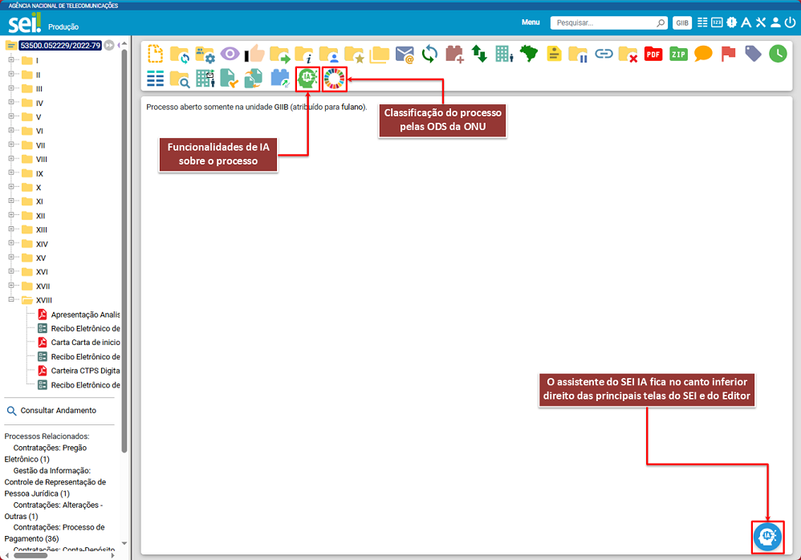

## Recomendação de Processos Similares

A recomendação de processos similares foi a primeira funcionalidade desenvolvida para o SEI IA. Essa funcionalidade utiliza técnicas de Inteligência Artificial para sugerir processos semelhantes com base no conteúdo dos documentos e metadados do processo visualizado no SEI. Inicialmente, a recomendação é baseada em termos relevantes, utilizando a técnica BM25, implementada no Solr por meio do Apache Lucene e seu recurso MoreLikeThis (MLT). Essa técnica permite encontrar documentos semelhantes a um documento específico fornecido como consulta.

Essa funcionalidade é especialmente útil quando se deseja encontrar conteúdo relacionado sem saber exatamente quais palavras-chave usar. Para adaptar essa técnica ao SEI, o MLT foi complementado para passar a considerar pesos na formação de query, nos metadados e nos dados, permitindo utilizar pesos parametrizados que consideram metadados, seções e documentos relevantes de um processo, atuando como ponderadores no cálculo final das sugestões fornecidas. Chamamos essa modificação no MLT de Weightedx2 MoreLikeThis (**W2MLT**).

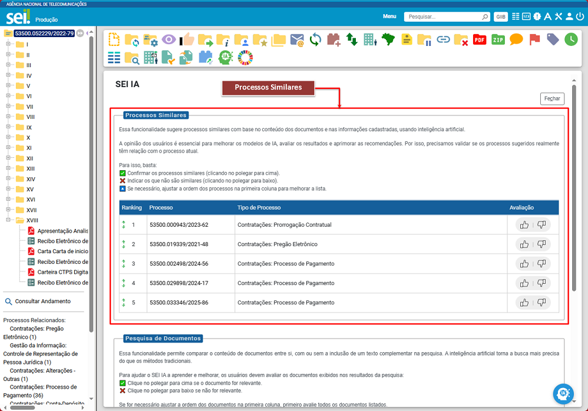

## Recomendação de Documentos Similares

A segunda funcionalidade do SEI IA permite a pesquisa por confronto de conteúdo de documentos. Isso pode ser feito tanto com a inserção de texto complementar quanto sem ela. Utilizando técnicas de Inteligência Artificial, a pesquisa se torna mais assertiva em comparação com técnicas tradicionais. Assim como na recomendação de processos, a recomendação de documentos similares também utiliza o **W2MLT**, com pesos parametrizados que consideram metadados e seções dos documentos.

Além disso, é possível fornecer recomendações de documentos considerando não apenas documentos do SEI, mas também um texto de pesquisa fornecido pelo usuário, além de poder restringir as recomendações a determinados tipos de documentos de interesse.

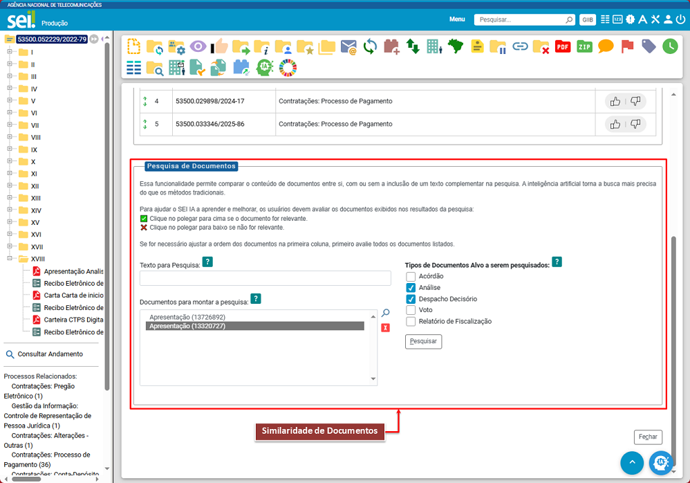

Após preencher os critérios de pesquisa e acionar o botão “**Pesquisar**”, uma janela exibirá a listagem dos documentos similares encontrados. Para contribuir com o aprendizado ativo do SEI IA, os usuários devem avaliar os documentos apresentados na janela de resultado da pesquisa, confirmando sua relevância clicando no ícone de polegar para cima ou para baixo. Caso a ordem dos documentos listados na janela de resultado possa ser melhorada, antes de mudar o ranking na primeira coluna, é necessário avaliar todos os documentos listados.

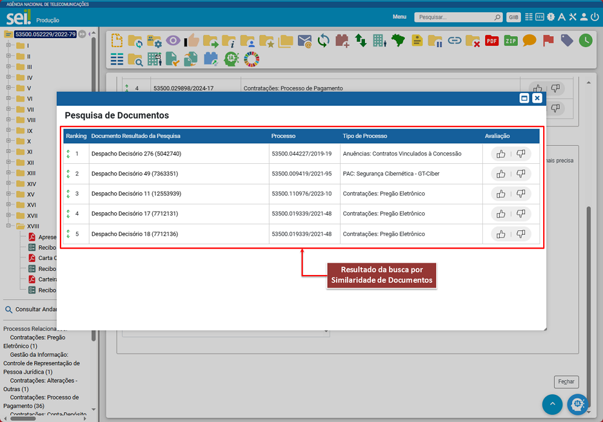

## Classificação de Processos pelos ODS da ONU

Essa funcionalidade classifica processos segundo os Objetivos de Desenvolvimento Sustentável (ODS) da ONU para a Agenda 2030\. Os ODS são um apelo global para acabar com a pobreza, proteger o meio ambiente e o clima e garantir que as pessoas, em todos os lugares, possam desfrutar de paz e prosperidade ([https\://brasil.un.org/pt-br/sdgs](https://brasil.un.org/pt-br/sdgs)).

Ao clicar no ícone de cada ODS é possível visualizar a última classificação realizada por usuário interno (**ícone colorido**), classificação sugerida pelo SEI IA pendente de avaliação (**ícone colorido com destaque "IA"**) e classificação sugerida por Usuário Externo pendente de avaliação (**ícone colorido com destaque de Usuário Externo**). A avaliação deve confirmar ou não as sugestões de classificação realizadas.

Quando o ícone estiver cinza sem destaque, significa que não existe histórico de classificação. Um ícone cinza com destaque, que simboliza histórico, significa que atualmente não possui classificação efetiva ou sugerida, mas tem histórico de classificações anteriores. Na janela de classificação aberta sobre cada Objetivo, caso disponível, é possível acessar o histórico de classificação correspondente.

**Atenção**: Ainda não foi desenvolvida solução de IA para analisar o conteúdo dos documentos e sugerir automaticamente classificações pelos ODS. Atualmente, usuários internos estão fazendo classificações reais em volume representativo para viabilizar testes com diversas técnicas e algoritmos. A disponibilização de solução de IA para sugestões automáticas de classificações será lançada em versão futura do módulo.

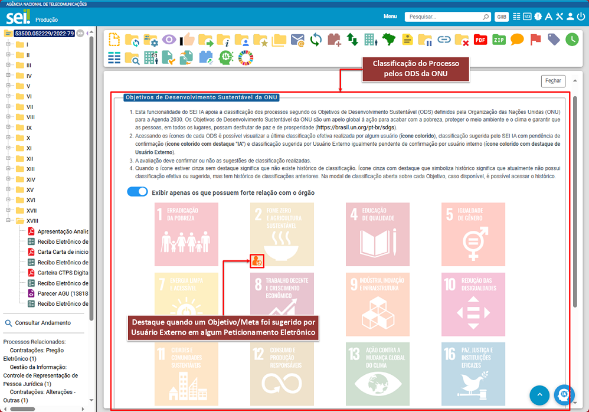

Se a administração do SEI tiver ativado a “*Fase de Avaliação Especializada por Racional*”, será obrigatório preencher o campo “**Racional**” ao realizar classificações, desclassificações e confirmação ou não de sugestões de classificações feitas por IA ou por Usuários Externos ao realizarem peticionamentos eletrônicos.

Essa etapa é provisória e essencial para desenvolver algoritmos de IA mais precisos. O usuário deve explicar a lógica da escolha da meta para o ODS, indicando os documentos e trechos correspondentes que justificam a escolha da meta.

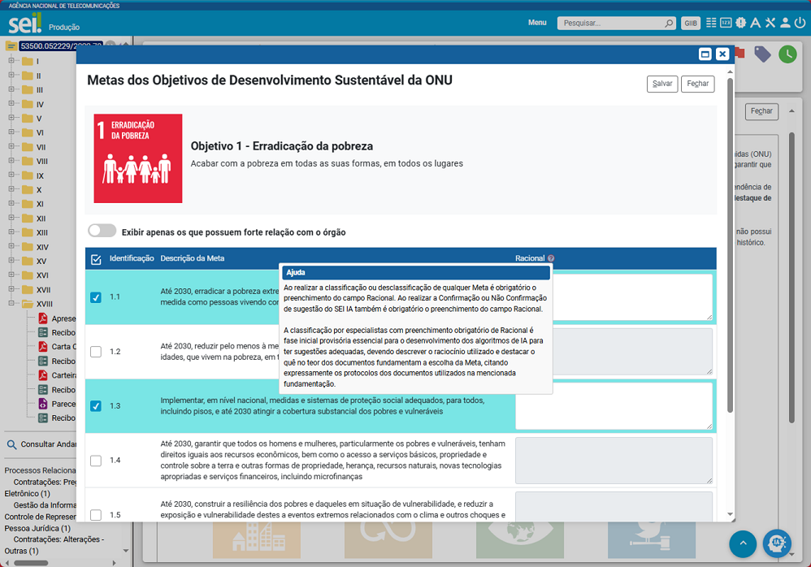

Se houver sugestão de classificação realizada por Usuário Externo em um peticionamento eletrônico, o Objetivo terá ícone de destaque para alertar internamente que é apenas uma sugestão, pendente de avaliação. Ao abrir a janela do ODS com essa sugestão, o sistema informa a meta com sugestão pendente de avaliação, para ser confirmada ou rejeitada.

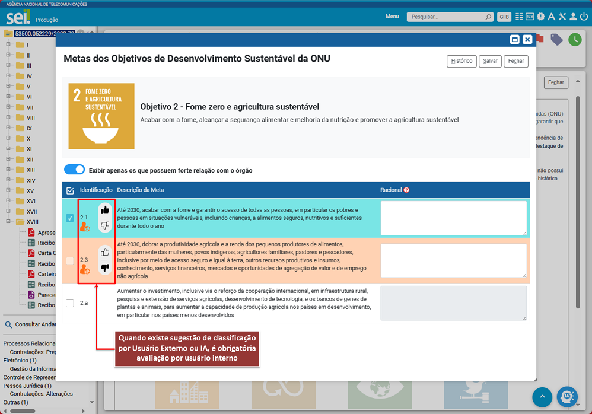

## Assistente

| O assistente do SEI IA representa uma inovação significativa para otimização e agilidade na Administração Pública. Ele foi concebido para oferecer funcionalidades essenciais que auxiliam os usuários na execução de tarefas variadas de forma eficiente e intuitiva, tanto no âmbito dos processos eletrônicos quanto em outras atividades diárias. Dotado de capacidades avançadas de interpretação e escrita, baseadas nos Grandes Modelos de Linguagem (LLMs), o assistente utiliza tecnologia de ponta para realizar análises, traduções, revisões de documentos, criação de resumos, elaboração de conteúdo jornalístico, entre outras tarefas demandadas pelo usuário. Sua interface acessível permite interações via chat, proporcionando uma experiência de usuário simplificada e produtiva, além de garantir a segurança da informação segundo as regras de acesso do SEI e demais requisitos tecnológicos. Embora seja uma ferramenta poderosa, é importante destacar que o assistente não foi treinado com dados específicos de qualquer órgão público. Assim, ele não substitui o conhecimento especializado dos usuários. A utilização consciente do assistente é fundamental para explorar todo o seu potencial, garantindo benefícios substanciais. Sobre ferramentas de IA Generativa gratuitas, destacam-se exemplos como o [ChatGPT](https://chatgpt.com/) (OpenAI), [Gemini](https://gemini.google.com/) (Google), [Claude](https://claude.ai/) (Anthropic) e [Copilot](https://copilot.microsoft.com/) (Microsoft). Essas plataformas demonstram o potencial da IA Generativa para fornecer respostas precisas e contextualmente relevantes em diversos cenários. Entretanto, é fundamental reconhecer que ferramentas gratuitas na internet não são adequadas para uso corporativo, devido aos riscos de segurança e privacidade envolvidos no manuseio de dados institucionais. [ChatGPT](https://chatgpt.com/) (OpenAI): é uma ferramenta versátil de IA Generativa, porém, ao utilizar a versão gratuita, o usuário deve ter em mente que os dados fornecidos (prompts e arquivos) podem ser utilizados para aprimorar os serviços e treinar novos modelos de IA da empresa, conforme descrito na [Política de Privacidade da OpenAI](https://openai.com/pt-BR/policies/privacy-policy/). [Gemini](https://gemini.google.com/) (Google): de acordo com a [Política de Privacidade do Google](https://policies.google.com/privacy?hl=pt-BR), os dados dos usuários são coletados para fornecer, manter e melhorar os serviços, bem como desenvolver novos. Isso significa que informações inseridas no Gemini gratuito podem ser utilizadas para treinamento e refinamento de modelos de IA. [Claude](https://claude.ai/) (Anthropic): também oferece suporte a diversas tarefas, mas, segundo a [Política de Privacidade da Anthropic](https://www.anthropic.com/legal/privacy), os dados fornecidos pelos usuários (prompts e respostas geradas) podem ser aplicados na melhoria dos serviços e no treinamento de seus modelos de IA. [Copilot](https://copilot.microsoft.com/) (Microsoft): projetado para facilitar tarefas diárias, utiliza dados fornecidos pelos usuários (prompts e interações) para melhorar os serviços da empresa e treinar modelos de IA, conforme disposto na [Política de Privacidade da Microsoft](https://www.microsoft.com/pt-br/privacy/privacystatement). No ambiente corporativo, a regra é a garantia de segurança e privacidade dos dados institucionais, algo que apenas serviços contratados sob política de privacidade própria podem oferecer. | 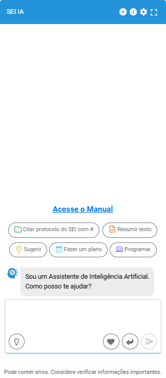 |
| :---- | :---: |

Atualmente, o assistente do SEI IA faz uso da API do GPT-4.1 por meio do Azure OpenAI Service da Microsoft. Por se tratar de um serviço comercial e regido por um contrato específico, assegura-se que os conteúdos transmitidos (prompts e respostas) sejam tratados com alta confidencialidade e segurança, sem serem utilizados para treinamento ou melhoria de modelos da Microsoft ou de terceiros. Esse compromisso, descrito em [Azure OpenAI Data Privacy](https://learn.microsoft.com/pt-br/legal/cognitive-services/openai/data-privacy?tabs=azure-portal), reforça que:

*Your prompts (inputs) and completions (outputs), your embeddings, and your training data:*

* *are NOT available to other customers.*  
* *are NOT available to OpenAI.*  
* *are NOT used to improve OpenAI models.*  
* *are NOT used to train, retrain, or improve Azure OpenAI Service foundation models.*  
* *are NOT used to improve any Microsoft or 3rd party products or services without your permission or instruction.*  
* *Your fine-tuned Azure OpenAI models are available exclusively for your use.*

  *The Azure OpenAI Service is operated by Microsoft as an Azure service; Microsoft hosts the OpenAI models in Microsoft’s Azure environment and the Service does NOT interact with any services operated by OpenAI (e.g. ChatGPT, or the OpenAI API).*

Ainda, o [Privacy & Security Terms da Microsoft](https://www.microsoft.com/licensing/terms/product/PrivacyandSecurityTerms/EAEAS) reforça o compromisso de proteger os dados dos clientes, garantindo que todas as informações sejam mantidas em segurança. Órgãos públicos como AGU e TCU adotaram a mesma abordagem, desenvolvendo soluções com o LLM do Azure OpenAI Service.

Conforme pode ser observado no tópico [Arquitetura do Assistente](#arquitetura-do-assistente) deste manual, para além de uma simples implementação de integração via API com um LLM, a eficácia do assistente é resultante de uma abordagem projetada para lidar com grandes volumes de conteúdos, garantindo que funcione de maneira precisa, eficiente, segura **e totalmente desacoplada da API de LLM utilizada**.

O assistente do SEI IA permite a utilização de qualquer API de LLM que seja devidamente integrada à solução, não estando restrito ao Azure OpenAI Service da Microsoft.

Apenas por motivos de viabilização do desenvolvimento inicial do assistente, de acesso imediato à API do GPT-4.1 por meio do Azure OpenAI Service da Microsoft, da segurança reconhecida sobre a referida API e da viablidade de sua contratação como serviço por meio de representante comercial no Brasil é que o referido LLM foi inicialmente integrado ao assistente do SEI IA.

Desde que a Anatel tenha acesso a outras APIs de LLMs comerciais no Brasil para fins de desenvolvimento e uso, será possível integrar outras IAs Generativas ao assistente do SEI IA.

Em resumo, o assistente possibilita o acesso não apenas aos benefícios avançados da IA Generativa, mas permite seu uso organizacional de maneira segura e eficiente, integrado aos conteúdos dos processos eletrônicos, promovendo confiança e eficácia no ambiente corporativo.

Com a implementação dessa tecnologia inovadora, o SEI IA reforça o compromisso da Anatel com a modernização e eficiência operacional, facilitando o trabalho diário dos servidores e promovendo uma gestão mais ágil e precisa, além de distribuir a solução para qualquer órgão que utilize o SEI.

Destacamos que o assistente:

* **Não** foi treinado com dados do órgão. A base de treinamento é a original do GPT-4.1.  
* **Não** conversa genericamente com o SEI do órgão.  
* **Não** ensina o uso do SEI.

A versão atual do assistente abrange:

* Uso geral: funciona como um ChatGPT corporativo para diversas necessidades.  
* Possui uma interface intuitiva de chat.  
* Aciona funcionalidades específicas do SEI para:  
  * Interações citando variados documentos por prompt (usando \# antes e colado ao protocolo de cada documento).  
  * Interações citando um processo por prompt (usando \# antes e colado ao protocolo do processo).  
* Funcionalidades de sua interface:  
  * Nomear, arquivar e desarquivar tópicos.  
  * Favoritar Prompts.  
  * Galeria de Prompts.  
  * Ativar modelo de Reflexão.

Evoluções previstas:

* Buscar na Web.  
* Conectar bases de conhecimento.  
* Agentes Personalizados.

Com as funcionalidades atuais, citando ou não documentos do SEI, o assistente pode:

* **Resumir** textos ou documentos.  
* **Destacar** pontos principais de interesse.  
* **Explicar** qualquer assunto em que esteja trabalhando.  
* **Criar minutas** de texto para qualquer necessidade (como discursos, instruções processuais, despachos, etc.), para ajustes no seu uso efetivo.  
* **Reescrever textos**, seguindo um estilo novo ou mesmo com melhorias gramaticais ou linguísticas.  
* **Traduzir textos** de e para variados idiomas, com ou sem contexto temático.  
* **Elaborar textos** jornalísticos para publicação de matérias no portal do órgão.  
* **Avaliar** respostas de diligências.  
* **Ampliar ideias** por meio de *brainstorming* com temas relacionados a determinado assunto.  
* **Produzir títulos e slogans** que geram maior engajamento.  
* **Tirar dúvidas** sobre algum tema.  
* **Alavancar conhecimento** sobre assuntos desconhecidos.  
* **Auxiliar com diversas linguagens de programação**, como Python e SQL, ajudando a construir ou corrigir erros em seus códigos.  
* **Desenvolver** fórmulas no Excel.

Sempre tenha em mente a premissa: “***Se o assistente responder errado, melhore o prompt***”.

* A tecnologia de IA Generativa é avançada, mas ainda não possui capacidade de telepatia. Se não escrever em detalhes **o que se quer** e **como quer**, a ferramenta não adivinhará o que lhe agrada.

O objetivo deste manual é ensinar a tirar o melhor proveito possível do assistente, de forma responsável, utilizando a tecnologia de IA Generativa para ampliar produtividade.

### Materiais Introdutórios

Para uma melhor contextualização, compreensão e aplicação prática do assistente do SEI, recomenda-se inicialmente a familiarização com os temas de IA Generativa e Engenharia de prompts a partir de dois materiais introdutórios: "[IA Generativa para Todos](https://www.coursera.org/learn/generative-ai-for-everyone)" e "[Descubra a Engenharia de Prompts](https://www.youtube.com/watch?v=jNNatjruXx8)"; ambos com opção de legenda em Português.

O curso "[IA Generativa para Todos](https://www.coursera.org/learn/generative-ai-for-everyone)" é oferecido gratuitamente pela DeepLearning.AI e explora o que é a IA Generativa, uma tecnologia disruptiva que já impacta diversos setores, facilitando desde a criação de conteúdos até a automação de tarefas complexas. O aprendizado supervisionado e a previsão de palavras são conceitos chave abordados, com ênfase na capacidade dos LLMs de reescrever textos e apoiar processos criativos e analíticos.

O vídeo "[Descubra a Engenharia de Prompts](https://www.youtube.com/watch?v=jNNatjruXx8)" do Google AI Essentials foca na formulação precisa de instruções para obter respostas relevantes de modelos de IA. A importância de prompts bem elaborados é destacada para garantir resultados precisos, relevantes e imparciais, especialmente ao lidar com a criação de conteúdos, sumarização de informações e outras aplicações críticas. São discutidos os riscos associados, como vieses nos dados de treinamento e respostas incorretas da IA.

Ambos os materiais enfatizam a necessidade de compreender as capacidades e limitações das IA Generativas para maximizar sua eficácia operacional. A integração dessas tecnologias nos fluxos de trabalho corporativos visa otimizar processos e melhorar a eficiência, promovendo uma interação mais intuitiva e produtiva entre humanos e IA.

### Introdução sobre IA Generativa

A Inteligência Artificial Generativa está transformando a interação entre humanos e máquinas ao capacitar sistemas para compreender e gerar linguagem humana de maneira avançada. Modelos como o GPT (*Generative Pre-trained Transformer*) são utilizados para realizar tarefas complexas como tradução de idiomas, análise de sentimentos e criação de conteúdo textual refinado.

É importante compreender os Grandes Modelos de Linguagem (Large Language Models \- LLMs), como o GPT, que têm capacidade para processar uma ampla gama de informações e entender relações linguísticas complexas. A arquitetura de rede neural Transformer, baseada no princípio da atenção descrito no artigo "[*Attention Is All You Need*](https://arxiv.org/abs/1706.03762)", é essencial para o funcionamento eficaz da IA Generativa. Essa estrutura permite que a IA processe grandes volumes de dados textuais com precisão e eficiência.

No entanto, por mais potentes e capazes que possam parecer, esses modelos não possuem consciência própria e não substituem o julgamento humano em decisões éticas ou críticas. Por isso, é fundamental reconhecer as limitações dos LLMs, que podem gerar respostas imprecisas devido à sua natureza probabilística e à dificuldade em capturar nuances sutis e contextuais.

### Interface do Assistente

O assistente pode ser acessado por um ícone no **canto inferior direito** das principais telas do SEI e do Editor.

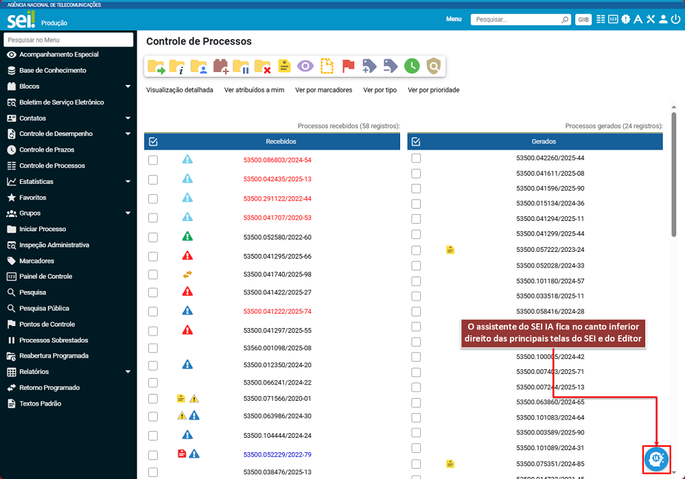

Ao clicar no ícone, o assistente abre em modo reduzido. O usuário pode inserir diretamente seus prompts na área de digitação. Na primeira interação do dia, se não houver selecionado previamente um tópico existente, o sistema cria um novo tópico automaticamente. No canto superior direito do assistente, há botões de ação. O primeiro botão alterna entre modo reduzido e expandido.

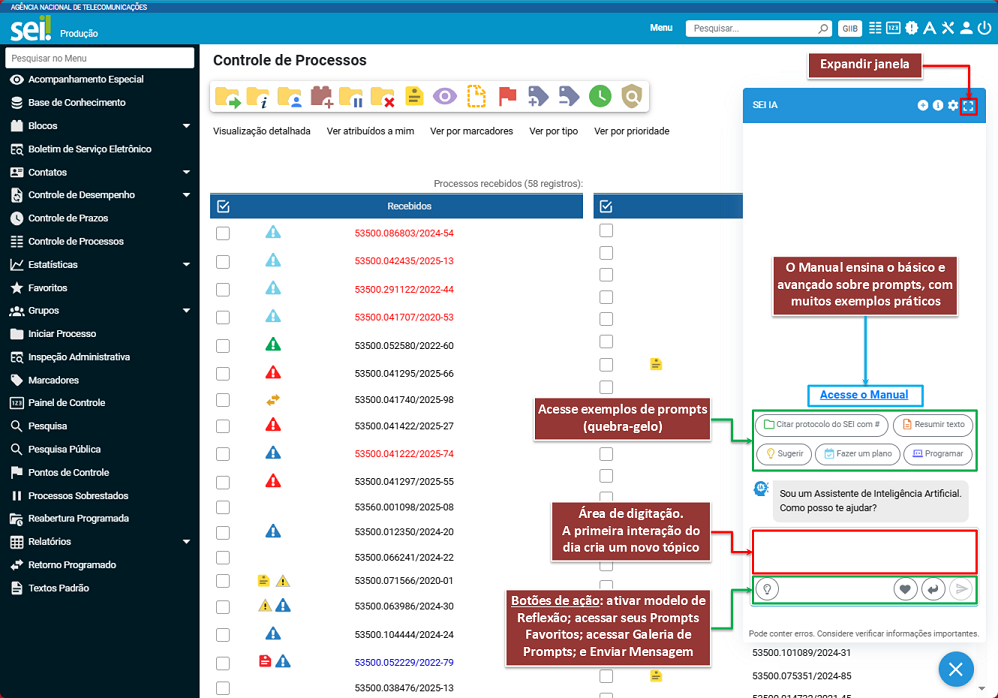

No modo expandido, a coluna à esquerda mostra a lista de tópicos do usuário. Para melhor organização, recomenda-se renomear os tópicos por assunto ou tarefa e criar novos tópicos sempre que tratar de temas diferentes. As mensagens só podem ser vistas pelo próprio usuário e apenas na Unidade onde foram criadas. Se o usuário acessar outra Unidade, verá outro conjunto de tópicos e mensagens.

**Aviso Importante**: O uso de qualquer resposta do assistente é de responsabilidade exclusiva do usuário. Verifique sempre as informações antes de usá-las. A tecnologia de inteligência artificial generativa pode parecer muito correta e convincente, mesmo quando está completamente errada.

Assim como ocorre quando um usuário utiliza texto obtido de qualquer fonte, a responsabilidade sobre seu teor passa a ser exclusiva do usuário que copiou e colou o texto, ajustando-o ou não. O usuário assume como seu o texto, sob sua exclusiva responsabilidade, independentemente de ter sido assistido por quem quer que seja.

Cada botão de exemplos de prompts (**quebra-gelo**) exibe uma lista com quatro prompts de uso prático, válidos para qualquer instituição. Esses prompts servem como ponto de partida para que o usuário tenha um primeiro contato com o assistente e compreenda melhor como utilizá-lo no dia a dia.

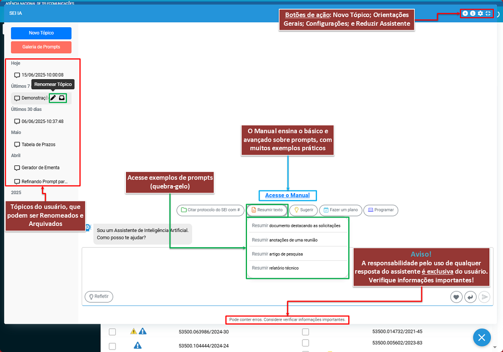

Abaixo de cada **resposta do assistente**, há botões para:

* **Feedback sobre a resposta do Assistente**: importante para melhorar a ferramenta.  
* **Copiar**: copia o conteúdo em formato markdown.

Abaixo de cada **prompt do usuário**, há botões para:

* **Copiar**: copia o prompt.  
* **Favoritar Prompt**: salva o prompt em um grupo pessoal de favoritos.  
* **Publicar na Galeria de Prompts**: compartilha o prompt para que todos da instituição possam usar.

Se o botão **Refletir** estiver disponível, ele pode ser ativado em tarefas que exigem maior precisão, tanto para seguir mais fielmente as instruções do prompt quanto sobre o conteúdo a ser processado. Ao ativar esse botão, o assistente utiliza o modelo **o4-mini**, que produz respostas mais adequadas em casos que exigem rigor, como no uso do prompt [Gerador de Ementa de decisão no modelo padronizado pelo CNJ](#gerador-de-ementa-de-decisão).

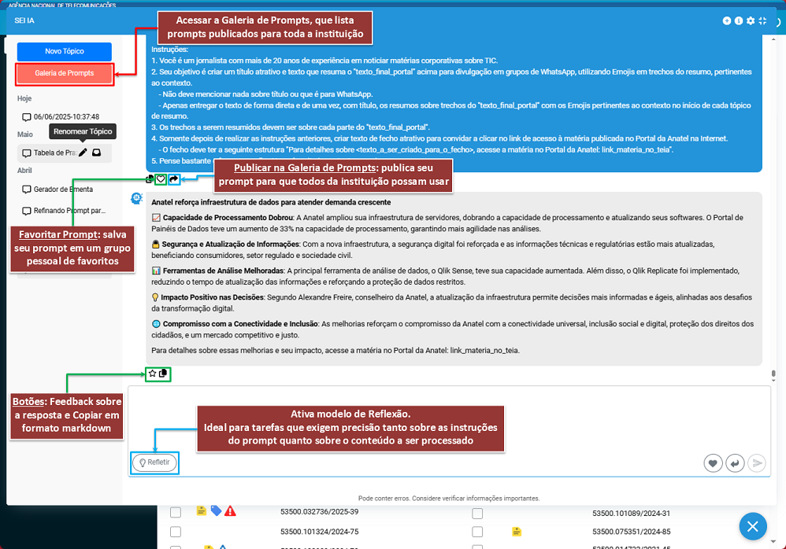

Ao acessar a janela de **Prompts Favoritos**, o usuário pode organizar sua lista de grupos e prompts salvos como favoritos. A qualquer momento é possível reutilizar um prompt, acionando o botão de ação “Transportar” para enviar o conteúdo para a área de digitação do assistente.

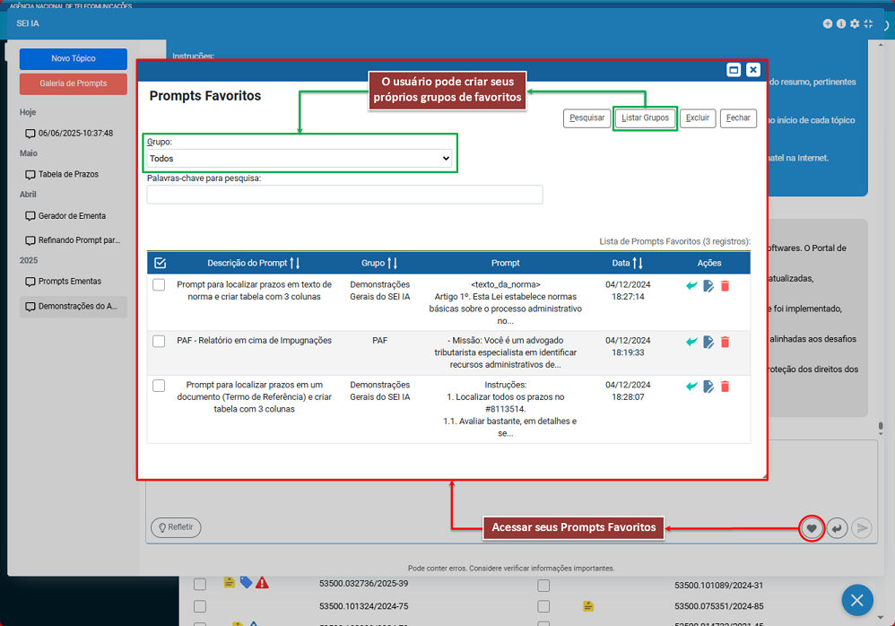

Ao acessar a janela da **Galeria de Prompts**, o usuário pode utilizar qualquer prompt publicado na galeria da instituição, que são organizados por grupos temáticos definidos pela administração do SEI. Além do botão “**Publicar na Galeria de Prompts**” abaixo de cada prompt do usuário, ele também pode criar diretamente sua publicação de prompt utilizando o botão “**Novo**”. A qualquer momento é possível reutilizar um prompt, acionando o botão de ação “Transportar” para enviar o conteúdo para a área de digitação do assistente.

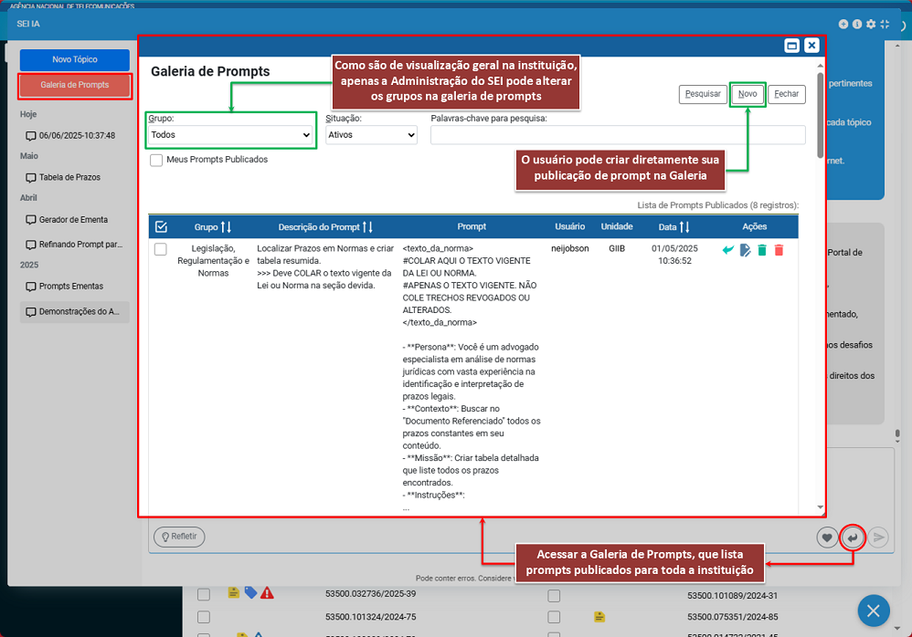

No canto superior direito do assistente, há também um botão de ação que abre a janela “**Orientações Gerais**”. Essa janela traz orientações básicas para o uso adequado do assistente, incluindo um link para acessar este manual.

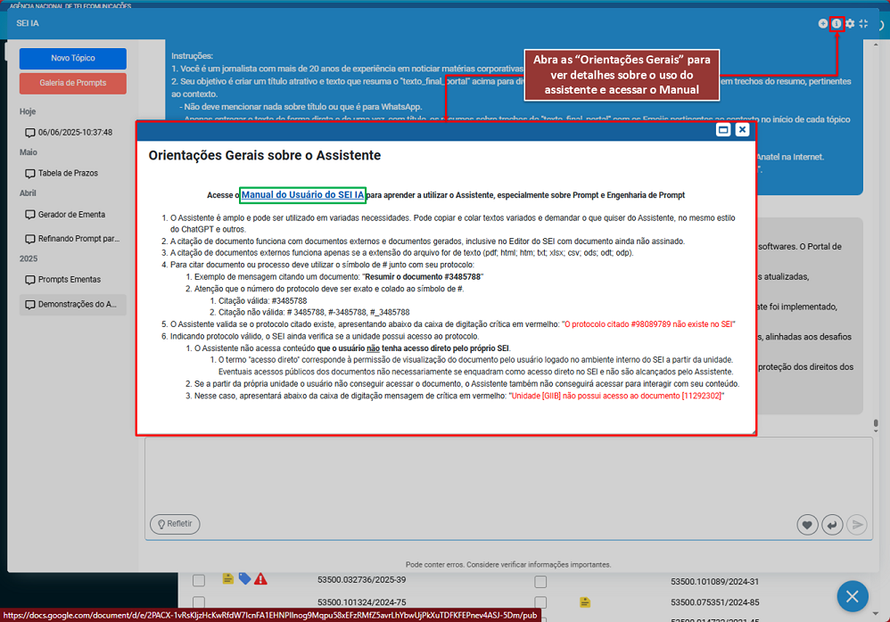

#### Funcionamento do Assistente

O assistente é de uso geral e pode ser utilizado em diversas tarefas. É possível copiar e colar textos variados e demandar o que quiser, no mesmo estilo do ChatGPT e outros assistentes de IA Generativa.

Dentro de um tópico específico você pode interagir com as mensagens mais recentes e suas respostas. O sistema utiliza um mecanismo de memória interna do tópico que permite recuperar e considerar mensagens anteriores nos próximos prompts. O tamanho dessa memória é limitada a 10% do tamanho total da janela de contexto do modelo utilizado. Essa funcionalidade assegura que a interação esteja sempre focada nas mensagens mais relevantes e recentes dentro do tópico, garantindo uma comunicação eficaz e contextualizada.

No que se refere a funcionalidades específicas do SEI, a primeira versão abrange "conversar" com um processo e com um ou vários documentos por mensagem:

* Pode enviar prompts sem citar qualquer documento, citar um ou mais documentos e combinar textos colados citações de processo ou de documento.  
* Ainda vamos evoluir para conversar com o SEI como um todo, sem permitir conversas com conteúdos de documentos aos quais a unidade não tenha acesso.  
* A citação de documento funciona com documentos externos e documentos gerados no Editor do SEI, mesmo os que ainda não foram assinados; desde que a unidade tenha acesso.  
* A citação de documentos externos funciona apenas para as extensões de arquivo: **pdf, html, htm, txt, ods, xlsx, csv, xml, odt, odp, doc, docx, json, ppt, pptx, rtf, xls, xlsm**.

O assistente realiza validações rigorosas para garantir a conformidade das mensagens enviadas pelos usuários, especialmente no que diz respeito à citação de protocolos, segundo as regras de negócio do SEI sobre nível de acesso aos documentos e processos, de forma a não comprometer a segurança da informação. Em hipótese alguma o usuário consegue interagir com o conteúdo de documento que não tenha acesso diretamente pelo SEI a partir da unidade onde esteja logado.

**Validações realizadas pelo Assistente**

1. **Citação de Documento**: Para citar documentos, utilize o símbolo de **\#**, seguido obrigatoriamente por um número de pelo menos 7 dígitos, incluindo zeros à esquerda, que é o padrão inicial para protocolos de documentos no SEI.  
   1. Exemplo de mensagem citando um documento: “**Resumir o documento \#12261106**”  
   2. Atenção: o número do protocolo do documento deve ser exato e colado ao símbolo de **\#**.  
      1. Citação válida: \#12261106  
      2. Citação inválida: \# 12261106, \#-12261106, \#\_12261106  
   3. Qualquer uso de **\#** que não seguir este padrão, retornará a seguinte crítica:  
      1. “O uso do caractere de "\#" é exclusivo para citação de protocolos do SEI, cujo número deve estar colado ao \# (no formato, por exemplo \#01234567). Assim, a mensagem possui citação de protocolo em formato irregular.”  
2. **Citação de Documento Externo PDF com indicação de Intervalo de Páginas**: É possível citar documento externo indicando intervalo específico de páginas sobre o qual o assistente deve se ater para atender ao prompt do usuário.  
   1. Inclua junto ao protocolo do documento citado o intervalo de páginas entre colchetes, da seguinte forma [**inteiro:inteiro**].  
      1. Por exemplo: “**Resumir o documento \#12261106[1:7]**”  
   2. Ou indique a página única de interesse, da seguinte forma **[inteiro]**.  
   3. Qualquer uso de **\#** que contiver a abertura de colchetes colado ao número de protocolo de documento será considerado indicação de intervalo de páginas e exigirá o padrão definido. Se não estiver no padrão, retornará a seguinte crítica:  
      1. “A indicação de intervalo de páginas sobre o Documento Externo está em formato irregular. Deve utilizar o formato [p:p] um intervalo ou [p] para indicar página única: \#12261106[10:15] ou \#12261106[13].”  
   4. A indicação de intervalo de páginas somente funciona para documento externo do tipo PDF. Caso contrário, retornará a seguinte crítica:  
      1. “A indicação de intervalo de páginas sobre Documento Externo para interação com o Assistente de IA está restrita a documentos do tipo PDF.”  
3. **Caracteres especiais junto da citação de protocolo**: A citação de um protocolo pode terminar com um dos seguintes caracteres: ".", ",", ";", ":", "?", "\!", ")", ou "\]".  
   1. Após estes caracteres podem ocorrer espaços em branco, quebras de linha ou o final do prompt.  
4. **Verificação de Existência**: Após as validações de formato, o assistente verifica se o protocolo existe no SEI.  
   1. Se não for encontrado, retornará a seguinte crítica:  
      1. “O protocolo citado \#98089789 não existe no SEI.”  
5. **Verificação de Acesso**: Citado protocolo válido de documento e apenas um por mensagem, o SEI verifica se a unidade possui acesso ao documento.  
   1. O assistente não acessa conteúdo de documento que o usuário não tenha acesso diretamente pelo próprio SEI.  
   2. Se o usuário não tiver acesso ao documento a partir da unidade onde esteja logado, retornará a seguinte crítica:  
      1. “Unidade [sigla\_unidade] não possui acesso ao documento [11292302]”  
6. **Restrições Adicionais na Citação Documentos:**  
   1. A citação de documento gerado não aceita indicação de intervalo de páginas, o que retornará a seguinte crítica:  
      1. “O protocolo indicado se refere a Documento Gerado no SEI, que, por natureza, não aceita indicação de intervalo de páginas para interação sobre seu conteúdo com o Assistente de IA.”  
   2. Para documentos externos, o assistente verifica se a extensão do arquivo é uma das permitidas (**pdf, html, htm, txt, ods, xlsx, csv, xml, odt, odp, doc, docx, json, ppt, pptx, rtf, xls, xlsm**). Caso contrário, retornará a seguinte crítica:  
      1. “O protocolo indicado se refere a Documento Externo de arquivo com extensão não permitida para interação sobre seu conteúdo com o Assistente de IA.”  
7. **Citação de documentos de processos com nível de acesso Sigiloso**: A interação com documentos de processos Sigilosos somente ocorre dentro da tela do correspondente processo já aberto, ou seja, depois de confirmado que o Usuário possui Credencial de Acesso sobre o processo Sigiloso. Se o usuário citar um documento nesse cenário sem estar já dentro do processo Sigiloso, então o assistente retornará a seguinte crítica:  
   1. “Para interagir com o Assistente IA em documentos de Processos com o nível de acesso Sigiloso é necessário que você tenha o acesso e esteja dentro do processo desejado.”  
8. **Restrição relacionada ao limite de tokens diários**: O assistente possui um limite diário por usuário para uso, este limite é parametrizado na administração do SEI. Caso o usuário exceda o limite definido, então o assistente retornará a seguinte crítica:  
   1. “O volume de conteúdo permitido nas interações diárias foi excedido. Tente novamente amanhã, quando o volume de conteúdo permitido para interação terá sido renovado.”  
9. **Restrição relacionada a interação com protocolo de processo e de documento no mesmo prompt**: A interação com protocolo de processo e de documento não é permitida ao mesmo tempo. Caso o usuário cite ambos no mesmo prompt, então o assistente retornará a seguinte crítica:  
   1. “Não é permitida a interação com protocolo de processo e de documento ao mesmo tempo.”  
10. **Restrição relacionada a interação com mais de um protocolo de processo**: A interação com mais de um protocolo de processo não é permitida no mesmo prompt. Caso o usuário cite mais de um no mesmo prompt, então o assistente retornará a seguinte crítica:  
    1. “Não é permitida a interação com mais de um protocolo de processo.”  
11. **Citação de documento externo recente**: Caso o Assistente identifique que em um prompt foi citado um documento externo recente que ainda não foi indexado pelo Solr, então o assistente retornará a seguinte crítica:  
    1. “O documento externo é recente e ainda está pendente de indexação interna pelo SEI. Espere de 1 a 2 minutos para poder interagir.”  
12. **Verificação de acesso em citação de processo**: Citado protocolo válido de processo, o SEI verifica se a unidade possui acesso a algum documento do processo citado. Se o usuário na unidade não tiver acesso a nenhum documento a partir da unidade onde esteja logado, retornará a seguinte crítica:  
    1. “Unidade [sigla\_unidade] não possui acesso a nenhum documento do processo nº [53500.054323/2025-13] ”

### Receios, Resistência e Adaptação à Tecnologia

Ao introduzir uma nova tecnologia, é natural que surjam questionamentos e receios entre os usuários. Um dos principais receios quanto à IA Generativa diz respeito à confiabilidade das informações geradas, especialmente em tarefas críticas para o negócio. A preocupação com vieses e possíveis inconsistências nas respostas da IA também é válida, pois decisões equivocadas podem surgir se não houver uma verificação adequada.

Além disso, a possibilidade de perda de controle e uma dependência excessiva da tecnologia são pontos de apreensão. Muitos se preocupam com a falta de rastreabilidade e com a incapacidade de explicação das respostas fornecidas pela IA, o que pode dificultar a justificação de decisões importantes. Esses receios são compreensíveis, especialmente quando consideramos a complexidade e a inovação inerentes às soluções de IA Generativa.

Entretanto, é essencial superar essa resistência inicial para aproveitar plenamente as vantagens que a IA pode oferecer. **Com medidas de segurança robustas e um treinamento adequado para os usuários**, é possível não apenas adaptar-se à tecnologia, mas também sentir-se confortável em utilizá-la de forma eficaz e segura.

A adoção da IA Generativa não apenas impulsiona inovações, economiza tempo e transforma positivamente a cultura organizacional, mas também representa uma evolução natural em um mundo onde a tecnologia desempenha um papel cada vez mais central.

É fundamental estar aberto às mudanças que a IA Generativa pode trazer, nas dinâmicas sociais e de forma mais ampla no contexto de trabalho. Ao adotar essa tecnologia com mente aberta, é possível não apenas acompanhar, mas liderar o avanço em direção a um futuro onde a IA é uma aliada estratégica na otimização das operações e na melhoria contínua dos processos organizacionais, de forma segura e responsável.

Superar resistência inicial e adaptar-se à nova tecnologia envolve:

* **Abertura para Aprendizagem**: Estar disposto a aprender e explorar as funcionalidades do assistente, aproveitando os recursos disponíveis para melhorar a eficiência do trabalho.  
* **Feedback Contínuo**: Fornecer feedback regular sobre o desempenho do assistente para que melhorias possam ser implementadas continuamente, adaptando a tecnologia às necessidades dos usuários.  
* **Integração com Fluxos de Trabalho**: Integrar o assistente nos fluxos de trabalho diários de forma que complemente e otimize as tarefas, promovendo uma transição suave para a nova tecnologia.

### Uso Responsável e Ético de IA Generativa

Conforme destacado no tópico [Assistente](#assistente), a premissa fundamental para o uso responsável e ético de IA Generativa em ambiente corporativo é a utilização de soluções institucionais, amparadas por contrato e política de privacidade específicos. Essa abordagem assegura que os dados inseridos pelos usuários sejam tratados com confidencialidade, não sejam empregados para treinar modelos de terceiros e não fiquem expostos a potenciais riscos de segurança. Já as ferramentas gratuitas na Internet, embora úteis em contextos pessoais ou gerais, não oferecem as mesmas garantias de privacidade dos dados, tornando-se inviáveis para finalidades corporativas.

A seguir, apresentamos orientações para uso responsável e ético de IA Generativa, com o objetivo de maximizar benefícios, garantir qualidade e confiabilidade, além de assegurar a segurança e privacidade dos dados:

* **Segurança de Dados**: Para proteger informações institucionais, sobretudo as de caráter restrito, é essencial utilizar exclusivamente o assistente corporativo. Ferramentas de terceiros na Internet podem expor dados restritos e aumentar o risco de responsabilização. Ademais, as Políticas de Segurança da Informação e Comunicação dos órgãos devem ser seguidas rigorosamente no uso de qualquer tecnologia de IA Generativa.  
* **Revisão e Avaliação**: Qualquer produção assistida por IA Generativa necessita de revisão e análise criteriosa, alinhada aos princípios gerais da Administração Pública, aos riscos envolvidos e às melhores práticas em vigor.  
* **Responsabilidade do Autor**: O autor de qualquer documento é inteiramente responsável pelo conteúdo final, independentemente de contar com soluções de IA no processo de elaboração. Portanto, cabe-lhe a tarefa de revisar, validar e assumir a autoria do texto. As normas gerais e específicas do órgão continuam vigentes e o uso inadequado da IA não exime o autor de eventuais falhas ou imprecisões.  
* **Proteção e Prevenção**: Para proteger servidores, cidadãos e a própria instituição, é essencial utilizar a IA Generativa em conformidade com os princípios de legalidade, impessoalidade, moralidade, equidade, ética e transparência, bem como com as políticas de não discriminação. Conteúdos considerados inadequados, discriminatórios, incorretos ou que possam causar danos não devem integrar as atividades profissionais.  
* **Revisão Humana**: Toda resposta gerada pela IA precisa passar por uma avaliação humana para verificar sua correção, pertinência e relevância, evitando o fenômeno da “alucinação” — em que a IA pode fornecer informações imprecisas ou sem fundamento.  
  * Nunca utilize respostas da IA sem revisão humana.  
  * Avalie cuidadosamente sua capacidade de identificar inconsistências e falhas.  
* **Medidas Disciplinares**: O descumprimento das orientações sobre uso responsável e ético de IA Generativa pode ensejar medidas disciplinares, conforme previsto nas normas institucionais. Incidentes de segurança decorrentes do uso inadequado podem ser tratados seguindo os processos internos de resposta a incidentes.

### Introdução a Prompts

Para aproveitar ao máximo o assistente do SEI IA, é fundamental compreender o papel e importância dos prompts para interagir de forma eficaz.

**O que é um prompt?**

*É uma instrução, pedido ou estímulo fornecido ao modelo de linguagem para gerar uma resposta específica. Serve como ponto de partida que direciona o tipo de informação desejada. Pode incluir contexto adicional, exemplos e diretrizes de formato.*

Os prompts são cruciais porque orientam o modelo sobre o que escrever, permitindo respostas personalizadas conforme as necessidades do usuário. Por exemplo, ao fornecer um prompt como "***O que é inovação?***", o modelo é capaz de gerar um texto informativo e natural sobre o tema, baseado nos dados e no treinamento recebido.

Prompts eficazes geralmente incluem dados de entrada específicos, exemplos concretos, instruções claras sobre a saída esperada, indicadores estruturais como tags e contexto adicional para enriquecer a compreensão do modelo. Para extrair melhores respostas, é recomendado desafiar o modelo com prompts detalhados e específicos, fornecendo todas as informações pertinentes para a resposta desejada. O usuário deve estar ciente de que quanto mais preciso e claro for o prompt, mais útil será a resposta gerada.

Dominar a arte de formular prompts facilita a interação com o assistente e maximiza a utilidade e eficiência das respostas, promovendo uma experiência mais produtiva e satisfatória. Assim, indicamos uma **regra de ouro** na elaboração de qualquer prompt:

*Ao criar um prompt, pense em como você explicaria a tarefa para uma pessoa ao seu lado. Se a explicação for clara para um humano, provavelmente também será para o modelo de linguagem.*

### Engenharia de Prompts

Engenharia de prompt é a prática de escrever instruções eficazes para que a IA entregue respostas mais úteis e precisas. Dominar essa técnica melhora o diálogo com IA e se tornou uma habilidade essencial. No uso do assistente do SEI IA, aplicar boas práticas na elaboração de prompts garante eficiência, precisão e relevância das respostas.

**Técnicas de Prompts**

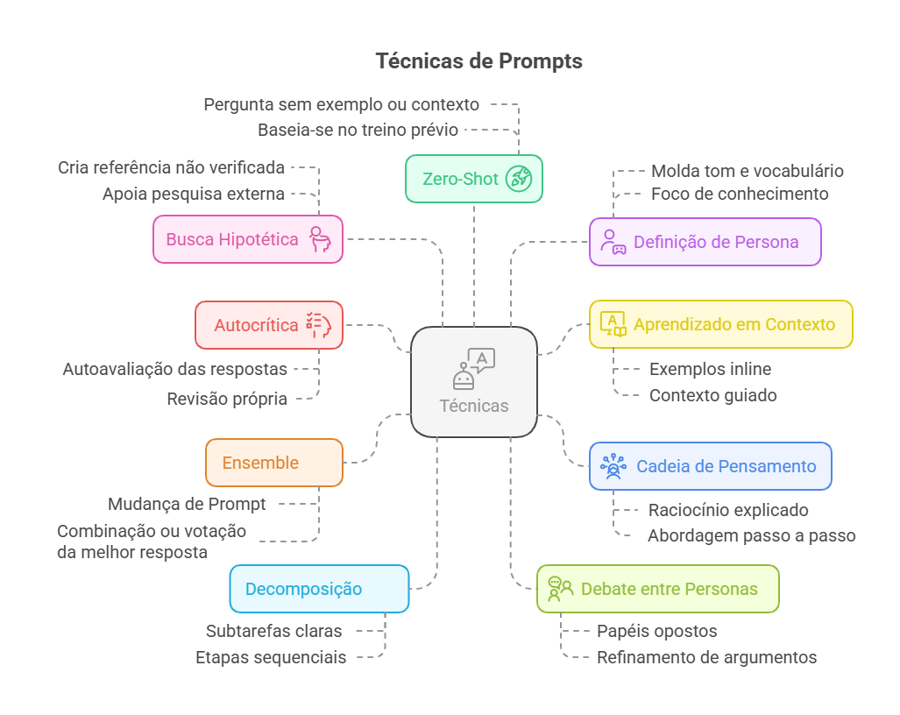

* **Zero-Shot**: Utiliza prompts sem exemplos explícitos, desafiando o modelo a gerar respostas com base em seu treinamento prévio.  
  * Exemplo:

    Classifique o texto em neutro, negativo ou positivo.

    Texto: **Acho que as férias estão boas**. Sentimento: ?

* **One-Shot**: Fornece **um único exemplo** para que o modelo possa imitá-lo e completar a tarefa da melhor forma possível.  
  * Exemplo:

    Classifique o texto em neutro, negativo ou positivo.

    Texto: Que espetáculo horrível\! Sentimento: Negativo

    Texto: **Acho que as férias estão boas**. Sentimento: ?

* **Few-Shot**: Fornece **múltiplos exemplos** (dois ou mais) para que o modelo observe um padrão e o siga na geração da resposta.  
  * Exemplo:

    Classifique o texto em neutro, negativo ou positivo.

    Texto: Isso é incrível\! Sentimento: Positivo

    Texto: Isto é mau\! Sentimento: Negativo

    Texto: Uau, esse filme foi radical\! Sentimento: Positivo

    Texto: Que espetáculo horrível\! Sentimento: Negativo

    Texto: **Acho que as férias estão boas**. Sentimento: ?

  * Exemplo adicional:

    Extraia os endereços do seguinte documento. Um endereço pode conter nome da rua, número, bairro, cidade, estado, país e outros elementos para identificação de localidades. Diferencie corretamente nomes de localidades de nomes de pessoas.

    Exemplos:

    ✅ Entrada: “O evento será na Avenida Paulista, 1000, Bela Vista, São Paulo.”  
    🔹 Saída: “Avenida Paulista, 1000, Bela Vista, São Paulo”

    ✅ Entrada: “Nos encontramos na Rua das Acácias, 250, no centro.”  
    🔹 Saída: “Rua das Acácias, 250, centro”

    ❌ Entrada: “João da Silva mora em São Paulo.”  
    🔹 Saída: Nenhum endereço encontrado

    ❌ Entrada: “Maria passou pela Av Epitácio Pessoa, mas seguiu viagem para Recife.”  
    🔹 Saída: “Av Epitácio Pessoa”

    ✅ Entrada: “Estamos localizados na Alameda Santos, 745, Jardim Paulista.”  
    🔹 Saída: “Alameda Santos, 745, Jardim Paulista”

    Documento: \#[13893791](https://sei.anatel.gov.br/sei/modulos/pesquisa/md_pesq_documento_consulta_externa.php?HWH32bONvibUcMC3mewfUpIX7e-9fyZZC4iEjI2QHwXAoLCOrVZwNzRf5vR3YcCMWNZ4eCgQDLmVzIOFPcg7RjAA7C1SaBePE07kCYrOrAyp3q34cwA8Zb57BYEUsen9)

* **Definição de Persona**: Diz ao modelo “quem” ele deve representar (ex.: um advogado sênior, um professor ou um redator publicitário) para moldar o tom, o vocabulário e o foco de conhecimento da resposta, adequando-a ao público e ao objetivo do usuário.  
  * Exemplo sem persona:

    Forneça conselhos sobre gerenciamento do tempo e como lidar com tantas tarefas surgindo de toda parte e a todo tempo.

  * Exemplo com persona:

    Você é um coach de produtividade com vasta experiência em consultorias para CEOs e executivos de sucesso.

    Forneça conselhos sobre gerenciamento do tempo e como lidar com tantas tarefas surgindo de toda parte e a todo tempo.

* **Aprendizado em Contexto**: Incorpora exemplos e instruções diretamente no prompt, ajudando o modelo a entender melhor o contexto da solicitação. Esta abordagem também se manifesta ao fornecer ao modelo detalhes ou informações de fundo relevantes para a conversa ou tarefa atual, permitindo que ele adapte sua resposta de acordo com as nuances do que foi solicitado. Acesse [Exemplos de prompts do tipo Aprendizado em Contexto](#exemplos-de-prompts-do-tipo-aprendizado-em-contexto).  
* **Cadeia de Pensamento**: Estimula o modelo a articular seu processo de raciocínio, pensando em cadeia como abordar o problema passo a passo. Pode (**a**) simplesmente incluir no meio do prompt a frase “***Vamos pensar passo a passo***”; (**b**) adicionar questionamentos de reflexão interna de como algo funciona ou é estruturado; e (**c**) demandar escrever explicitamente os passos para orientar seguir eles na estruturação da resposta final.  
  * Exemplo (**a**):

    Quando eu tinha 3 anos, meu irmão tinha o triplo da minha idade. Agora, tenho 20 anos. Quantos anos tem meu irmão? **Vamos pensar passo a passo**.

  * Exemplo (**b**) \- prompt completo em [Exemplo de aplicação do Modelo de Prompt Perfeito](#exemplo-de-aplicação-do-modelo-de-prompt-perfeito):

    …

    \- Antes, tenha em consideração os seguintes pontos ao realizar sua análise, passo a passo:

    	\- O que é um recurso administrativo de impugnação?

    	\- Qual é a estrutura comum de um recurso administrativo de impugnação?

    	\- Como identificar essa estrutura no Documento Referenciado?

    …

  * Exemplo (**c**):

    Dado o seguinte documento jurídico, siga passo a passo o raciocínio para encontrar alegações:

    1\. Pense quais são os principais passos para analisar um documento jurídico e precisamente identificar as alegações e suas informações importantes para um julgamento.

    2\. **Escreva** os principais passos identificados.

    3\. Siga os passos identificados de forma cautelosa, devendo sempre pensar em como melhorar os passos seguintes diante das informações dos passos já escritos.

    Documento: \#0242855[17:39]

    Responda de forma estruturada:

* **Debate entre Personas**: Faz o modelo assumir papéis **opostos** (ex.: proponente x crítico) que dialogam ou avaliam mutuamente suas respostas, refinando argumentos e gerando uma solução mais robusta.  
  * Exemplo \- **Persona 1 (advogado)**:

    Você é um **advogado**, com vasto conhecimento jurídico sobre processos de contratação de mão de obra para prestação de serviços de business intelligence e ciência de dados.

    Contexto: 

    	\- Estudo Técnico Preliminar da Contratação de TI \#[6701662](https://sei.anatel.gov.br/sei/modulos/pesquisa/md_pesq_documento_consulta_externa.php?eEP-wqk1skrd8hSlk5Z3rN4EVg9uLJqrLYJw_9INcO4LcLwIj4Zo2imEoIP_ppekcFSmhTlQGtHmHyVOhfJVJ-SnPsvyx5x_7c7GXUO2YPGCmSmatTvH24kgYkTyxhso)

    	\- Informe \#[7654511](https://sei.anatel.gov.br/sei/modulos/pesquisa/md_pesq_documento_consulta_externa.php?eEP-wqk1skrd8hSlk5Z3rN4EVg9uLJqrLYJw_9INcO4TKq6ryIS2XK-ADIqmbh0MTZuu706rrOM75z9BXm6Xc2GD8cnTescKeTMQmsE5afHHq29CmEHAoMYPCjeEvANX)

    	\- Minuta de Termo de Referência \#[6701667](https://sei.anatel.gov.br/sei/modulos/pesquisa/md_pesq_documento_consulta_externa.php?eEP-wqk1skrd8hSlk5Z3rN4EVg9uLJqrLYJw_9INcO6RCrF5T58LO80G0AK1ZybNyGs3KlmjnKehqH1kmSy2XRQbK-gGVB5w1eLJEBdQWzUS3j2Zgy9UUVDPEe0EcFMu)

    	\- Parecer \#[8106432](https://sei.anatel.gov.br/sei/modulos/pesquisa/md_pesq_documento_consulta_externa.php?eEP-wqk1skrd8hSlk5Z3rN4EVg9uLJqrLYJw_9INcO4VhhQXdRs3pJCyz6LbTc7wXZp98-BBaxdPxZO6ZygXBeNby7pQmEhN57PRavWrXLQpVleNPNuQTHFVyBaUqzfi)

    O item 61 do Parecer define: Recomenda-se, ainda que o tipo de licitação seja menor preço global, que o administrador avalie a possibilidade de haver proposta por itens, sendo, assim, vencedora a licitante que cotar o menor preço global, considerando os valores individuais aplicados para cada item, conforme o caso. 

    Avalie criteriosamente o item 61 do Parecer e os documentos citados acima, buscando elementos nos documentos que demonstrem que a recomendação já foi atendida, pensando em justificativas que podem ser apresentadas. 

    Com base nos documentos e na sua análise, então escreva três respostas objetivas para o item 61.

  * Exemplo \- **Persona 2 (procurador)**:

    Agora assuma que você é o **procurador** federal responsável pela escrita do Parecer.

    Contexto: 

    	\- Estudo Técnico Preliminar da Contratação de TI \#[6701662](https://sei.anatel.gov.br/sei/modulos/pesquisa/md_pesq_documento_consulta_externa.php?eEP-wqk1skrd8hSlk5Z3rN4EVg9uLJqrLYJw_9INcO4LcLwIj4Zo2imEoIP_ppekcFSmhTlQGtHmHyVOhfJVJ-SnPsvyx5x_7c7GXUO2YPGCmSmatTvH24kgYkTyxhso)

    	\- Informe \#[7654511](https://sei.anatel.gov.br/sei/modulos/pesquisa/md_pesq_documento_consulta_externa.php?eEP-wqk1skrd8hSlk5Z3rN4EVg9uLJqrLYJw_9INcO4TKq6ryIS2XK-ADIqmbh0MTZuu706rrOM75z9BXm6Xc2GD8cnTescKeTMQmsE5afHHq29CmEHAoMYPCjeEvANX)

    	\- Minuta de Termo de Referência \#[6701667](https://sei.anatel.gov.br/sei/modulos/pesquisa/md_pesq_documento_consulta_externa.php?eEP-wqk1skrd8hSlk5Z3rN4EVg9uLJqrLYJw_9INcO6RCrF5T58LO80G0AK1ZybNyGs3KlmjnKehqH1kmSy2XRQbK-gGVB5w1eLJEBdQWzUS3j2Zgy9UUVDPEe0EcFMu)

    	\- Parecer \#[8106432](https://sei.anatel.gov.br/sei/modulos/pesquisa/md_pesq_documento_consulta_externa.php?eEP-wqk1skrd8hSlk5Z3rN4EVg9uLJqrLYJw_9INcO4VhhQXdRs3pJCyz6LbTc7wXZp98-BBaxdPxZO6ZygXBeNby7pQmEhN57PRavWrXLQpVleNPNuQTHFVyBaUqzfi)

    Considerando as três respostas objetivas fornecidas acima, ao prompt anterior, escreva uma avaliação para cada resposta apresentada pelo advogado, avaliando se a resposta atende o item 61 do Parecer. 

    Caso a avaliação seja negativa, apresente críticas para cada resposta com avaliação negativa apresentada pelo advogado. Também apresente sugestões de melhorias.

* **Autocrítica**: Permite que o modelo critique seus próprios resultados, contribuindo para melhorar a qualidade da resposta. Foca na avaliação interna e **reflexão** do modelo sobre seu próprio processo ou resultado, buscando uma melhoria qualitativa de uma única linha de raciocínio. É como o modelo “pensando por si mesmo” antes de finalizar uma resposta.  
  * Exemplo:

    Dado o seguinte documento jurídico, siga passo a passo o raciocínio para encontrar alegações:

    	1\. Identifique o tipo de documento e as partes envolvidas.

    	2\. Extraia trechos contendo alegações feitas pelas partes.

    	3\. Classifique cada alegação.

    	4\. Verifique se há fundamentação legal ou probatória para cada alegação.

    	5\. Gere um resumo das alegações encontradas, suas partes e a fundamentação legal apresentada.

    	6\. Avalie o resultado gerado, identifique possíveis melhorias, escreva um novo texto contendo apenas as melhorias identificadas. Mas, se não identificar melhorias, apenas informe que não foram identificadas.

    	7\. Se foram identificadas melhorias, reescreva o texto, aplicando as melhorias

    Documento: \#[12261106](https://sei.anatel.gov.br/sei/modulos/pesquisa/md_pesq_documento_consulta_externa.php?8-74Kn1tDR89f1Q7RjX8EYU46IzCFD26Q9Xx5QNDbqbg7QFK7XTqNvBs24TS0cgCJb3XW_oGkX7dGnG7ugdXFfdVsQTst0xwmLYS92QUS1aOiyRmtUqGPJvyu6fRKq1I)

    Responda de forma estruturada:

* **Busca Hipotética**: Faz o modelo criar uma referência ou resposta plausível (ex.: jurisprudência, artigo, termo técnico) ainda não verificada, servindo como parâmetro de pesquisa em bases externas para localizar fontes reais correspondentes.  
  * Exemplo:

    Você é um Ministro do TCU, com vasto conhecimento jurídico e sobre processos de contratação de mão de obra para prestação de serviços de business intelligence e ciência de dados.

    Contexto: 

    	\- Estudo Técnico Preliminar da Contratação de TI \#[6701662](https://sei.anatel.gov.br/sei/modulos/pesquisa/md_pesq_documento_consulta_externa.php?eEP-wqk1skrd8hSlk5Z3rN4EVg9uLJqrLYJw_9INcO4LcLwIj4Zo2imEoIP_ppekcFSmhTlQGtHmHyVOhfJVJ-SnPsvyx5x_7c7GXUO2YPGCmSmatTvH24kgYkTyxhso)

    	\- Informe \#[7654511](https://sei.anatel.gov.br/sei/modulos/pesquisa/md_pesq_documento_consulta_externa.php?eEP-wqk1skrd8hSlk5Z3rN4EVg9uLJqrLYJw_9INcO4TKq6ryIS2XK-ADIqmbh0MTZuu706rrOM75z9BXm6Xc2GD8cnTescKeTMQmsE5afHHq29CmEHAoMYPCjeEvANX)

    	\- Minuta de Termo de Referência \#[6701667](https://sei.anatel.gov.br/sei/modulos/pesquisa/md_pesq_documento_consulta_externa.php?eEP-wqk1skrd8hSlk5Z3rN4EVg9uLJqrLYJw_9INcO6RCrF5T58LO80G0AK1ZybNyGs3KlmjnKehqH1kmSy2XRQbK-gGVB5w1eLJEBdQWzUS3j2Zgy9UUVDPEe0EcFMu)

    	\- Parecer \#[8106432](https://sei.anatel.gov.br/sei/modulos/pesquisa/md_pesq_documento_consulta_externa.php?eEP-wqk1skrd8hSlk5Z3rN4EVg9uLJqrLYJw_9INcO4VhhQXdRs3pJCyz6LbTc7wXZp98-BBaxdPxZO6ZygXBeNby7pQmEhN57PRavWrXLQpVleNPNuQTHFVyBaUqzfi)

    O item 61 do Parecer define: Recomenda-se, ainda que o tipo de licitação seja menor preço global, que o administrador avalie a possibilidade de haver proposta por itens, sendo, assim, vencedora a licitante que cotar o menor preço global, considerando os valores individuais aplicados para cada item, conforme o caso. 

    Escreva uma jurisprudência sobre a possibilidade de licitações com diversos itens, onde as propostas não são feitas por item e será vencedora a licitante que cotar o menor preço global, considerando os valores individuais aplicados para cada item.

  * Com a “*jurisprudência*” **inventada** a partir do prompt acima é possível pesquisar na internet para localizar fontes reais. No exemplo real acima foram localizadas as fontes abaixo:  
    * [https\://licitacoesecontratos.tcu.gov.br/3-4-1-menor-preco/](https://licitacoesecontratos.tcu.gov.br/3-4-1-menor-preco/)  
    * [https\://11e.com.br/nas-licitacoes-tipo-menor-preco-por-lote-a-administracao-deve-observar-o-valor-unitario-dos-itens/](https://11e.com.br/nas-licitacoes-tipo-menor-preco-por-lote-a-administracao-deve-observar-o-valor-unitario-dos-itens/)  
    * [https\://www\.gov.br/compras/pt-br/acesso-a-informacao/noticias/global](https://www.gov.br/compras/pt-br/acesso-a-informacao/noticias/global)  
* **Decomposição**: Quebra uma tarefa grande em várias pequenas e sequenciais, de modo que resolva cada parte separadamente com mais compreensão e foco, depois juntando tudo em uma resposta final mais clara e precisa.  
* **Ensemble**: Combina várias respostas diferentes para a mesma questão (ex.: mudando o prompt, a persona ou o público-alvo) e depois escolhe, combina ou deixa o próprio modelo “votar” **nos melhores trechos**. O resultado final reúne o que cada versão tem de mais forte, ficando mais completo e confiável.  
* **Autoconsistência**: A ideia central é experimentar múltiplos e diversos caminhos de raciocínio por meio da técnica de Cadeia de Pensamento (CoT) com poucos exemplos (few-shot CoT) e, em seguida, utilizar as gerações resultantes para **selecionar a resposta mais consistente entre elas**, funcionando como uma “votação da maioria” para aumentar a robustez e correção.

**Diretrizes para criar prompts eficazes**

1. **Começar simples**: Inicie com prompts simples e adicione complexidade gradualmente para entender melhor as respostas e ajustar conforme necessário.  
2. **Atribuir persona**: Define ao modelo um papel específico (ex.: advogado sênior) para orientar seu estilo, vocabulário e domínio de conhecimento, tornando as respostas mais relevantes e adequadas.  
3. **Objetivo bem definido**: Tenha uma visão precisa do que deseja obter na resposta e dos critérios para avaliar sua qualidade. Um objetivo bem definido facilita a criação de prompts direcionados e eficazes.  
4. **Instruções diretas e claras**: Seja direto e específico para evitar ambiguidades, indicando com precisão a tarefa e o resultado desejado. Por exemplo, em vez de pedir para "resumir um documento", especifique os elementos específicos a serem destacados no resumo, como o solicitante, o pedido principal e a data da solicitação. Isso direciona o modelo de maneira clara, aumentando as chances de obter a resposta que se espera.  
5. **Contexto**: Explique o contexto para facilitar a compreensão do pedido.  
6. **Encorajar reflexão e conhecimento especializado**: Incentive o assistente a refletir, reconhecer limites, buscar evidências e consultar conhecimento especializado antes de responder.  
7. **Dê tempo para “pensar”**: Permita tempo para o assistente analisar a tarefa com atenção e cuidado, principalmente em questões complexas. Isso estimula o assistente a refletir como um especialista na área antes de responder, fornecendo explicações mais detalhadas e fundamentadas.  
8. **Exemplos**: Forneça exemplos de resposta esperada, tanto positivos quanto negativos.  
9. **Forneça texto de referência**: Envie textos de referência quando necessário, para apoiar a resposta em informações confiáveis e contextualizadas. Por exemplo, antes de solicitar a redação de um documento, peça para revisar um modelo de documento existente e basear a resposta nesse modelo ajustado. Isso reduz o risco de "invenções" e aumenta a precisão das respostas.  
10. **Divida tarefas complexas em subtarefas**: Em casos de tarefas complexas é aconselhável dividir em etapas menores, com instruções claras para cada parte.  
11. **Definir formato de resposta**: Especifique formato, tamanho, tom e estilo da resposta que deseja receber.  
12. **Formate em Markdown**: Use [Markdown](https://www.markdownguide.org/basic-syntax/#lists-1) para estruturar melhor o prompt, destacar partes importantes e indicar a formatação desejada para a resposta. Isso melhora a legibilidade para os usuários e ajuda o modelo a entender melhor a estrutura do prompt e da resposta.  
13. **Delimitadores**: Use delimitadores no estilo de tags XML **&lt;nome\_da\_tag&gt;**conteúdo**&lt;/nome\_da\_tag&gt;** para identificar seções importantes do prompt. Isso ajuda o modelo a distinguir claramente diferentes partes do prompt.  
14. **Avaliação e ajuste constantes**: Avalie, teste e ajuste os prompts de modo contínuo para aperfeiçoar os resultados.

**Erros comuns que devem ser evitados**

1. **Vaguidade e ambiguidade**: Prompts vagos ou ambíguos podem resultar em respostas imprecisas. Para evitar isso, seja específico e claro na solicitação e forneça exemplos quando necessário.  
2. **Excesso de informação**: Incluir informações desnecessárias pode confundir. Mantenha o prompt conciso e direto ao ponto para evitar sobrecarga com detalhes irrelevantes.  
3. **Falta de contexto**: Omitir informações contextuais relevantes leva a respostas inadequadas. Forneça informações contextuais suficientes para garantir compreensão completamente da tarefa.  
4. **Uso de linguagem complexa**: Utilizar linguagem excessivamente técnica ou complexa pode gerar má interpretação. Utilize linguagem simples e acessível para garantir compreensão correta.  
5. **Não especificar formato ou tipo de resposta**: Não indicar o formato ou tipo de resposta esperado pode levar a resultados insatisfatórios. Defina claramente o formato e as características da resposta esperada.  
6. **Ignorar ajustes e refinamentos**: Não ajustar e refinar os prompts pode resultar em respostas de baixa qualidade. Siga um processo iterativo de ajuste até obter resposta na qualidade desejada.  
7. **Não testar**: A falta de testes pode resultar em erros e inconsistências. Revise cuidadosamente o prompt e teste-o com diferentes exemplos para garantir que produza resultados consistentes.  
8. **Desconhecimento do modelo**: Não conhecer as limitações e capacidades pode levar à formulação de prompts ineficazes. Familiarize-se com as capacidades do modelo para criar prompts mais adequados.

Seguir as diretrizes e evitar os erros comuns listados aumenta a qualidade das respostas e torna a interação com a IA mais produtiva. Pratique, teste e refine seus prompts para aproveitar todo o potencial da IA Generativa.

### Modelo de Prompt Perfeito

O modelo de prompt perfeito proporciona uma estrutura versátil e eficiente que orienta o usuário em situações diversas e complexas de uso de ferramentas de IA Generativa. O modelo usa técnicas de engenharia de prompts para facilitar a definição clara a persona, contexto, tarefa/objetivo, restrições, instruções, formato, exemplos e documento referenciado.

Ao usar este modelo, considere três pontos principais: a finalidade exata da ação que deve ser realizada; o formato esperado para a resposta; e as restrições que devem ser respeitadas.

Antes, vejamos um resumo das boas práticas em engenharia de prompts:

* Use **verbos no infinitivo ou imperativo** para garantir comunicação direta e sem ambiguidade.  
* **Peça atenção**: faça o seu melhor; seja cuidadoso; seja cauteloso; seja criterioso.  
* **Faça apelo emocional**: isso é muito importante para mim; isso é muito importante para meu órgão.  
* Dê **exemplos positivos e negativos** para otimizar a resposta esperada.  
* Deixe claro que pode usar o tempo necessário para **pensar antes de responder**, sem pressa.  
* Deixe expresso que **não deve inventar nada**.  
* **Seja detalhista**; mesmo o que parece ser óbvio precisa ser escrito.  
* **Não repita os mesmos termos** em trechos distintos; use sinônimos quando possível. Repetir apenas para reforçar algo importante.  
* Tenha **consciência da diferença entre termos**: “**listar** informações” é diferente de “**transcrever** texto”.  
* **Use [Markdown](https://www.markdownguide.org/basic-syntax/#lists-1)** para estruturar melhor o prompt, destacar partes importantes e indicar formatação desejada.  
* Use **delimitadores** no estilo de tags XML para identificar melhor seções importantes do prompt.  
* **Decomponha tarefas** complexas em etapas simples usando prompts intermediários.

#### Texto sem formatação do modelo

Segue o modelo de prompt perfeito em texto simples, para facilitar copiar e colar em um editor texto:

&lt;exemplo\_1\_boa\_ementa&gt;  
\#aqui colete o texto longo de exemplo  
&lt;/exemplo\_1\_boa\_ementa&gt;

&lt;exemplo\_2\_boa\_ementa&gt;  
\#aqui colete o texto longo de exemplo  
&lt;/exemplo\_2\_boa\_ementa&gt;

**\# Persona**  
texto.

**\# Contexto**  
texto.

**\# Tarefa/Objetivo**  
texto.

**\# Restrições**  
\- texto.  
\- texto.

**\# Instruções**  
\- texto.  
\- texto.

**\# Formato**  
\- texto.  
\- texto.

**\# Exemplos**  
Considere o conteúdo entre as tags &lt;exemplo\_1\_boa\_ementa&gt; e &lt;/exemplo\_1\_boa\_ementa&gt; e tags &lt;exemplo\_2\_boa\_ementa&gt; e &lt;/exemplo\_2\_boa\_ementa&gt; APENAS como bons exemplos de estilo, padrão e formatação esperados.

**\# Documento Referenciado**  
\#protocolo

#### Orientações de uso do modelo de prompt perfeito

* **Persona**: Defina o papel especializado que a IA deve assumir, adicionando detalhes específicos sobre experiência e perfil.  
  * Exemplos:  
    * Você é um jornalista especializado no setor de telecomunicações com mais de 20 anos de experiência.  
    * Você é um advogado tributarista com mais de 20 anos de experiência, especializado na análise cautelosa de recursos administrativos.  
* **Contexto**: Descreva o cenário geral ou situação relevante que possa direcionar a resposta a suas necessidades, agregando informações indiretas à Persona ou à Tarefa/Objetivo.  
  * Não passe contexto irrelevante ou que se confunda com a Persona ou a Tarefa/Objetivo.  
  * Podem ser informações sobre:  
    * Localização da persona (se informou que é um “encanador”, é aqui que poderia explicar que é um “encanador serviços residenciais” ou “encanador que atende a Rodoviária X”).  
    * **Público-alvo** da resposta (especialista em direito, adolescente, criança).  
    * Setor econômico dos destinatários do texto.  
    * Setor e nome do órgão onde a persona trabalha.  
    * Objeto do que vai ser escrito (livro técnico, romance, literatura de cordel).  
* **Tarefa/Objetivo**: Defina o objeto principal a ser produzido e o resultado esperado.  
  * Deixe explícito como medir o sucesso (ex. “convencer”, “educar”, “gerar ideias”).  
  * Exemplos:  
    * Gerar um Relatório Técnico sobre o texto demandado utilizando os princípios do ITIL.  
    * Redigir ementa de decisão sobre o Documento Referenciado.  
    * Criar relatório detalhado sobre os principais elementos do recurso administrativo de impugnação contra crédito tributário apresentado pelo interessado. O relatório será utilizado na instrução do processo administrativo fiscal correspondente, passando por avaliação profunda pelas autoridades competentes do meu órgão público.  
* **Restrições**: Indique expressamente o que não quer que seja feito.  
  * Exemplos:  
    * Não invente nada.  
    * Se baseie exclusivamente no conteúdo do Documento Referenciado.  
    * Caso alguma informação não conste no Documento Referenciado, indique expressamente "Informação não encontrada".  
    * Não reescreva trechos entre aspas.  
    * Não invente dispositivos de legislação ou jurisprudência.  
* **Instruções**: Especifique em detalhes o que deve ser feito, passo por passo.  
  * Quer escrever algo específico em uma ordem específica?  
  * Quer que o texto a ser escrito tenha títulos específicos?  
  * Quer textos grandes ou curtos?  
  * Quer usar algum estilo linguístico específico?  
  * Quer que use uma linguagem complexa, técnica ou simples?  
* **Formato**: Defina o formato ou a formatação de como quer a resposta.  
  * Se é para um Tweet, capítulo de livro, post de blog.  
  * Se deve segmentar em seções.  
  * Usar ou não lista, ordenada ou não ordenada.  
  * Pode informar um limite, por exemplo, de 10 mil palavras.  
* **Exemplos**: É muito útil passar exemplos positivos e negativos do que se espera. (**seção opcional**)  
  * Se os exemplos forem textos longos, deve utilizar delimitadores no estilo de tags XML para identificar os exemplos:  
    * &lt;exemplo\_1&gt;*texto do exemplo 1*&lt;/exemplo\_1&gt;  
    * &lt;exemplo\_2&gt;*texto do exemplo 2*&lt;/exemplo\_2&gt;

* **Documento Referenciado**: \#protocolo (**seção opcional**)

  * Se quiser utilizar o conteúdo de um documento ou processo do SEI, deve indicar o protocolo no formato “\#protocolo”.

#### Exemplo de aplicação do Modelo de Prompt Perfeito

Abaixo é apresentado exemplo de aplicação do modelo de prompt perfeito sobre o documento externo SEI nº [12261106](https://sei.anatel.gov.br/sei/modulos/pesquisa/md_pesq_documento_consulta_externa.php?8-74Kn1tDR89f1Q7RjX8EYU46IzCFD26Q9Xx5QNDbqbg7QFK7XTqNvBs24TS0cgCJb3XW_oGkX7dGnG7ugdXFfdVsQTst0xwmLYS92QUS1aOiyRmtUqGPJvyu6fRKq1I), constante no processo nº [53500.058416/2024-28](https://sei.anatel.gov.br/sei/modulos/pesquisa/md_pesq_processo_exibir.php?92AHliMZAlcgWWxm2w2qy-GDVz335h7FYd_mrGCDn9UEi2XStDTUZKOJ_damneHH9mwnSMIjw0l3j23hD04TstwSg22C6K1dpejq7XcRqi07j7P2lf2sEw3XYDZelf5P). é possível ver abaixo o prompt e mais abaixo veja a qualidade da resposta dada pelo assistente.

**\# Persona**  
Você é um advogado tributarista com mais de 20 anos de experiência, especializado na análise cautelosa de recursos administrativos.

**\# Contexto**  
Analisar impugnação apresentada pelo interessado contra cobrança de crédito tributário em processo administrativo fiscal aberto pelo meu órgão.

**\# Tarefa/Objetivo**  
\- Criar relatório detalhado sobre os principais elementos do recurso administrativo de impugnação contra crédito tributário apresentado pelo interessado.  
\- O relatório será utilizado na instrução do processo administrativo fiscal correspondente, passando por avaliação profunda pelas autoridades competentes do meu órgão público.

**\# Restrições**  
\- Não invente nada.  
\- Se baseie \*\*exclusivamente\*\* no conteúdo do Documento Referenciado.  
\- Caso alguma informação não conste no Documento Referenciado, indique expressamente "Informação não encontrada".

**\# Instruções**  
\- O Documento Referenciado contém um recurso administrativo de impugnação apresentado pelo interessado em processo administrativo fiscal aberto contra ele.  
\- Lembre-se que pode acontecer de você não identificar alguma informação no conteúdo do Documento Referenciado, devendo indicar expressamente "Informação não encontrada".  
\- Antes, tenha em consideração os seguintes pontos ao realizar sua análise, passo a passo:  
	\- O que é um recurso administrativo de impugnação?  
	\- Qual é a estrutura comum de um recurso administrativo de impugnação?  
	\- Como identificar essa estrutura no Documento Referenciado?  
\- Realizar a análise sobre o recurso administrativo de impugnação constante no Documento Referenciado seguindo a seção "Formato" abaixo.  
\- Reserve o tempo necessário para pensar bem e seja cuidadoso, sem pressa.  
\- Isso é muito importante para mim e para meu órgão\!

**\# Formato**  
\- Liste os dados abaixo como itens dentro da seção "\# Principais Fatos do Recurso", explicitando sempre que possível os tipos de créditos que constam no recurso:  
	\- Número da Notificação de Lançamento;  
	\- Nome da Empresa;  
	\- CNPJ;  
	\- Sucessão Empresarial;  
	\- Número do Relatório de Fiscalização;  
	\- Valores Apurados para Contribuição ao FUST no Relatório de Fiscalização;  
	\- Data do Recebimento da Notificação;  
	\- Tempestividade;  
	\- Data da Apresentação da Impugnação;  
	\- Solicitação de Vistas ou Cópia;  
	\- Alegações Apresentadas; e  
	\- Documentos Citados, que comprovem as alegações apresentadas (por exemplo: Notas Fiscais, Contratos, DIPJ).  
\- Liste dentro da seção "\# Transcrições do que Fundamenta cada Alegação Apresentada" as transcrições dos trechos que fundamentam cada uma das "Alegações Apresentadas".  
\- Liste dentro da seção "\# Pedidos" os pedidos aduzidos pelo interessado.  
\- Liste dentro da seção "\# Principais Pontos da Impugnação" os pontos mais relevantes constantes na impugnação.

**\# Documento Referenciado**  
\#[12261106](https://sei.anatel.gov.br/sei/modulos/pesquisa/md_pesq_documento_consulta_externa.php?8-74Kn1tDR89f1Q7RjX8EYU46IzCFD26Q9Xx5QNDbqbg7QFK7XTqNvBs24TS0cgCJb3XW_oGkX7dGnG7ugdXFfdVsQTst0xwmLYS92QUS1aOiyRmtUqGPJvyu6fRKq1I)

Com o prompt acima, veja a resposta completa do assistente:

**Principais Fatos do Recurso**

* Número da Notificação de Lançamento: Notificação FUST nº 001-XXXXXX/2023/AFFO-ANATEL  
* Nome da Empresa: EMPRESA FULANO DE TAL LTDA.  
* CNPJ: 99.888.777/0001-66  
* Sucessão Empresarial: Informação não encontrada  
* Número do Relatório de Fiscalização: Relatório de Fiscalização nº 99999  
* Valores Apurados para Contribuição ao FUST no Relatório de Fiscalização: base de cálculo considerada de R\$ 403.809.876,34 (receita operacional bruta apurada pela fiscalização para o ano-calendário de 2017\)  
* Data do Recebimento da Notificação: 16/08/2021 (doc. 02\)  
* Tempestividade: tempestiva (prazo de 30 dias, art. 15 do Decreto 70.235/72)  
* Data da Apresentação da Impugnação: 23/09/2022 (São Paulo, 23 de setembro de 2022\)  
* Solicitação de Vistas ou Cópia: Informação não encontrada  
* Alegações Apresentadas:  
  1. Violação ao princípio da legalidade e aos procedimentos de lançamento do CTN (Decreto 70.235/72 e art. 142 do CTN) – lançamento eivado de nulidade.  
  2. Imunidade constitucional da CIDE-FUST sobre receitas decorrentes de exportação (CF, art. 149, § 2º, I).  
  3. Inexigibilidade de FUST sobre receitas de serviços acessórios ou complementares à comunicação (outsourcing de redes, locação de equipamentos), não estando na base de cálculo legal.  
  4. Majoração indevida da base de cálculo pela inclusão de receitas não tributáveis ao FUST, sem individualização do fato gerador nem distinção das receitas.  
* Documentos Citados:  
  • Doc. 01 – Procuração, Contrato Social e Comprovante de Inscrição no CNPJ  
  • Doc. 02 – Comprovantes de tempestividade  
  • Doc. 03 – Notificação e Relatório de Fiscalização  
  • Doc. 04 – Planilha com informações das receitas de exportação  
  • Doc. 05 – Notas Fiscais de exportações  
  • Doc. 06 – GIA de ICMS de 2017  
  • Doc. 07 – Notas Fiscais sujeitas ao ISS (serviços complementares)  
  • Doc. 08 – Memória de cálculo da receita operacional de serviços de telecomunicações

**Transcrições do que Fundamenta cada Alegação Apresentada**

1. “A contribuição em tela é um tributo da espécie das contribuições de intervenção no domínio econômico. Como tal, submete-se a todos os princípios reguladores do Sistema Tributário Nacional, estabelecidos nos arts. 145 a 162 da Constituição Federal, dentre eles, um dos mais importantes é o princípio da legalidade, que impede a exigência de tributo sem lei que o estabeleça.” (p. 2\)  
2. “§ 2º. As contribuições sociais e de intervenção no domínio econômico de que trata o caput deste artigo: I – não incidirão sobre as receitas decorrentes de exportação.” (transcrição de art. 149, § 2º, I, CF, p. 4\)  
3. “Conforme consta da legislação da Contribuição ao FUST, a base de cálculo do tributo é a receita bruta auferida pelos contribuintes com a prestação de serviços de comunicação. Deste modo, essa contribuição somente pode incidir sobre receitas decorrentes desses serviços específicos, não estando incluídos os serviços suplementares.” (p. 3\)  
4. “Ao analisar o Relatório de Fiscalização que sustenta o lançamento, verifica-se o fato de os agentes fiscais terem considerado como base da apuração a totalidade da receita bruta operacional da Impugnante, inflando indevidamente a base de cálculo do tributo com valores que não guardam qualquer relação com sua materialidade.” (p. 11–12)

**Pedidos**

* Que seja conhecida e provida a presente impugnação para:  
  a) decretar a nulidade do lançamento (Notificação FUST nº 001-XXXXXX/2023/AFFO-ANATEL, Relatório nº 99999);  
  b) cancelar integralmente os débitos exigidos;  
  c) readequar a base de cálculo do FUST, excluindo receitas de exportação e serviços não comunicação;  
  d) emitir Certidão de Regularidade Fiscal, na forma dos arts. 205 e 206 do CTN.  
* Caso necessário, que sejam determinadas diligências complementares e solicitados documentos adicionais à Impugnante.

**Principais Pontos da Impugnação**

* Tempestividade reconhecida (recebimento em 16/08/2021; impugnação em 23/09/2022).  
* Violação ao princípio da legalidade e aos requisitos de constituição do crédito tributário (CTN, art. 142).  
* Imunidade constitucional das receitas de exportação de serviços de telecomunicações (CF, art. 149, § 2º, I).  
* Inexigibilidade de FUST sobre receitas de serviços complementares (outsourcing de redes, locação de equipamentos).  
* Ausência de individualização do fato gerador e de segregação das receitas tributáveis e não tributáveis no Relatório de Fiscalização.  
* Nulidade e improcedência do auto de infração por vícios formais e materiais no lançamento.

### Aula - Assistente do SEI IA e Engenharia de Prompts

| [Acesse a gravação](https://www.youtube.com/watch?v=Q4oIQBLHKXo) de uma aula completa sobre o assistente do SEI IA, uso responsável de IA generativa, técnicas de prompts e engenharia de prompts. [Acesse os slides da apresentação](https://www.canva.com/design/DAGqoXRJj2Y/GlvF7VPtDapQIIpa4H0hDA/view?utm_content=DAGqoXRJj2Y&utm_campaign=designshare&utm_medium=link2&utm_source=uniquelinks&utlId=hcf1b9870ab). A aula abordou: explicação da interface do assistente breve explicação sobre IA generativa critérios de uso responsável definição de prompt exemplos de uso técnicas de prompts citação de processo e de documentos nos prompts diretrizes para construir prompts eficazes boas práticas em engenharia de prompts explicação do modelo de “Prompt Perfeito” exemplos de prompts avançados utilizando o modelo de “Prompt Perfeito” | [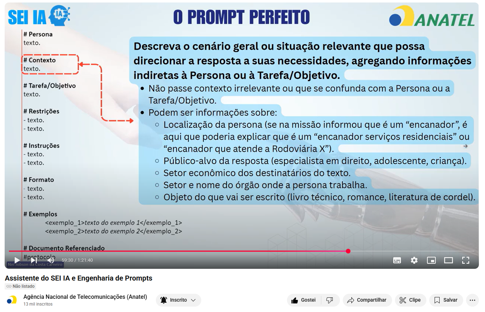](https://www.youtube.com/watch?v=Q4oIQBLHKXo) |
| :---- | :---: |

### Materiais complementares sobre IA Generativa e engenharia de prompts

Para quem quiser acompanhar e se aprofundar mais sobre IA generativa e engenharia de prompts, recomendamos:

* Portal [Prompt Engineering Guide](https://www.promptingguide.ai/pt) (em português)  
* [Manual de Prompts para todos os negócios do Google](https://drive.google.com/file/d/1hj51XbTDHdDuSMyQYVpk4xB0XvcTUukE/view?usp=sharing) (em português)  
* [Manual de Engenharia de Prompts do Google](https://drive.google.com/file/d/13yeD3uaaWQVprvwnyyZjtVuOCsah_Mf3/view?usp=sharing) (em inglês)  
* Curso gratuito [Prompt Engineering – Vanderbilt University](https://www.coursera.org/learn/prompt-engineering) (tradução automática)  
* Paper [A Prompt Pattern Catalog to Enhance Prompt Engineering with ChatGPT](https://arxiv.org/pdf/2302.11382) (em inglês)  
* Paper [The Prompt Report: A Systematic Survey of Prompting Techniques](https://arxiv.org/abs/2406.06608) (em inglês)

### Arquitetura do Assistente

O assistente baseado em inteligência artificial do SEI IA é uma solução abrangente que inclui diversos processos e tecnologias complementares para possibilitar o melhor uso da IA Generativa nos processos eletrônicos e em tarefas cotidianas.

Para além de uma simples implementação de integração via API com um LLM, a eficácia do assistente é resultante de uma abordagem projetada para lidar com grandes volumes de conteúdos, garantindo que funcione de maneira precisa, eficiente, segura **e totalmente desacoplada da API de LLM utilizada**.

O assistente do SEI IA permite a utilização de qualquer API de LLM que seja devidamente integrada à solução, não estando restrito ao Azure OpenAI Service da Microsoft.

Apenas por motivos de viabilização do desenvolvimento inicial do assistente, de acesso imediato à API do GPT-4.1 por meio do Azure OpenAI Service da Microsoft, da segurança reconhecida sobre a referida API e da viablidade de sua contratação como serviço por meio de representante comercial no Brasil é que o referido LLM foi inicialmente integrado ao assistente do SEI IA.

Desde que a Anatel tenha acesso a outras APIs de LLMs comerciais no Brasil para fins de desenvolvimento e uso, será possível integrar outras IAs Generativas ao assistente do SEI IA.

A arquitetura do assistente permite uma interação fluida e útil, aproveitando ao máximo as capacidades da IA Generativa no contexto dos conteúdos dos processos eletrônicos do SEI. Esse design integrado assegura que o sistema possa oferecer suporte eficaz mesmo em cenários de alta demanda, proporcionando respostas e sugestões relevantes para os usuários.

O resultado é uma solução robusta que potencializa significativamente os benefícios da adoção da Inteligência Artificial no contexto dos processos eletrônicos e das tarefas diárias necessárias à Administração Pública.

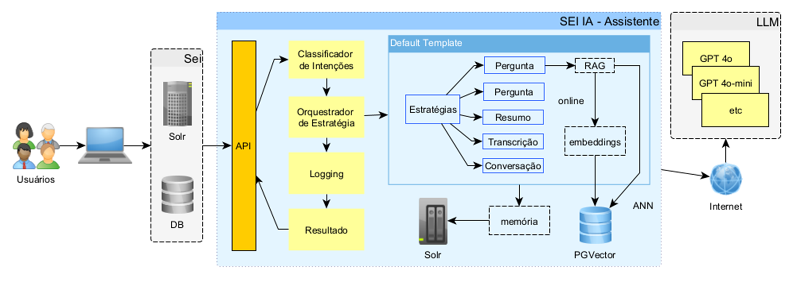

## Exemplos de prompts do tipo Zero-Shot

**1\.**  
**Prompt:**  
Resumir o documento \#[4945518](https://sei.anatel.gov.br/sei/publicacoes/controlador_publicacoes.php?acao=publicacao_visualizar&id_documento=5630078&id_orgao_publicacao=0)  
**Resposta:**  
O documento \#4945518 trata da análise e decisão sobre a anulação do Ato nº 3.982, de 30 de setembro de 2016, que autorizou a empresa R.B. SERVIÇOS DE INFORMÁTICA LTDA a explorar o Serviço de Comunicação Multimídia (SCM). A anulação foi motivada pelo fato de a empresa não ter cumprido uma condição subjetiva essencial para a obtenção da autorização, conforme o art. 133, inciso II, da Lei Geral de Telecomunicações (LGT). A empresa havia sido punida com a sanção de caducidade, que ainda estava vigente no momento da expedição do ato.

A análise concluiu que a Anatel tem o dever de anular atos administrativos com vícios de legalidade, conforme a Lei nº 9.784/1999 e o Regimento Interno da Anatel. O Conselho Diretor da Anatel é a autoridade competente para decidir sobre a anulação, uma vez que o ato foi expedido pelo Superintendente de Outorga e Recursos à Prestação.

A decisão final foi pela anulação do Ato nº 3.982/2016, com determinações adicionais para que a Superintendência de Controle de Obrigações (SCO) tome providências caso identifique descumprimento de obrigações pela empresa, e para que a Superintendência de Outorga e Recursos à Prestação (SOR) adote medidas para a restituição dos valores pagos pela empresa.

Em resumo, o documento detalha o processo de anulação do ato administrativo que autorizou a R.B. SERVIÇOS DE INFORMÁTICA LTDA a explorar o SCM, devido a um vício de legalidade, e as ações subsequentes a serem tomadas pela Anatel.

**2\.**  
**Prompt (mencionando a resposta anterior, acima, do resumo):**  
Reformular a resposta anterior para criar um texto jornalístico para divulgar o conteúdo do referido documento  
**Resposta:**  
**Anatel Anula Autorização de Serviço de Comunicação Multimídia da R.B. Serviços de Informática Ltda**

Em uma decisão recente, a Agência Nacional de Telecomunicações (Anatel) anulou o Ato nº 3.982, de 30 de setembro de 2016, que havia autorizado a empresa R.B. Serviços de Informática Ltda a explorar o Serviço de Comunicação Multimídia (SCM). A medida foi tomada após a constatação de que a empresa não cumpriu uma condição essencial para a obtenção da autorização, conforme estipulado no artigo 133, inciso II, da Lei Geral de Telecomunicações (LGT).

A R.B. Serviços de Informática Ltda havia sido penalizada com a sanção de caducidade, que ainda estava em vigor no momento da expedição do ato. De acordo com a legislação vigente, a Anatel tem a obrigação de anular atos administrativos que apresentem vícios de legalidade, conforme estabelecido pela Lei nº 9.784/1999 e pelo Regimento Interno da agência.

O Conselho Diretor da Anatel, autoridade competente para decidir sobre a anulação, concluiu pela invalidação do Ato nº 3.982/2016. Além disso, foram determinadas ações adicionais para a Superintendência de Controle de Obrigações (SCO), que deverá tomar providências caso identifique descumprimento de obrigações pela empresa. A Superintendência de Outorga e Recursos à Prestação (SOR) também foi instruída a adotar medidas para a restituição dos valores pagos pela empresa.

Essa decisão marca um importante passo na fiscalização e regulação do setor de telecomunicações, reafirmando o compromisso da Anatel com a legalidade e a transparência em suas ações.

**3\.**  
**Prompt:**  
Redigir e-mail para dar conhecimento do documento \#[4945518](https://sei.anatel.gov.br/sei/publicacoes/controlador_publicacoes.php?acao=publicacao_visualizar&id_documento=5630078&id_orgao_publicacao=0)  
**Resposta:**  
Assunto: Conhecimento do Documento \#4945518 \- Análise nº 163/2019/VA

Prezado(a) [Nome do Destinatário],

Espero que esta mensagem o(a) encontre bem.

Gostaria de informar que o documento \#4945518, referente à Análise nº 163/2019/VA, foi concluído e está disponível para sua consulta. O documento trata do Procedimento de Anulação do Ato nº 3.982, de 30 de setembro de 2016, que outorgou autorização para a exploração do Serviço de Comunicação Multimídia (SCM) à empresa R.B. SERVIÇOS DE INFORMÁTICA LTDA.

Segue um resumo dos principais pontos abordados no documento:

1\. **Assunto**: Procedimento de Anulação do Ato nº 3.982, de 30 de setembro de 2016\.  
2\. **Ementa**: Anulação de ato administrativo devido a vício insanável, com base no dever de autotutela da Administração Pública.  
3\. **Fundamentação**: A empresa não preenchia uma condição subjetiva indispensável para a obtenção da autorização, conforme o art. 133, inciso II, da Lei Geral de Telecomunicações (LGT).  
4\. **Decisão**: Declaração de nulidade do Ato nº 3.982/2016 e determinações adicionais para a Superintendência de Controle de Obrigações (SCO) e a Superintendência de Outorga e Recursos à Prestação (SOR).

Para mais detalhes, o documento completo está disponível no sistema SEI.

Caso tenha alguma dúvida ou necessite de mais informações, estou à disposição.

Atenciosamente,

## Exemplos de prompts do tipo Aprendizado em Contexto

**1\.**  
**Prompt:**  
Considere o conteúdo:  
\---  
A ciência de dados (em inglês: data science) é uma área interdisciplinar, que localiza-se em uma interface entre a estatística e a ciência da computação e utiliza o método científico; processos, algoritmos e sistemas, para extrair conhecimento e tomar decisões a partir de dados dos diversos tipos, sendo eles ruidosos, nebulosos, estruturados ou não-estruturados. Sendo assim uma área voltada para o estudo e a análise organizada de dados científicos e mercadológicos, financeiros, sociais, geográficos, históricos, biológicos, psicológicos, dentre muitos outros. Visa, desse modo, a extração de conhecimento, detecção de padrões e/ou obtenção de insights para possíveis tomadas de decisão. Ciência de dados enquanto campo existe há 30 anos, porém ganhou mais destaque nos últimos anos devido a alguns fatores como o surgimento e a popularização de grandes bancos de dados e o desenvolvimento de áreas como machine learning. Cientistas de Dados podem trabalhar no setor privado, por exemplo, transformando grandes quantidades de dados brutos em insights de negócios, auxiliando empresas em tomadas de decisões para atingir melhores resultados[1] ou na academia e terceiro setor como pesquisadores quantitativos interdisciplinares.  
\---  
Com base apenas no conteúdo fornecido, há quanto tempo existe Ciência de Dados?

**Resposta:**  
Com base no conteúdo fornecido, a Ciência de Dados enquanto campo existe há 30 anos.

**2\.**  
**Prompt:**  
Considere o conteúdo:  
\---  
Machado de Assis nasceu em 21 de junho de 1839, no Morro do Livramento, no Rio de Janeiro, então capital do Império, em pleno Período Regencial. Seu pai foi Francisco José de Assis, mulato que pintava paredes, filho de Francisco de Assis e Inácia Maria Rosa, ambos pardos. A mãe foi a portuguesa Maria Leopoldina Machado da Câmara, branca, filha de Estêvão José Machado e Ana Rosa. Os Machado haviam emigrado para o Brasil em 1815, oriundos da Ilha de São Miguel, no arquipélago português dos Açores. Ambos os pais de Machado de Assis sabiam ler e escrever, fato incomum na sua época e classe social. Ambos eram agregados da Dona Maria José de Mendonça Barroso Pereira, esposa do falecido senador Bento Barroso Pereira, que abrigou seus pais e os permitiu morar junto com ela.   
\---  
Com base apenas no conteúdo fornecido, faça uma análise crítica quanto ao local e época em que Machado de Assis nasceu e cresceu.

**Resposta:**  
Machado de Assis nasceu no Morro do Livramento, no Rio de Janeiro, em 21 de junho de 1839, durante o Período Regencial do Império Brasileiro. Essa época é marcada por uma instabilidade política e social, caracterizada pela regência de figuras que assumiram o poder em nome do imperador Pedro II, ainda jovem na época. O contexto político do Período Regencial influenciou profundamente o ambiente social e cultural do Brasil, criando um cenário de tensão e transformação.

O local do nascimento, o Morro do Livramento, era um bairro popular no Rio de Janeiro, e a posição social da família de Machado de Assis era modesta. O fato de seu pai ser um pintor de paredes e sua mãe uma portuguesa pode indicar que a família estava em uma posição econômica relativamente baixa. No entanto, o fato de ambos os pais saberem ler e escrever era raro e significativo para a época e classe social a que pertenciam. Esse fator é relevante, pois contribuiu para o acesso de Machado à educação e, subsequentemente, ao desenvolvimento de suas habilidades literárias.

Adicionalmente, o fato de a família de Machado de Assis ter sido agregada à casa de Dona Maria José de Mendonça Barroso Pereira, uma figura socialmente mais influente, sugere uma rede de apoio e uma certa mobilidade social. Esse apoio pode ter sido crucial para o desenvolvimento intelectual e profissional de Machado de Assis, proporcionando-lhe oportunidades que seriam menos acessíveis para alguém de sua classe social original.

Em suma, Machado de Assis nasceu e cresceu em um ambiente de relativa pobreza e instabilidade política, mas com a vantagem de ter pais alfabetizados e um apoio social que possibilitou sua educação e ascensão intelectual. Esse contexto, portanto, moldou não apenas sua visão de mundo, mas também influenciou profundamente sua obra literária.

**3**.  
**Prompt:**  
Considere o conteúdo:  
\---  
O plano foi organizado com base em cinco eixos: Infraestrutura e Desenvolvimento de IA; Difusão, Formação e Capacitação; IA para Melhoria dos Serviços Públicos; IA para Inovação Empresarial; Apoio ao Processo Regulatório e de Governança da IA.  
\---  
Crie bullets de até 20 palavras sobre cada um dos eixos. Transcreva-os.

Em seguida, sob a ótica de um especialista em IA, escreva um parágrafo sobre cada um dos bullets.

Por fim, crie um parágrafo final sintetizando as ideias principais apresentadas.

**Resposta:**  
**Bullets sobre cada eixo**:

Infraestrutura e Desenvolvimento de IA: Investimento em tecnologias e recursos para suportar a pesquisa e o desenvolvimento de inteligência artificial.

Difusão, Formação e Capacitação: Programas para disseminar conhecimentos sobre IA e oferecer treinamentos especializados para profissionais e acadêmicos.

IA para Melhoria dos Serviços Públicos: Implementação de IA para otimizar a eficiência e a qualidade dos serviços oferecidos pelo governo.

IA para Inovação Empresarial: Uso de IA para fomentar a criatividade, eficiência e competitividade nas empresas e indústrias.

Apoio ao Processo Regulatório e de Governança da IA: Desenvolvimento de diretrizes e regulamentações para assegurar a ética e a transparência na aplicação de IA.

* **Infraestrutura e Desenvolvimento de IA:** Para que a pesquisa e o desenvolvimento de IA avancem, é crucial investir em tecnologias robustas e recursos adequados. Isso inclui a construção de centros de pesquisa, aquisição de hardware de ponta e suporte financeiro para projetos inovadores. A infraestrutura sólida permite não apenas a realização de experimentos complexos, mas também a criação de ambientes colaborativos que impulsionam novas descobertas e aplicações em IA.  
* **Difusão, Formação e Capacitação:** A disseminação de conhecimentos sobre IA e a formação de profissionais qualificados são fundamentais para a evolução do setor. Programas educacionais e treinamentos especializados preparam a próxima geração de especialistas, garantindo que a força de trabalho esteja atualizada com as mais recentes inovações tecnológicas. Além disso, a capacitação contínua ajuda a manter os profissionais engajados e produtivos no campo da IA.  
* **IA para Melhoria dos Serviços Públicos:** A aplicação de IA no setor público pode transformar a prestação de serviços, tornando-a mais eficiente e centrada no usuário. Ferramentas de IA podem automatizar processos burocráticos, melhorar a análise de dados e oferecer soluções personalizadas, resultando em serviços mais rápidos e de maior qualidade para os cidadãos. Este uso estratégico de IA pode também reduzir custos e aumentar a transparência governamental.  
* **IA para Inovação Empresarial:** Empresas que adotam IA podem explorar novas oportunidades de mercado e aprimorar suas operações. A IA pode impulsionar a inovação ao possibilitar a análise de grandes volumes de dados, prever tendências e otimizar processos. Com a integração de IA, as empresas podem criar produtos e serviços diferenciados, aumentar a eficiência operacional e ganhar vantagem competitiva no mercado.  
* **Apoio ao Processo Regulatório e de Governança da IA:** Para garantir que a implementação de IA seja ética e transparente, é essencial desenvolver regulamentações e políticas robustas. O apoio ao processo regulatório inclui a criação de diretrizes que protejam os direitos dos indivíduos e promovam a responsabilidade das entidades que utilizam IA. Um marco regulatório eficaz ajuda a prevenir abusos e assegura que a tecnologia seja usada de maneira justa e segura.

  **Síntese:**

  O plano estruturado em cinco eixos visa fortalecer a área de IA através de investimentos em infraestrutura, capacitação, e inovação. A implementação de IA para melhorar serviços públicos e fomentar a inovação empresarial é crucial para criar uma sociedade mais eficiente e competitiva. Além disso, o desenvolvimento de um suporte robusto ao processo regulatório e de governança assegura que a tecnologia seja utilizada de maneira ética e responsável. Esses esforços combinados prometem impulsionar tanto o crescimento econômico quanto a melhoria da qualidade de vida.

**4\.**  
**Prompt:**  
Considere o conteúdo:

\---

Ein Transformer ist eine von Google entwickelte Deep-Learning-Architektur, die einen sog. Aufmerksamkeitsmechanismus integriert, der erstmals in einem Artikel aus dem Jahr 2017 „Attention Is All You Need“ vorgestellt wurde. Dabei wird Text in numerische Darstellungen umgewandelt, die als Token bezeichnet werden, anschließend durch Worteinbettung in Vektoren umgewandelt. Dies kann z. B. benutzt werden, um Text von einer Sprache in eine andere zu übersetzen. Dazu wird ein Transformer mittels maschinellem Lernen auf einer (großen) Menge von Beispielstexten trainiert, bevor das trainierte Modell dann zur Übersetzung verwendet werden kann. Weitere Beispielanwendungen von Transformern sind die Textgenerierung oder die Zusammenfassung längerer Texte. Transformer weisen hierbei eine bessere Effizienz gegenüber Long-short-term-memory-Architekturen (LSTM) auf und sind die Grundarchitektur des generativen vortrainierten Transformers (GPT) und anderer vortrainierter Machine-Learning-Modelle.

\---

Traduza o conteúdo para o português. Transcreva a tradução.

Em seguida, pense, justifique e forneça cinco temas relacionados ao conteúdo traduzido que possam auxiliar um iniciante no tema a se aprofundar nesse assunto.

**Resposta:**  
Aqui está a tradução para o português do conteúdo fornecido:

Um Transformer é uma arquitetura de Deep Learning desenvolvida pelo Google, que integra um mecanismo de atenção, apresentado pela primeira vez no artigo de 2017 “Attention Is All You Need”. Nessa arquitetura, o texto é convertido em representações numéricas chamadas tokens e, posteriormente, transformado em vetores por meio de embeddings de palavras. Isso pode ser utilizado, por exemplo, para traduzir texto de um idioma para outro. Para isso, um Transformer é treinado usando uma (grande) quantidade de textos de exemplo, e o modelo treinado pode então ser utilizado para a tradução. Outras aplicações dos Transformers incluem a geração de texto e a sumarização de textos longos. Os Transformers apresentam uma eficiência superior em comparação com arquiteturas Long Short-Term Memory (LSTM) e são a arquitetura base do Transformer Generativo Pré-Treinado (GPT) e de outros modelos de Machine Learning pré-treinados.

Aqui estão cinco temas relacionados ao conteúdo traduzido que podem ajudar um iniciante a se aprofundar no assunto:

* **Fundamentos dos Transformers**: Explorar como a arquitetura Transformer funciona, detalhando o mecanismo de atenção e as suas partes principais, como camadas de atenção e feed-forward. Isso ajudará a entender como os Transformers processam e transformam dados.  
* **Embeddings de Palavras e Representações Numéricas**: Estudar como as palavras são convertidas em representações numéricas e vetores, incluindo técnicas como Word2Vec, GloVe e BERT. Compreender esses conceitos é crucial para entender como o Transformer lida com o texto.  
* **Comparação entre Transformers e LSTM**: Analisar as diferenças entre Transformers e Long Short-Term Memory (LSTM) em termos de arquitetura, eficiência e desempenho. Isso ajuda a compreender por que os Transformers superaram os LSTMs em várias aplicações de NLP.  
* **Treinamento e Ajuste de Modelos de Transformers**: Aprender sobre o processo de treinamento de modelos Transformer, incluindo o pré-treinamento e o ajuste fino (fine-tuning), e como esses processos impactam a performance dos modelos em tarefas específicas.  
* **Aplicações de Transformers em NLP**: Explorar diversas aplicações práticas dos Transformers, como tradução automática, geração de texto, e sumarização de texto. Isso inclui examinar casos de uso reais e ferramentas populares que utilizam Transformers, como GPT-3 e BERT.

  Esses temas fornecem uma base sólida e abrangente para quem está começando a aprender sobre Transformers e suas aplicações.

## Galeria de Prompts

Neste tópico listamos prompts que os usuários tenham construído de forma otimizada e com bons resultados em sua área de aplicação.

Centralizamos o versionamento dos prompts avançados no seguinte projeto no GitHub [**https\://github.com/anatelgovbr/prompts**](https://github.com/anatelgovbr/prompts). Nesse repositório, versionamos, organizamos e adicionamos prompts avançados para apoiar atividades de análise, redação, comunicação e conformidade. Os prompts são desenvolvidos principalmente para o SEI IA, mas podem ser adaptados para outras ferramentas de inteligência artificial, conforme o contexto e os recursos disponíveis.

### Localizar Prazos em Documento e Norma

Localiza a definição de prazos em documento citado ou texto de norma colado, criando tabela com o dispositivo, resumo do dispositivo destacando o prazo e o marco de sua contagem e o prazo em si.

[**Clique aqui para acessar a pasta com os prompts**](https://github.com/anatelgovbr/prompts/tree/main/Localizar_de_Prazos)

[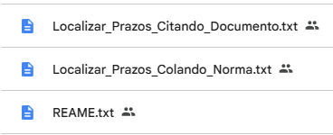](https://github.com/anatelgovbr/prompts/tree/main/Localizar_de_Prazos)

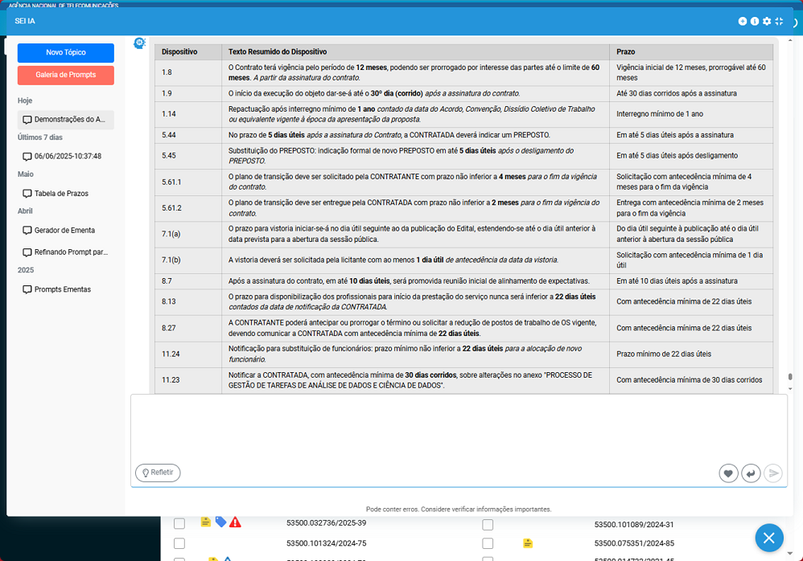

### Relatório sobre Impugnação em Processo Administrativo Fiscal (PAF)

Cria um relatório detalhado sobre impugnação apresentada em em Processo Administrativo Fiscal (PAF), com informações sobre os fatos da impugnação apresentada, número de notificação de lançamento, interessado, se teve sucessão empresarial, fiscalização, valores apurados, data do recebimento da notificação, tempestividade da apresentação da impugnação, se teve solicitação de vistas, as alegações apresentadas e os documentos citados.

[**Clique aqui para acessar a pasta com o prompt**](https://github.com/anatelgovbr/prompts/tree/main/Processo_Administrativo_Fiscal-PAF)

[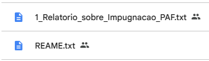](https://github.com/anatelgovbr/prompts/tree/main/Processo_Administrativo_Fiscal-PAF)

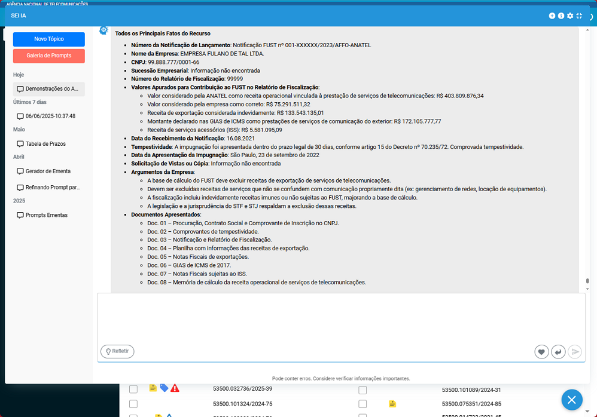

### Jornalismo

Acesse abaixo três prompts avançados relacionados com criação, revisão e divulgação de notícias. Existe prompt para criar notícia baseada em textos e destaques informados, outro para revisão final de uma notícia já minutada e um último prompt para criar divulgação para enviar por WhatsApp sobre uma notícia já publicada.

[**Clique aqui para acessar a pasta com os prompts**](https://github.com/anatelgovbr/prompts/tree/main/Jornalismo)

[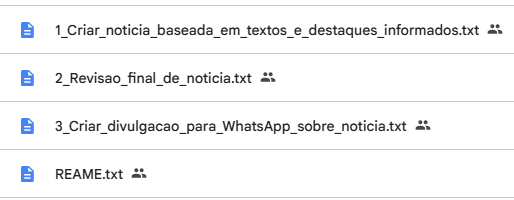](https://github.com/anatelgovbr/prompts/tree/main/Jornalismo)

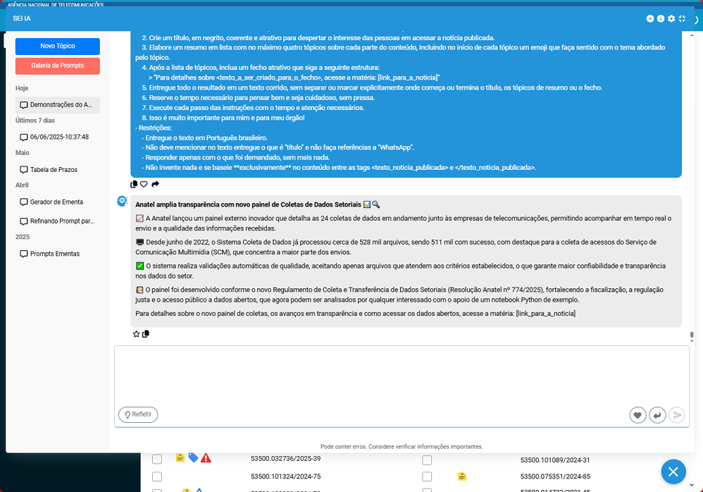

### Gerador de Ementa de decisão

Por meio da [Recomendação nº 154, de 13 de agosto de 2024](https://atos.cnj.jus.br/atos/detalhar/5693), o [CNJ lançou o modelo padrão para redação de ementas de decisões](https://www.cnj.jus.br/cnj-lanca-modelo-padrao-para-ementas-a-ser-usado-em-decisoes-judiciais/), definindo uma estrutura objetiva, que facilite a compreensão, de maneira rápida e clara, dos principais pontos e fundamentos do caso julgado às partes, aos interessados, à comunidade jurídica e a toda a sociedade.

“Não é incomum que as ementas sejam excessivamente longas e utilizem linguagem pouco acessível, o que dificulta a compreensão do que foi decidido e compromete a observância do Pacto do Judiciário pela Linguagem Simples”, descreveu o presidente do CNJ e do Supremo Tribunal Federal (STF), ministro Luís Roberto Barros.

Além do melhor entendimento das decisões tomadas, as diretrizes favorecem a aplicação de precedentes. Outro benefício dessa padronização é otimizar o processamento e a análise das informações dos acórdãos por soluções baseadas em Inteligência Artificial (IA), que contribuem para a recuperação rápida e precisa de informações relevantes, somado ao alinhamento com a política de uso de linguagem simples.

A ementa é o trecho do acórdão que contém um resumo de tudo o que foi decidido em relação ao conflito julgado. O modelo padronizado define cinco partes essenciais:

* um cabeçalho enxuto;  
* a descrição resumida do caso examinado;  
* a identificação concisa das questões em discussão;  
* a solução proposta; e  
* o dispositivo ou tese, contendo a conclusão do julgamento e o enunciado que sintetiza o decidido.

Ao final, a ementa deve relacionar a legislação e a jurisprudência relevantes para a conclusão da decisão tomada.

Baseado no [Manual de Padronização de Ementas](https://www.cnj.jus.br/wp-content/uploads/2024/08/manual-de-padronizacao-de-ementas-2024.pdf) do CNJ foi criado o prompt abaixo, para redação de ementas de decisão respeitando a divisão, diretrizes, formatação e estilo definidos.

[**Clique aqui para acessar a pasta com o prompt**](https://github.com/anatelgovbr/prompts/tree/main/Gerador_de_Ementas)

[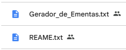](https://github.com/anatelgovbr/prompts/tree/main/Gerador_de_Ementas)

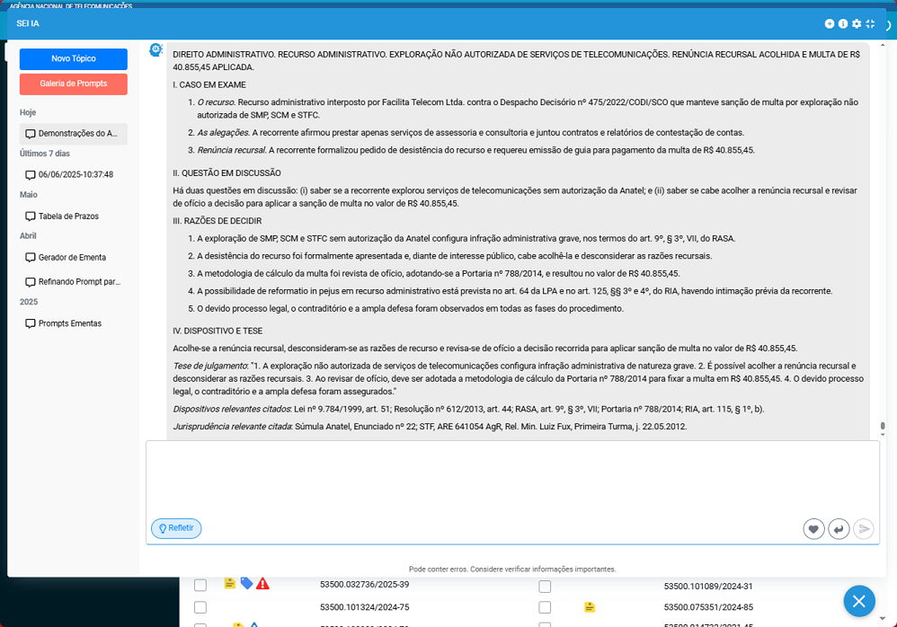

### Validar Planejamento de Contratações de TIC

[Disponibilizamos 25 prompts](https://github.com/anatelgovbr/prompts/tree/main/Contratacao_Validar_Planejamento_TIC) para validação de planejamento de contratações de soluções de Tecnologia da Informação e Comunicação (TIC), abrangendo variados quesitos normativos:

* **Documento de Formalização de Demanda (DFD)**: 1 prompt que valida a existência de informações mínimas exigidas.  
* **Estudo Técnico Preliminar (ETP)**: 9 prompts que validam diversos quesitos em múltiplos aspectos sobre o planejamento de contratações.  
* **Pesquisa de Preços (PP)**: 1 prompt que valida a instrução do relatório da pesquisa.  
* **Termo de Referência (TR)**: 14 prompts que validam sua regularidade, inclusive frente a outros documentos e formalidades pertinentes.

[**Clique aqui para acessar a pasta com os prompts**](https://github.com/anatelgovbr/prompts/tree/main/Contratacao_Validar_Planejamento_TIC)

**Atenção**: Na utilização desses prompts, cuidado para não se manter em um único tópico executando em sequência cada prompt, pois as respostas aos prompts anteriores podem influenciar o formato e até o mérito da resposta da execução do próximo prompt. É recomendado abrir um tópico para a execução de cada prompt sobre contratação em análise. Na versão mais recente do SEI IA desative a "Memória do Tópico" para evitar qualquer ruído das interações anteriores no tópico.

Esses prompts foram construídos tendo como base inicial sete prompts do Cenário 4 constantes no trabalho de conclusão do curso de pós-graduação lato sensu em Controle Governamental: Tecnologias para Inovação, realizado pelo Instituto Serzedello Corrêa (vinculado ao TCU), de autoria de servidor da CGU, senhor **Leonardo Alamy Martins**, publicado em janeiro de 2025:

* **Título**: Aplicação de LLM no controle de conformidade em licitações de tecnologia da informação.  
* **Resumo**: Trabalho de conclusão de pós-graduação em Controle Governamental: Tecnologias para a Inovação, no qual foi desenvolvida solução que utiliza Grandes Modelos de Linguagem (LLM) para a realização de auditorias de conformidade de licitações de Tecnologia da Informação.  
* **Acesso em 01/07/2025**: [https\://repositorio.cgu.gov.br/xmlui/handle/1/94769](https://repositorio.cgu.gov.br/xmlui/handle/1/94769)

Os sete prompts originais apresentados no TCC acima eram sobre ETP, sendo um na verdade sobre conteúdo de TR. Todos os sete prompts foram revisados e seguiram a formatação do Prompt Perfeito, apresentando melhor resultado e precisão.

Todos os demais prompts foram criados pela Anatel, ampliando a aplicação da técnica apresentada no TCC. Na revisão dos sete prompts originais e nos novos prompts foi utilizado o [**Instrumento de Padronização dos Procedimentos de Contratações de Soluções de Tecnologia da Informação e Comunicação**](https://www.gov.br/agu/pt-br/comunicacao/noticias/agu-lanca-guia-para-facilitar-contratacoes-na-area-de-tecnologia-da-informacao/Instrumento_de_Padronizao_AGU_TIC_Digital_reduzido.pdf), produzido em conjunto pelo MGI e AGU. Ainda, na melhoria da estrutura dos prompts, ao final, quando o resultado é “Não” ou “Parcialmente” sobre o atendimento ao quesito normativo, na seção “Transcrição dos Ajustes” são transcritos os trechos originais e ajustados para que passe a atender ao quesito de acordo com "Sim" na próxima análise.

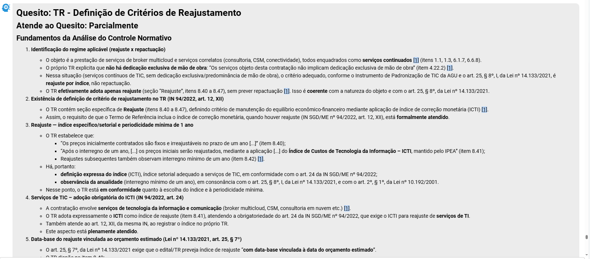

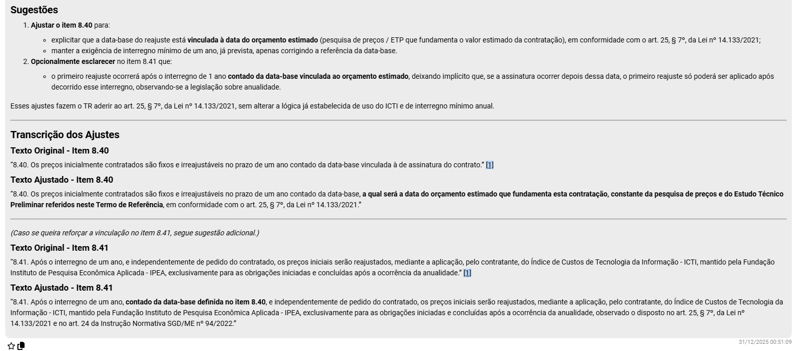

### Validar Planejamento de Contratações em Geral (não-TIC)

[Disponibilizamos prompts](https://github.com/anatelgovbr/prompts/tree/main/Contratacao_Validar_Planejamento_nao-TIC) para validação de planejamento de contratações em geral (não-TIC), abrangendo variados quesitos normativos:

* **Documento de Formalização de Demanda (DFD)**: 1 prompt que valida a existência de informações mínimas exigidas.  
* **Estudo Técnico Preliminar (ETP)**: 9 prompts que validam diversos quesitos em múltiplos aspectos sobre o planejamento de contratações.  
* **Pesquisa de Preços (PP)**: 1 prompt que valida a instrução do relatório da pesquisa.  
* **Termo de Referência (TR)**: construção pendente desses prompts.

[**Clique aqui para acessar a pasta com os prompts**](https://github.com/anatelgovbr/prompts/tree/main/Contratacao_Validar_Planejamento_nao-TIC)

**Atenção**: Na utilização desses prompts, cuidado para não se manter em um único tópico executando em sequência cada prompt, pois as respostas aos prompts anteriores podem influenciar o formato e até o mérito da resposta da execução do próximo prompt. É recomendado abrir um tópico para a execução de cada prompt sobre contratação em análise. Na versão mais recente do SEI IA desative a "Memória do Tópico" para evitar qualquer ruído das interações anteriores no tópico.

### Reescrita em Linguagem Simples

A [Lei nº 15.263, de 14 de novembro de 2025](https://www.planalto.gov.br/ccivil_03/_Ato2023-2026/2025/Lei/L15263.htm), sancionada recentemente pelo Presidente da República, cria a Política Nacional de Linguagem Simples para todo o país. Ela vale para órgãos e entidades da administração pública direta e indireta da União, dos Estados, do Distrito Federal e dos Municípios, que devem sempre observar a mencionada Política em suas comunicações com a população.

A Política Nacional de Linguagem Simples possui objetivos centrais:

* garantir o uso pela administração pública da linguagem simples, definida no art. 4º da mencionada Lei, em sua comunicação com o cidadão;

* possibilitar que os cidadãos consigam encontrar, entender e usar as informações publicadas pelos órgãos e entidades da administração pública;

* reduzir a necessidade de intermediários na comunicação entre o poder público e o cidadão;

* reduzir custos administrativos e tempo de atendimento ao cidadão;

* reduzir os custos administrativos e o tempo gasto com atividades de atendimento ao cidadão;

* promover a transparência ativa e o acesso à informação pública de forma clara;

* facilitar a participação popular e o controle social da gestão pública; e

* facilitar a compreensão da comunicação pública pelas pessoas com deficiência.

A Política estabelece os seguintes princípios:

* foco no cidadão;

* transparência;

* facilitação do acesso dos cidadãos aos serviços públicos;

* facilitação da participação popular e do controle social pelo cidadão;

* facilitação da comunicação entre o poder público e o cidadão; e

* facilitação do exercício do direito dos cidadãos.

O artigo 4º define Linguagem Simples como “*o conjunto de técnicas destinadas à transmissão clara e objetiva de informações, de modo que as palavras, a estrutura e o leiaute da mensagem permitam ao cidadão facilmente encontrar a informação, compreendê-la e usá-la*”.

Linguagem Simples é, portanto, um conjunto de técnicas de redação, arquitetura da informação e design voltado à clareza e à usabilidade da informação. O objetivo é que o público encontre, entenda e use o conteúdo sem esforço extra, inclusive em textos técnicos e jurídicos. Essa abordagem é coerente com normas recentes, como a NBR ISO 24495-1, e reforça transparência, inclusão e confiança institucional.

Ao escrever em Linguagem Simples, a nova lei exige que a administração pública aplique técnicas práticas, descritas em seu artigo 5º.

Construído inicialmente com base no [Manual de Linguagem Simples da Câmara dos Deputados](https://github.com/anatelgovbr/prompts/blob/main/Redacao_Linguagem_Simples/Materiais_Teoricos/ManualdeLinguagemSimples_Camara_dos_Depurados.pdf), o prompt “**Reescrita em Linguagem Simples**” está alinhado e reforça as técnicas previstas na nova [Lei nº 15.263/2025](https://www.planalto.gov.br/ccivil_03/_Ato2023-2026/2025/Lei/L15263.htm). Esse prompt avançado pode ajudar órgãos e entidades da administração pública a cumprir, de forma prática, os objetivos, princípios e técnicas previstos na nova lei.

[**Clique aqui para acessar a pasta com os prompts**](https://github.com/anatelgovbr/prompts/tree/main/Redacao_Linguagem_Simples)

[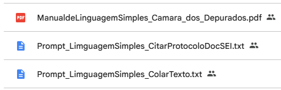](https://github.com/anatelgovbr/prompts/tree/main/Redacao_Linguagem_Simples)