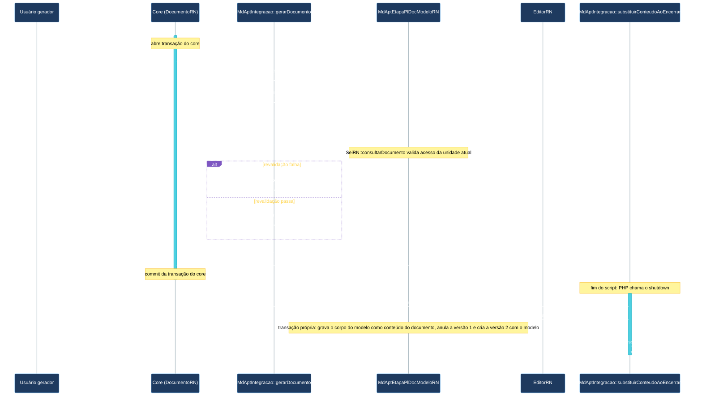

# Requisitos técnicos: Apoio a Plano de Trabalho (APT)

## RT-APT-001: Copiar o modelo depois da gravação do SEI

O módulo deve copiar o conteúdo do modelo depois que o SEI concluir a gravação do documento.

- Categoria: Integração.
- Critério de aceitação: o histórico do documento gerado mostra primeiro a versão inicial do SEI e depois a versão com o conteúdo do modelo (teste manual e leitura do código).

## RT-APT-002: Preservar a geração quando o módulo falhar

Se ocorrer erro no módulo durante a geração, então o módulo deve deixar o documento como o SEI o criou.

- Categoria: Confiabilidade.
- Critério de aceitação: o evento de geração e a rotina de encerramento que copia o modelo tratam qualquer erro do módulo sem repassá-lo ao SEI, e o documento fica com o conteúdo inicial do SEI (leitura do código).

## RT-APT-003: Registrar cada cópia do modelo no log

O módulo deve registrar no log do SEI cada cópia do modelo concluída ou recusada, com o resultado, os identificadores do modelo e do item de etapa e, na cópia concluída, o identificador do documento gerado.

- Categoria: Rastreabilidade.
- Critério de aceitação: depois dos cenários RF-APT-012.C1 e RF-APT-017.C1, o log do SEI tem um registro de cópia concluída com os identificadores do documento gerado, do modelo e do item de etapa e um registro de cópia recusada com os identificadores do modelo e do item de etapa e o motivo (teste manual).

## RT-APT-004: Proteger o conteúdo do documento modelo

O módulo deve omitir o texto do documento modelo das mensagens, das respostas da tela e dos registros de log.

- Categoria: Segurança.
- Critério de aceitação: depois de associar um modelo e gerar um documento com ele, a busca por um trecho do modelo nas mensagens da tela e no log do SEI não encontra resultado (teste manual e leitura do código).

## RT-APT-005: Copiar o modelo uma vez por documento

O módulo deve copiar o modelo no máximo uma vez para cada documento gerado.

- Categoria: Confiabilidade.
- Critério de aceitação: o histórico do documento gerado tem uma só versão com o conteúdo do modelo (teste manual e leitura do código).

## RT-APT-006: Garantir uma associação por item no banco de dados

O banco de dados deve garantir que cada item de etapa tenha no máximo uma associação.

- Categoria: Confiabilidade.
- Critério de aceitação: com dois cadastros simultâneos para o mesmo item, só um é gravado, e o outro recebe erro (teste manual).

## RT-APT-007: Manter os nomes instalados da tabela e da coluna

O módulo deve manter os nomes instalados da tabela `md_apt_etapa_pl_doc_modelo` e da coluna `id_md_apt_etapa_pl_doc_modelo`.

- Categoria: Manutenção.
- Critério de aceitação: a tabela e a coluna mantêm esses nomes nos scripts de instalação, e o auditor de banco aponta só o E003 já aceito (leitura dos scripts e auditor de banco).

## Visão de execução

Como os componentes do SEI e do módulo executam os cenários menos óbvios na leitura do código.

### Gerar documento com o conteúdo do modelo

#### Requisitos atendidos

O desenho atende a quatro requisitos técnicos do módulo: a cópia acontece depois da gravação do SEI (RT-APT-001), um erro do módulo deixa o documento como o SEI o criou (RT-APT-002), cada cópia fica no log (RT-APT-003) e cada documento recebe o modelo no máximo uma vez (RT-APT-005).

#### Sequência

Comportamentos do SEI e do PHP que o desenho usa:

1. O SEI chama o evento `gerarDocumento` dos módulos dentro de `DocumentoRN::gravarDocumentoInternoControlado`, na transação que grava o documento, e só depois chama `EditorRN::gerarVersaoInicial`, que cria as seções e a primeira versão. No momento do evento, o documento ainda não tem seção nem versão para substituir.
2. O padrão transacional do SEI não permite efeito colateral dentro da transação, e `DocumentoRN::atualizarConteudoRN1205`, usado na cópia, dispara indexação e feeds.
3. `register_shutdown_function` executa depois do fim do script, quando a transação do SEI já foi confirmada e a versão inicial existe. A sessão do usuário continua disponível, e a cópia roda em transação própria do módulo.
4. O PHP executa as funções de encerramento antes de descarregar a saída. Na geração pela tela, a resposta é um redirecionamento, então o navegador só abre o editor depois da cópia.

#### Limites conhecidos

- Se o servidor encerrar o processo PHP antes do encerramento da requisição, por exemplo por estouro do tempo máximo de execução do PHP, a cópia não acontece e o documento fica com o conteúdo inicial. O sinal é a ausência do registro de cópia concluída no log.
- A geração por serviço web passa pelo evento sem o plano de trabalho, porque o serviço informa só o item de etapa. O módulo não aplica o modelo, e o documento fica com o conteúdo inicial do SEI.
- A validação chama `DocumentoRN::bloquearConsultado`, que pode marcar o modelo como bloqueado quando a unidade que gera o documento é diferente da unidade geradora do modelo.
- Se o SEI desfizer a própria transação depois do evento, o documento gerado não existe quando a cópia começa. A atualização do conteúdo falha antes de qualquer gravação, nada é gravado nem indexado, e o erro vai para o log.
- Se a cópia falhar depois de atualizar o conteúdo do documento, por exemplo quando o documento não tem seção principal, o banco volta ao conteúdo inicial, mas a indexação e os feeds com o corpo do modelo já foram enviados.
- Depois da cópia, o conteúdo gravado do documento gerado fica só com o corpo do modelo, sem as demais seções.
- O log do SEI mostra os registros do módulo com o tipo Erro, inclusive o da cópia concluída.
